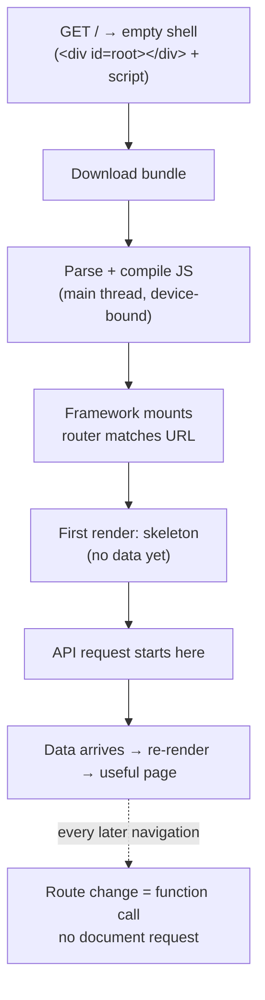

# The CSR Model

> Client-side rendering sends a nearly empty HTML document and a JavaScript bundle, then builds every pixel in the browser. Everything else about a CSR application — its speed, its SEO story, its failure modes — follows from that one decision.

**Part:** [02 · Rendering & Frameworks](../) · **Domain:** Rendering Architectures · **Priority:** Critical · **Difficulty:** Intermediate · **Reading time:** ~12 min

## TL;DR

In the CSR model the server returns a document whose body is one empty `<div>` plus a script tag. Nothing is visible until that script downloads, parses, executes, and produces DOM. In exchange, every navigation after the first is a function call rather than a request, the server becomes a static file host, and the whole UI runs in one long-lived process that can hold state across screens. The cost is concentrated entirely in the first load: a serial chain of HTML → JS → render → data → paint, executed on the main thread of whatever device the user happens to hold. CSR is the right default when the first load is amortized over a long session behind authentication, and the wrong default when the first load *is* the session.

> **Recommendation:** Use CSR for authenticated, session-heavy applications where users arrive once and stay. For anything a search engine or a first-time visitor lands on directly, render the first response on the server and keep CSR for what comes after.

## At a Glance

| | |
| --- | --- |
| **Use when** | Long sessions behind a login, highly interactive UI, no SEO requirement, a static host is desirable. |
| **Avoid when** | Content pages, SEO or social previews matter, first-visit-then-leave traffic, low-end devices on slow networks. |
| **Alternatives** | Server rendering, static generation, and islands — see [Alternative Approaches](#alternative-approaches). |
| **Primary risk** | Everything the user sees depends on one JavaScript bundle executing successfully on the main thread. |
| **Maturity** | Stable. |

## Prerequisites

- [Process & Thread Architecture](../../00-foundations/web-platform/process-and-thread-architecture.md) (`· The Web Platform`) — why the main thread is a single queue, and why blocking it stops rendering.
- [HTTP/1.1 Semantics](../../00-foundations/networking-protocols/http-1-1-semantics.md) (`· Networking & Protocols`) — the request/response cycle that CSR reduces to one document fetch plus API calls.

## Overview

*Client-side rendering* (CSR) is the architecture in which the server's HTML response contains no application content, and the DOM is constructed entirely by JavaScript running in the browser. The canonical CSR document is four lines long: a `<head>` with a stylesheet and a script, and a `<body>` with an empty mount node. Everything the user eventually sees — layout, text, images, interactive controls — is produced by executing that script.

The defining property is *where the first paint's data comes from*. In server rendering, markup arrives already populated and the browser paints it during the initial parse. In CSR, markup arrives empty and the browser cannot paint anything meaningful until the bundle has run. The visible page is a computed artifact of the client, not a transferred one.

This is often conflated with two adjacent ideas. A *single-page application* describes the navigation model — routes handled in the client without full page loads — and it is possible to have a server-rendered SPA. A *static site* describes where the HTML comes from, and a static host can serve either a CSR shell or fully rendered pages. CSR is specifically a statement about the content of the first response.

## The Problem

An engineer opens the network panel on a CSR dashboard and sees a fast site: the document returns in 40 ms and every asset is on a CDN. The user reports the same page takes six seconds to show anything.

Both observations are correct, because they measure different things. The 40 ms is the document. What the user waits for is the chain that starts after it, and the chain is serial by construction:

1. The document arrives and the parser finds a script tag.
2. The bundle downloads — 400 KB compressed on a connection that is not the office Wi-Fi.
3. The JavaScript is parsed and compiled, which on a mid-range phone runs several times slower than on a laptop.
4. The framework mounts, the router matches the URL, and the route component renders — showing a spinner, because it has no data.
5. Only now does the first API request leave the browser. The server, the database, and the network round trip all begin *after* everything above.
6. The response arrives, the component re-renders, and the page is finally useful.

Nothing in that list is wasteful on its own. The problem is that each step must finish before the next can start, and none of them began until the previous request completed. This is the CSR request waterfall, and it is not a bug in anyone's code — it is the direct consequence of shipping a document that says nothing about what the page needs.

## Why It Matters

The first-load cost lands unevenly. On a fast device with a warm cache, the chain collapses to a few hundred milliseconds and CSR feels excellent. On a three-year-old Android phone on a congested mobile network, the same chain takes seconds, and the parse-and-compile step — which no CDN can help with — grows in proportion to bundle size. The architecture concentrates its cost precisely on the users least equipped to absorb it.

It also concentrates *risk*. In a server-rendered page, a failed script leaves a readable document behind. In CSR, the script is the page: a chunk that 404s after a deploy, a third-party tag that throws during initialization, or a browser extension that breaks a global leaves the user with a blank white screen and no recovery path. The blast radius of any JavaScript error is the entire application.

Finally, it changes what other systems can see. Crawlers, link unfurlers, and previews that do not execute JavaScript see the empty shell. Search engines that do execute it defer that work to a second pass, so indexing becomes slower and less reliable. If discovery matters for a page, CSR is a decision about discoverability whether or not it was framed that way.

None of this makes CSR wrong. It makes CSR a trade that must be *chosen*, with the beneficiary named: the user who loads the shell once at 9 a.m. and navigates within it for the rest of the day.

## Mental Model

Think of CSR as *shipping the program instead of the output*. The server sends the instructions for building a page; the browser is the machine that runs them. Every property of the model follows from that.



Two consequences are worth naming. First, **the first load pays for the whole session, and every later navigation is nearly free** — which is exactly why the model rewards long sessions and punishes single-page visits. Second, **the data request cannot start until the JavaScript has decided it is needed**, so the network is idle during the very phase where it is most useful. Both of the standard CSR optimizations attack that second point: `<link rel="preload">` starts the bundle earlier, and route-level prefetching starts the *data* before the route renders.

The corollary is that the empty shell is not a fixed cost. A CSR app can send meaningful HTML for the chrome — navigation, header, layout skeleton — and still be CSR for its content. That is the app shell pattern, and it moves the perceived first paint far earlier without changing the architecture.

## Best Practices

Split the bundle by route and load the rest on demand. A single bundle means every user compiles code for screens they will never open; route-level splitting makes the parse cost proportional to the page. See [Code Splitting](../../05-reliability-quality/performance/code-splitting.md) (`· Performance Engineering`).

Start data requests outside the component tree. If the fetch lives in an effect, it cannot begin until render finishes, which serializes two things that could overlap. Route loaders and the render-as-you-fetch pattern move the request to route-match time — see [Fetch-on-Render vs Render-as-You-Fetch](../../03-application-architecture/data-server-state/fetch-on-render-vs-render-as-you-fetch.md) (`· Data & Server State`).

Preload the critical chain from the HTML. The document is the only thing the browser has early; use it. A `modulepreload` for the entry chunk and a `preconnect` to the API origin remove two serial round trips. See [Resource Prefetch & Preload](../../05-reliability-quality/performance/resource-prefetch-and-preload.md) (`· Performance Engineering`).

Render layout-stable skeletons, not spinners. A skeleton that occupies the final dimensions avoids the layout shift that a spinner-then-content swap produces, which is directly measured by CLS in [Core Web Vitals](../../05-reliability-quality/performance/core-web-vitals-lcp-inp-cls.md) (`· Performance Engineering`).

Give the shell a static fallback for total failure. An inline `<noscript>` message and a top-level error boundary turn a blank screen into an explicable one. This costs a few lines and is the only defense against the model's worst failure.

Prefetch the next route on intent. Hovering a link, focusing it, or bringing it into the viewport are all signals that the chunk and its data will be needed shortly, and all of them arrive with hundreds of milliseconds to spare.

Measure on a throttled mid-range device, not on the development machine. Parse and compile time scales with CPU, and the development machine is the least representative device in the fleet.

Budget the entry bundle explicitly. "Keep it small" is not a check anyone can fail; a CI assertion on the entry chunk's transferred size is.

## Trade-offs

CSR trades a slow, fragile first load for fast, resilient subsequent interaction and a simple deployment. The balance flips on session length: the more screens a user visits per load, the better the trade looks.

**Advantages**

- Navigations after the first need no document request — state, caches, and connections survive across screens.
- The server can be a static file host and a JSON API; no rendering infrastructure to run or scale.
- One process owns the UI, so cross-screen state (a cache, a websocket, an editor's undo stack) is straightforward.
- Deploys are file uploads; a CDN handles the rest with no cold starts or per-request compute.

**Disadvantages**

- First paint depends on downloading, compiling, and executing JavaScript, which is device-bound and cannot be cached away for new visitors.
- No meaningful HTML for crawlers, unfurlers, or JavaScript-disabled clients.
- Any error in the critical script path produces a blank page rather than degraded content.
- The first data request cannot start until the bundle has run, adding a serial round trip.

| Dimension | CSR | Cost / caveat |
| --- | --- | --- |
| First contentful paint | After bundle execution | Scales with bundle size and device CPU |
| Subsequent navigation | In-memory, no document fetch | Requires client routing and cache discipline |
| Server cost | Static hosting only | All rendering cost moves to the user's device |
| SEO / previews | Empty initial HTML | Needs prerendering or SSR for discoverable pages |
| Failure behavior | Blank screen | Only an error boundary or `<noscript>` degrades gracefully |

## Alternative Approaches

The choice is not CSR versus one alternative but *where the first response's HTML is produced*. Each option moves that work to a different place.

| Approach | Best when | Weakness | See |
| --- | --- | --- | --- |
| CSR (this article) | Authenticated apps, long sessions, no SEO need | Slow, failure-prone first load | (this article) |
| Server rendering | Content must be visible and indexable immediately | Server compute per request; hydration cost | `The SSR Model · Rendering Architectures` |
| Static generation | Content changes rarely and is the same for everyone | Rebuild or revalidation needed on change | `Static Site Generation · Rendering Architectures` |
| Islands architecture | Mostly static pages with a few interactive regions | Less suited to app-like, stateful UIs | `Islands Architecture · Rendering Architectures` |
| App shell over CSR | CSR is right, but the blank phase is too long | Chrome paints early; content still waits on JS | `The App Shell Pattern · Rendering Architectures` |

## Bad Example

A CSR entry point that produces the full serial waterfall, written the way it usually appears.

```tsx
// index.html
// <body><div id="root"></div><script type="module" src="/src/main.tsx"></script></body>
// ❌ No preload hints, no noscript fallback, no error boundary.

import { createRoot } from 'react-dom/client';
import { BrowserRouter, Route, Routes } from 'react-router-dom';
import Dashboard from './routes/Dashboard';
import Reports from './routes/Reports';
import Settings from './routes/Settings';
import Admin from './routes/Admin';

// ❌ (1) Every route is a static import, so one bundle contains every screen.
//        A user who only opens /dashboard still compiles the admin panel.
createRoot(document.getElementById('root')!).render(
  <BrowserRouter>
    <Routes>
      <Route path="/" element={<Dashboard />} />
      <Route path="/reports" element={<Reports />} />
      <Route path="/settings" element={<Settings />} />
      <Route path="/admin" element={<Admin />} />
    </Routes>
  </BrowserRouter>,
);

// routes/Dashboard.tsx
function Dashboard() {
  const [invoices, setInvoices] = useState<Invoice[] | null>(null);

  // ❌ (2) The request starts after the component renders, which is after the
  //        bundle has downloaded and compiled. Three serial phases, minimum.
  useEffect(() => {
    fetch('/api/invoices')
      .then((r) => r.json())
      .then(setInvoices);
    // ❌ (3) No error branch: a 500 leaves the spinner up forever.
  }, []);

  // ❌ (4) A centered spinner of unknown size; when data lands, everything
  //        below it jumps down. That shift is measured and charged as CLS.
  if (!invoices) return <Spinner />;

  return <InvoiceTable invoices={invoices} />;
}
```

**What goes wrong:** The user waits through four serial phases — download, compile, render, fetch — before seeing anything but a spinner, and the bundle they compile contains three screens they did not ask for. If the fetch fails, the spinner is permanent, because there is no error branch. If the bundle 404s after a deploy, the page is blank, because there is no fallback in the document. None of these are exotic failures; all three appear in the first month of production.

## Good Example

The same application with the chain shortened at every link: split routes, requests started at route-match time, and a document that fails visibly rather than silently.

```html
<!-- index.html — the only thing the browser has early, so it does real work. -->
<!doctype html>
<html lang="en">
  <head>
    <meta charset="utf-8" />
    <meta name="viewport" content="width=device-width, initial-scale=1" />
    <!-- ✅ Start the entry chunk and the API connection before the parser reaches them. -->
    <link rel="modulepreload" href="/assets/main.js" />
    <link rel="preconnect" href="https://api.example.com" crossorigin />
    <link rel="stylesheet" href="/assets/shell.css" />
  </head>
  <body>
    <!-- ✅ Static chrome paints during the initial parse, before any JS runs. -->
    <div id="root">
      <header class="app-header" aria-hidden="true"></header>
      <main class="app-skeleton"></main>
    </div>
    <noscript>
      <!-- ✅ The only defense against a JS-less client seeing nothing at all. -->
      <p>This application needs JavaScript. If it is blocked, enable it and reload.</p>
    </noscript>
    <script type="module" src="/assets/main.js"></script>
  </body>
</html>
```

```tsx
// main.tsx
import { lazy, Suspense } from 'react';
import { createRoot } from 'react-dom/client';
import { createBrowserRouter, RouterProvider } from 'react-router-dom';
import { QueryClient, QueryClientProvider } from '@tanstack/react-query';
import { RootErrorBoundary } from './RootErrorBoundary';

const queryClient = new QueryClient({
  defaultOptions: { queries: { staleTime: 30_000, retry: 2 } },
});

// ✅ One place describes how a route's data is fetched, so both the loader
//    and the component can reference it without duplicating the request.
export const invoicesQuery = {
  queryKey: ['invoices', 'list'] as const,
  queryFn: async ({ signal }: { signal: AbortSignal }): Promise<Invoice[]> => {
    const response = await fetch('https://api.example.com/invoices', { signal });
    if (!response.ok) throw new Error(`Failed to load invoices (${response.status})`);
    return (await response.json()) as Invoice[];
  },
};

const router = createBrowserRouter([
  {
    path: '/',
    // ✅ Each route is its own chunk: the parse cost matches the screen.
    lazy: async () => {
      const { Dashboard } = await import('./routes/Dashboard');
      return { Component: Dashboard };
    },
    // ✅ The request starts when the route matches — in parallel with the
    //    chunk download above, not after the component has rendered.
    loader: () => queryClient.ensureQueryData(invoicesQuery),
    errorElement: <RouteError />,
  },
  {
    path: '/reports',
    lazy: async () => ({ Component: (await import('./routes/Reports')).Reports }),
  },
]);

createRoot(document.getElementById('root')!).render(
  // ✅ A thrown error in any route renders a message, not a blank document.
  <RootErrorBoundary>
    <QueryClientProvider client={queryClient}>
      <Suspense fallback={<AppSkeleton />}>
        <RouterProvider router={router} />
      </Suspense>
    </QueryClientProvider>
  </RootErrorBoundary>,
);
```

```tsx
// routes/Dashboard.tsx
import { useQuery } from '@tanstack/react-query';
import { invoicesQuery } from '../main';

export function Dashboard() {
  // ✅ By the time this runs the loader has already started (often finished)
  //    the request; this reads the cache rather than initiating a fetch.
  const { data, error, isPending } = useQuery(invoicesQuery);

  // ✅ A skeleton with the table's real dimensions: no layout shift on swap.
  if (isPending) return <InvoiceTableSkeleton rows={10} />;
  if (error) return <InvoiceLoadError error={error} />;

  return <InvoiceTable invoices={data} />;
}
```

**Why it's better:** The chunk download and the data request now overlap instead of queueing, which removes a full round trip from the critical path. The parse cost is proportional to the route the user actually opened. A failed request renders an error with a retry rather than a permanent spinner, and a failure anywhere above renders a message rather than a blank document. The static chrome in the HTML paints during the initial parse, so the user sees structure before any JavaScript has run.

## Production Example

The failure the model is most exposed to is not slowness — it is a chunk that no longer exists. CSR applications load code lazily over the lifetime of a session, so a deploy that removes yesterday's chunks turns every open tab into a broken application at the moment the user navigates.

```tsx
import { Component, type ReactNode } from 'react';

interface State {
  error: Error | null;
  /** True when the failure is a chunk that no longer exists on the origin. */
  isStaleDeploy: boolean;
}

/**
 * A chunk load failure has a distinct signature across bundlers and browsers,
 * and a distinct remedy: the code is gone because the origin moved on, so a
 * reload fetches the new manifest. Treating it as a generic error and showing
 * "something went wrong" leaves the user stuck on a version that no longer exists.
 */
function isChunkLoadError(error: Error): boolean {
  return (
    error.name === 'ChunkLoadError' ||
    /Loading( CSS)? chunk \d+ failed/i.test(error.message) ||
    /Failed to fetch dynamically imported module/i.test(error.message) ||
    /error loading dynamically imported module/i.test(error.message)
  );
}

const RELOAD_MARKER = 'csr:reloaded-for-stale-deploy';

export class RootErrorBoundary extends Component<{ children: ReactNode }, State> {
  state: State = { error: null, isStaleDeploy: false };

  static getDerivedStateFromError(error: Error): State {
    return { error, isStaleDeploy: isChunkLoadError(error) };
  }

  componentDidUpdate() {
    if (!this.state.isStaleDeploy) return;

    // Reload once, and only once. A reload loop is worse than an error screen:
    // if the new manifest is also broken, the user can never read the message.
    if (sessionStorage.getItem(RELOAD_MARKER)) return;
    sessionStorage.setItem(RELOAD_MARKER, '1');
    window.location.reload();
  }

  componentDidCatch(error: Error, info: { componentStack?: string | null }) {
    // Report before any reload, or the signal disappears with the page.
    reportError({
      message: error.message,
      stack: error.stack,
      componentStack: info.componentStack ?? undefined,
      release: __BUILD_ID__,
      kind: isChunkLoadError(error) ? 'stale-deploy' : 'runtime',
    });
  }

  render() {
    const { error, isStaleDeploy } = this.state;
    if (!error) return this.props.children;

    if (isStaleDeploy) {
      return (
        <p role="status">A new version is available. Reloading…</p>
      );
    }

    // The whole point of the boundary: the document is never blank.
    return (
      <div role="alert">
        <h1>This page didn’t load</h1>
        <p>Something failed while starting the application.</p>
        <button type="button" onClick={() => window.location.reload()}>
          Reload
        </button>
      </div>
    );
  }
}
```

Two details carry the weight. The reload is guarded by a marker, because an unguarded reload on a genuinely broken deploy produces an infinite loop that no user can escape. And the report is sent from `componentDidCatch` rather than after the reload, because the reload destroys the context that explains the failure. The complementary half of this — keeping old chunks on the CDN for a grace period after each deploy so open tabs keep working — belongs to `Immutable Asset URLs · Delivery & Infrastructure`.

## Common Mistakes

See the [Rendering Architectures anti-patterns](../../../anti-patterns/#rendering-architectures) for the domain catalog. Concept-specific:

### Mistake: Fetching in an effect on the first route

- **Symptom:** The network panel shows the first API request starting a second or more after the document.
- **Why it fails:** The effect cannot run until the bundle has downloaded, compiled, and rendered, so the request is serialized behind three phases that could have overlapped it.
- **Fix:** Start the request at route-match time with a loader, or prefetch it from the document. See [Fetch-on-Render vs Render-as-You-Fetch](../../03-application-architecture/data-server-state/fetch-on-render-vs-render-as-you-fetch.md).

### Mistake: One bundle for every route

- **Symptom:** The entry chunk grows with every feature, and time to interactive rises for users who never open those features.
- **Why it fails:** Parse and compile time is proportional to bytes of JavaScript, and it is paid on the main thread before anything renders.
- **Fix:** Split at route boundaries and load on demand. See [Code Splitting](../../05-reliability-quality/performance/code-splitting.md).

### Mistake: Treating the empty shell as acceptable output

- **Symptom:** Shared links show no preview, and search results list the page with the fallback title from `index.html`.
- **Why it fails:** Crawlers and unfurlers read the transferred HTML; JavaScript-generated content is invisible to those that do not execute scripts, and deferred for those that do.
- **Fix:** Prerender or server-render any route that is a landing target; keep CSR for post-login screens.

### Mistake: A spinner where a skeleton belongs

- **Symptom:** Content jumps down the page when data arrives, and CLS regresses without any CSS change.
- **Why it fails:** The spinner's box has different dimensions from the content that replaces it, so the swap relayouts everything below.
- **Fix:** Render a skeleton with the content's final dimensions. See [Core Web Vitals](../../05-reliability-quality/performance/core-web-vitals-lcp-inp-cls.md).

### Mistake: No boundary above the router

- **Symptom:** A single throwing component produces a blank white page with a console error.
- **Why it fails:** In CSR the script is the page; an unhandled error unmounts the tree and there is no server-rendered markup underneath.
- **Fix:** Wrap the root in an error boundary and keep a `<noscript>` fallback in the document.

## Checklist

- [ ] The entry chunk has a size budget enforced in CI.
- [ ] Routes are split, and non-critical features load on demand.
- [ ] The first route's data request starts at route match, not in an effect.
- [ ] The document contains `modulepreload` for the entry chunk and `preconnect` for the API origin.
- [ ] Loading states are dimension-matched skeletons, not spinners.
- [ ] A root error boundary and a `<noscript>` fallback exist.
- [ ] Chunk load failures are detected and recovered from, with a reload guard.
- [ ] Performance is measured on a throttled mid-range device, not the development machine.
- [ ] Any route reachable from search or a shared link is prerendered or server-rendered.

## Related Articles

- [Client-Side Routing](../routing/client-side-routing.md) — the navigation model CSR enables, and where the URL fits (`· Routing`).
- [Code Splitting](../../05-reliability-quality/performance/code-splitting.md) — the primary lever on CSR's first-load cost (`· Performance Engineering`).
- [The Critical Rendering Path](../../05-reliability-quality/performance/the-critical-rendering-path.md) — what the browser does between document and paint (`· Performance Engineering`).
- [Fetch-on-Render vs Render-as-You-Fetch](../../03-application-architecture/data-server-state/fetch-on-render-vs-render-as-you-fetch.md) — removing the serial data round trip (`· Data & Server State`).
- [Resource Prefetch & Preload](../../05-reliability-quality/performance/resource-prefetch-and-preload.md) — starting the chain earlier from the document (`· Performance Engineering`).

## References

- [MDN — Critical rendering path](https://developer.mozilla.org/en-US/docs/Web/Performance/Guides/Critical_rendering_path) — the browser-side sequence CSR extends with a script execution phase.
- [web.dev — Rendering on the Web](https://web.dev/articles/rendering-on-the-web) — the taxonomy that places CSR against server rendering and static generation.
