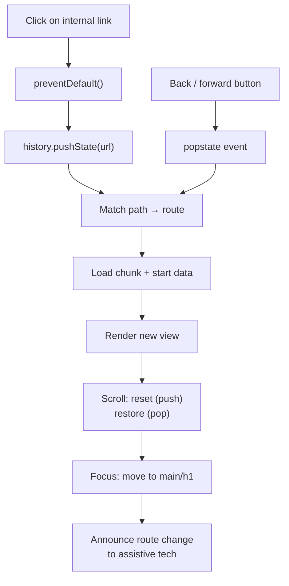

# Client-Side Routing

> Client-side routing intercepts navigation, rewrites the URL with the History API, and swaps the view in place. The browser stops doing the work — which means everything the browser did for free is now yours to reimplement.

**Part:** [02 · Rendering & Frameworks](../) · **Domain:** Routing · **Priority:** Critical · **Difficulty:** Intermediate · **Reading time:** ~12 min

## TL;DR

A client-side router does three things: it prevents the browser's default navigation, it calls `history.pushState` to change the URL, and it renders whichever component matches the new path. In return, a navigation costs a render instead of a full document load, and everything in memory — caches, websockets, scroll containers, an editor's undo stack — survives it. What it does not do is any of the work the browser used to handle silently: resetting scroll position, moving keyboard focus, announcing the change to a screen reader, cancelling in-flight requests from the previous view, and treating the back button as a real navigation. Each of those is now application code, and each of them is a bug when it is missing.

> **Recommendation:** Use a routing library rather than the History API directly, and treat scroll restoration, focus management, and announcement as part of "the router works" — not as accessibility polish added later.

## At a Glance

| | |
| --- | --- |
| **Use when** | The application is already client-rendered and users navigate between many screens per session. |
| **Avoid when** | Pages are independent documents, or a full reload per navigation costs nothing users notice. |
| **Alternatives** | Server routing and hybrid routing — see [Alternative Approaches](#alternative-approaches). |
| **Primary risk** | Silently dropping the browser behaviors — focus, scroll, announcement — that navigation used to provide. |
| **Maturity** | Stable. |

## Prerequisites

- [The CSR Model](../rendering-architectures/the-csr-model.md) (`· Rendering Architectures`) — the architecture that makes in-place view swapping possible.
- [Web Storage](../../00-foundations/browser-apis/web-storage.md) (`· Browser APIs`) — where scroll positions and session-scoped route state are persisted across reloads.

## Overview

*Client-side routing* is the pattern in which the application, not the browser, decides what a URL displays. A click on an internal link is intercepted, `history.pushState` updates the address bar without issuing a request, and a matcher turns the new path into a component to render. The document never reloads.

The URL remains the interface. That is the part most easily lost: a client-side router is not a mechanism for hiding and showing views, it is a mechanism for keeping the URL an accurate, shareable, restorable description of what the user is looking at. A view the user can reach but not link to has failed at routing regardless of how smoothly it animates in.

Two things are frequently confused with it. *Client-side rendering* is about where the first HTML comes from; a server-rendered application can still route on the client after hydration. *Hash routing* (`#/reports`) is a client-side routing technique that predates the History API and is now only appropriate when the host cannot be configured to serve the shell for arbitrary paths.

## The Problem

A team replaces `<a href>` with a router and the application gets noticeably faster. Then the reports arrive, one per quarter, and none of them look like routing bugs.

A user navigates from a long list to a detail page and lands halfway down, because the scroll position carried over from the previous screen. Another presses the back button and the list reappears at the top rather than where they left off. A keyboard user tabs after navigating and focus is still in the old page's header — or worse, on `<body>`, so the next Tab starts from the beginning of the document. A screen reader user hears nothing at all: the page changed, the announcement did not.

Meanwhile a slow request from the abandoned screen resolves and writes into a component that no longer exists. A modal opens, the user presses back expecting it to close, and instead they leave the page entirely. A form is half-filled when the user clicks a link, and the draft disappears without a prompt.

None of these are failures of the router's matching logic, which works perfectly in all of them. They are the browser behaviors that stopped happening the moment the default navigation was prevented, and each one has to be reimplemented explicitly.

## Why It Matters

The browser's navigation is not just a page load. It is a bundle of behaviors accumulated over three decades: scroll reset on forward navigation and restoration on back, focus reset to the top of the document, an announcement to assistive technology that a new page has loaded, cancellation of pending requests, and a clean slate for memory. Preventing the default discards the whole bundle at once, and gets back only the part the router explicitly reimplements.

The accessibility half of that bundle is where the cost is highest and the detection is worst. A sighted mouse user never notices that focus did not move; a screen reader user experiences an application where navigation appears to do nothing, because nothing is announced and the reading cursor stays where it was. This is a WCAG failure that no visual review will catch, and it is present by default in every router until the application adds the announcement.

The memory half compounds over a session. A full page load frees everything; a client-side navigation frees only what the application releases. Listeners attached to `window`, timers, observers, and subscriptions that are not cleaned up survive every navigation, so a long session accumulates them — and the leak shows up as a gradually degrading application that nobody can reproduce in a five-minute test.

## Mental Model

A client-side navigation is a state transition that *must* end in the same state the browser would have produced: the URL matches the view, the scroll position is correct for the direction of travel, focus is somewhere sensible, and the change has been announced.



Two rules fall out. First, **push and pop are different navigations**: a forward navigation should start at the top of the page, a back navigation should return to where the user was. Routers that treat both identically produce one of the two common complaints. Second, **the transition is not finished when the component renders** — it is finished when scroll, focus, and announcement have all been handled. Treating render as the end of the transition is the single most common source of the bugs above.

The back button deserves its own note. `popstate` is the browser telling the application that the URL already changed; the application's job is to catch up, not to decide. Any state the user perceives as navigable — an open modal, a filter selection, a wizard step — should therefore live in the URL, or the back button will do something the user did not expect.

## Best Practices

Render real anchors with real `href` values. A router link must be an `<a>` with the destination in `href`, so that middle-click, ⌘-click, "open in new tab," and "copy link address" all work, and so that assistive technology reports a link. A `<div onClick={navigate}>` is not a link, and no amount of ARIA makes it one.

Only intercept clicks you should. Prevent the default for plain left clicks on same-origin links, and let everything else through: modifier keys, non-left buttons, `target="_blank"`, `download`, and external origins.

Reset scroll on push, restore on pop. Store the scroll position keyed by history entry before leaving, and apply it when a `popstate` navigation returns to that entry. Set `history.scrollRestoration = 'manual'` so the browser's own attempt does not fight yours.

Move focus on every navigation. After the new view renders, focus a container at the top of the main content — a `<div tabIndex={-1}>` wrapping `<main>`, or the route's `<h1>`. This restores keyboard position and makes the change audible to screen readers.

Announce the new page. A visually hidden live region containing the new document title, updated after render, is what turns a silent view swap into a perceptible navigation.

Put user-navigable state in the URL. Filters, tabs, pagination, and open dialogs that users expect the back button to reverse belong in the path or the query string, not in component state.

Cancel work that belongs to the previous route. Pass an `AbortSignal` to fetches and abort on unmount, so an abandoned screen's response cannot land on the new one.

Guard destructive navigations, not all of them. A confirmation prompt on leaving a dirty form is worth it; one on every navigation trains users to dismiss it.

Configure the server to serve the shell for unknown paths. A deep link that returns 404 on refresh is a hosting misconfiguration, not a routing decision — see `Static Hosting · Delivery & Infrastructure`.

## Trade-offs

Client-side routing trades browser-provided correctness for speed and continuity. The trade is good when navigations are frequent and state is worth preserving; it is a pure loss when neither is true.

**Advantages**

- A navigation costs a render, not a document request — typically tens of milliseconds instead of hundreds.
- In-memory state survives: caches, websockets, scroll containers, and unsaved work persist across screens.
- Transitions, shared layouts, and pending UI are possible because both views exist in one document.
- Data for the next route can start loading on hover, before the user commits.

**Disadvantages**

- Scroll, focus, announcement, and request cancellation must all be reimplemented, and their absence is invisible in normal testing.
- Leaks accumulate across a session because nothing is freed by a page load.
- The router and its matching rules are application code that can disagree with the server's.
- Every route must be served by the host as the same shell, or refreshing a deep link 404s.

| Dimension | Client-side routing | Cost / caveat |
| --- | --- | --- |
| Navigation latency | No document request | First load must ship the router and matcher |
| State continuity | Preserved across screens | Nothing is freed automatically; leaks accumulate |
| Accessibility | Must be built | Silent by default; failures are invisible to sighted review |
| History semantics | Full control via History API | Push vs pop must be distinguished by hand |
| Hosting | Requires shell fallback | Deep links 404 without a rewrite rule |

## Alternative Approaches

The question is where route matching happens, and each answer moves a different cost.

| Approach | Best when | Weakness | See |
| --- | --- | --- | --- |
| Client-side routing (this article) | Frequent in-session navigation, state worth preserving | Browser behaviors must be reimplemented | (this article) |
| Server routing | Independent documents; navigation is rare | Full reload discards all client state | `File-Based & Server Routing · Routing` |
| Hybrid routing | First navigation server-rendered, later ones client-side | Two matching implementations to keep in agreement | `Hybrid Routing · Routing` |
| Hash routing | The host cannot serve arbitrary paths | The fragment is not sent to the server; poor for SEO | `Client-Side Routing · Routing` (this article) |

## Bad Example

A hand-rolled router that matches correctly and gets everything around the match wrong.

```tsx
import { useEffect, useState } from 'react';

// ❌ A router that handles the URL and nothing else.
function useRoute() {
  const [path, setPath] = useState(window.location.pathname);

  useEffect(() => {
    // ❌ (1) popstate is handled, but push and pop are indistinguishable,
    //        so scroll behavior cannot differ between them.
    const onPop = () => setPath(window.location.pathname);
    window.addEventListener('popstate', onPop);
    return () => window.removeEventListener('popstate', onPop);
  }, []);

  return {
    path,
    navigate: (to: string) => {
      history.pushState(null, '', to);
      setPath(to);
      // ❌ (2) No scroll reset: arriving at a detail page mid-scroll.
      // ❌ (3) No focus move: keyboard position stays in the old view.
      // ❌ (4) No announcement: screen readers report nothing happened.
    },
  };
}

function Link({ to, children }: { to: string; children: React.ReactNode }) {
  const { navigate } = useRoute();
  // ❌ (5) Not an anchor: no middle-click, no ⌘-click, no "copy link",
  //        and assistive technology does not report a link at all.
  return <span onClick={() => navigate(to)}>{children}</span>;
}

function InvoiceDetail({ id }: { id: string }) {
  const [invoice, setInvoice] = useState<Invoice | null>(null);

  useEffect(() => {
    // ❌ (6) No AbortSignal: navigating away leaves this request running,
    //        and a slow response resolves against an unmounted component.
    fetch(`/api/invoices/${id}`)
      .then((r) => r.json())
      .then(setInvoice);
  }, [id]);

  return invoice ? <Detail invoice={invoice} /> : <Spinner />;
}
```

**What goes wrong:** Matching works, so the bug reports never mention routing. A keyboard user finds focus stranded in the previous view. A screen reader user perceives the click as having done nothing. Mouse users land partway down detail pages and cannot open links in a new tab. And each abandoned navigation leaves a request running, so a user clicking quickly through a list accumulates responses that arrive out of order.

## Good Example

A router that finishes the transition: real anchors, direction-aware scroll, focus, announcement, and cancellation.

```tsx
import { useCallback, useEffect, useRef, useState } from 'react';

type NavigationType = 'push' | 'pop';

interface RouteState {
  path: string;
  type: NavigationType;
  /** Monotonic key identifying this history entry, used for scroll storage. */
  key: string;
}

const scrollPositions = new Map<string, number>();

export function useRouter() {
  const [route, setRoute] = useState<RouteState>(() => ({
    path: window.location.pathname,
    type: 'pop',
    key: 'initial',
  }));

  useEffect(() => {
    // ✅ Take scroll restoration away from the browser so it cannot fight us.
    history.scrollRestoration = 'manual';
  }, []);

  useEffect(() => {
    const onPopState = (event: PopStateEvent) => {
      const key = (event.state as { key?: string } | null)?.key ?? 'initial';
      // ✅ Back/forward is a distinct navigation type; scroll must be restored.
      setRoute({ path: window.location.pathname, type: 'pop', key });
    };
    window.addEventListener('popstate', onPopState);
    return () => window.removeEventListener('popstate', onPopState);
  }, []);

  const navigate = useCallback((to: string, options?: { replace?: boolean }) => {
    // ✅ Remember where the user was before leaving this entry.
    scrollPositions.set(route.key, window.scrollY);

    const key = String(Date.now());
    const method = options?.replace ? 'replaceState' : 'pushState';
    history[method]({ key }, '', to);
    setRoute({ path: to, type: 'push', key });
  }, [route.key]);

  return { route, navigate };
}

/** ✅ A real anchor: middle-click, ⌘-click, and "copy link address" all work. */
export function Link({ to, children, ...rest }: LinkProps) {
  const { navigate } = useRouter();

  const onClick = (event: React.MouseEvent<HTMLAnchorElement>) => {
    // ✅ Only intercept the navigation the browser would do in this tab.
    if (
      event.defaultPrevented ||
      event.button !== 0 ||
      event.metaKey || event.ctrlKey || event.shiftKey || event.altKey ||
      rest.target === '_blank' ||
      rest.download !== undefined ||
      new URL(to, location.href).origin !== location.origin
    ) {
      return;
    }
    event.preventDefault();
    navigate(to);
  };

  return <a href={to} onClick={onClick} {...rest}>{children}</a>;
}

/**
 * ✅ Completes the transition: scroll, focus, and announcement.
 * Rendered once, high in the tree, and given the route on every change.
 */
export function RouteTransition({ route, title, children }: TransitionProps) {
  const headingRef = useRef<HTMLDivElement>(null);
  const [announcement, setAnnouncement] = useState('');

  useEffect(() => {
    // ✅ Forward navigation starts at the top; back returns where you were.
    if (route.type === 'push') {
      window.scrollTo(0, 0);
    } else {
      window.scrollTo(0, scrollPositions.get(route.key) ?? 0);
    }

    // ✅ Restores keyboard position and puts the reading cursor in the new view.
    headingRef.current?.focus();

    // ✅ Announced after render so assistive tech reads the new content's name.
    document.title = title;
    setAnnouncement(`${title} — page loaded`);
  }, [route.key, route.path, route.type, title]);

  return (
    <>
      <div aria-live="polite" aria-atomic="true" className="visually-hidden">
        {announcement}
      </div>
      {/* tabIndex={-1} makes the container programmatically focusable
          without adding it to the Tab order. */}
      <div ref={headingRef} tabIndex={-1}>
        {children}
      </div>
    </>
  );
}
```

```tsx
// ✅ Route data that belongs to the previous screen is cancelled, not raced.
function InvoiceDetail({ id }: { id: string }) {
  const [state, setState] = useState<Async<Invoice>>({ status: 'pending' });

  useEffect(() => {
    const controller = new AbortController();

    fetch(`/api/invoices/${id}`, { signal: controller.signal })
      .then(async (response) => {
        if (!response.ok) throw new Error(`Failed to load invoice (${response.status})`);
        setState({ status: 'success', data: (await response.json()) as Invoice });
      })
      .catch((error: Error) => {
        // An abort is an expected outcome of navigating away, not an error.
        if (error.name === 'AbortError') return;
        setState({ status: 'error', error });
      });

    return () => controller.abort();
  }, [id]);

  if (state.status === 'pending') return <DetailSkeleton />;
  if (state.status === 'error') return <DetailError error={state.error} />;
  return <Detail invoice={state.data} />;
}
```

**Why it's better:** The transition now ends where the browser's would have. Forward navigations start at the top and back navigations return to the remembered position, because push and pop are distinguished. Focus moves into the new view, so keyboard users continue from the right place and screen reader users hear the page change. Links are anchors, so every browser affordance around them still works. And an abandoned request is aborted rather than left to resolve into a screen that has moved on.

## Production Example

The hardest case in client-side routing is a navigation that should be allowed to fail: the user has unsaved work, or the destination's data cannot load. The browser's own navigation is unconditional, so the router has to add the concept of a *blocked* navigation — and get the back button right, which is where naive implementations break.

```tsx
import { useCallback, useEffect, useRef, useState } from 'react';

type Blocker = (to: string) => boolean | Promise<boolean>;

/**
 * Blocking a push navigation is straightforward: don't call pushState.
 * Blocking a *pop* navigation is not — by the time popstate fires the browser
 * has already moved, so "cancelling" means pushing the user back to where they
 * were. That correction is itself a history entry, which is why it has to be
 * done with care or the user ends up in a loop they cannot escape by pressing
 * back repeatedly.
 */
export function useNavigationBlocker(shouldBlock: boolean, confirm: Blocker) {
  const correctingRef = useRef(false);
  const currentUrlRef = useRef(window.location.href);

  useEffect(() => {
    currentUrlRef.current = window.location.href;
  });

  useEffect(() => {
    if (!shouldBlock) return;

    const onPopState = async () => {
      // Our own corrective pushState re-enters this handler; ignore it once.
      if (correctingRef.current) {
        correctingRef.current = false;
        return;
      }

      const destination = window.location.href;
      const allowed = await confirm(destination);
      if (allowed) return;

      // Put the user back. Marked so the resulting popstate is not re-blocked.
      correctingRef.current = true;
      history.pushState(history.state, '', currentUrlRef.current);
    };

    // The browser's own dialog for closing the tab or a full reload. The text
    // is not ours to choose — browsers show a fixed message — but the prompt
    // only appears if the event is cancelled, so the flag still matters.
    const onBeforeUnload = (event: BeforeUnloadEvent) => {
      event.preventDefault();
      event.returnValue = '';
    };

    window.addEventListener('popstate', onPopState);
    window.addEventListener('beforeunload', onBeforeUnload);
    return () => {
      window.removeEventListener('popstate', onPopState);
      window.removeEventListener('beforeunload', onBeforeUnload);
    };
  }, [shouldBlock, confirm]);
}

export function InvoiceEditor({ id }: { id: string }) {
  const { isDirty, save, discard } = useInvoiceDraft(id);
  const [pending, setPending] = useState<{ to: string; resolve: (ok: boolean) => void } | null>(null);

  // A promise-returning confirm lets the blocker await a real dialog rather
  // than window.confirm, which cannot be styled, translated, or tested well.
  const confirm = useCallback(
    (to: string) => new Promise<boolean>((resolve) => setPending({ to, resolve })),
    [],
  );

  useNavigationBlocker(isDirty, confirm);

  return (
    <>
      <EditorForm />
      {pending && (
        <ConfirmDialog
          title="Leave without saving?"
          body="This invoice has unsaved changes."
          onSave={async () => {
            await save();
            pending.resolve(true);
            setPending(null);
          }}
          onDiscard={() => {
            discard();
            pending.resolve(true);
            setPending(null);
          }}
          onCancel={() => {
            pending.resolve(false);
            setPending(null);
          }}
        />
      )}
    </>
  );
}
```

Two details are load-bearing. The `correctingRef` flag exists because the corrective `pushState` fires `popstate` again; without it the handler re-blocks its own correction and the user can never leave. And `beforeunload` is registered alongside, because the router controls in-application navigation only — a reload or a tab close bypasses it entirely, and the browser's native prompt is the only defense there.

## Common Mistakes

See the [Routing anti-patterns](../../../anti-patterns/#routing) for the domain catalog. Concept-specific:

### Mistake: Navigating from a `<div>` or `<button>`

- **Symptom:** ⌘-click opens nothing, "copy link address" is missing from the context menu, and screen readers do not report a link.
- **Why it fails:** Only an `<a>` with an `href` carries link semantics and the browser affordances built on them.
- **Fix:** Render an anchor with the real destination and intercept only plain left clicks.

### Mistake: Not moving focus after navigation

- **Symptom:** Tab after navigating continues from the previous view, or restarts from the top of the document.
- **Why it fails:** Preventing the default navigation also prevents the focus reset the browser performs on a page load.
- **Fix:** Focus a `tabIndex={-1}` container at the top of the new view after render.

### Mistake: Silent route changes

- **Symptom:** A screen reader user activates a link and hears nothing.
- **Why it fails:** Assistive technology announces document loads; an in-place DOM swap is not one.
- **Fix:** Update `document.title` and write the new page name into a polite live region after render.

### Mistake: Treating push and pop identically

- **Symptom:** Back from a detail page returns to the top of a long list, losing the user's place.
- **Why it fails:** Forward navigation should reset scroll and back navigation should restore it; one handler cannot do both without knowing the type.
- **Fix:** Store scroll positions per history entry and branch on the navigation type.

### Mistake: Ephemeral state the back button reverses

- **Symptom:** Opening a modal and pressing back leaves the page entirely.
- **Why it fails:** The user's mental model of "back" is the last perceptible change; if that change was not a history entry, back does something else.
- **Fix:** Put user-navigable state in the URL, or accept that back exits and make the modal's close affordance obvious.

### Mistake: Requests that outlive their route

- **Symptom:** Console warnings about updating unmounted components, and stale data appearing briefly on the new screen.
- **Why it fails:** Nothing cancels in-flight work when the view is swapped; the response arrives regardless.
- **Fix:** Pass an `AbortSignal` and abort on cleanup; ignore `AbortError`.

## Checklist

- [ ] Every internal navigation is an `<a>` with a real `href`.
- [ ] Modifier clicks, middle clicks, `target`, `download`, and external origins are not intercepted.
- [ ] `history.scrollRestoration` is `'manual'` and positions are stored per history entry.
- [ ] Push resets scroll to the top; pop restores the stored position.
- [ ] Focus moves into the new view after every navigation.
- [ ] `document.title` is updated and the change is announced in a live region.
- [ ] In-flight requests from the previous route are aborted.
- [ ] State the user expects back to reverse lives in the URL.
- [ ] Unsaved-work blocking handles pop navigations and `beforeunload`, with no loop.
- [ ] The host serves the application shell for unknown paths, so deep links survive a refresh.

## Related Articles

- [The CSR Model](../rendering-architectures/the-csr-model.md) — the rendering architecture this navigation model belongs to (`· Rendering Architectures`).
- [Code Splitting](../../05-reliability-quality/performance/code-splitting.md) — splitting at route boundaries, the natural seam (`· Performance Engineering`).
- [Data Prefetching](../../03-application-architecture/data-server-state/data-prefetching.md) — starting the next route's data on intent (`· Data & Server State`).
- [WCAG Principles (POUR)](../../04-interface-engineering/accessibility/wcag-principles-pour.md) — the criteria route announcement and focus management satisfy (`· Accessibility`).
- [Role, Name, State](../../04-interface-engineering/accessibility/role-name-state.md) — why a `<div onClick>` is not a link (`· Accessibility`).

## References

- [MDN — History API](https://developer.mozilla.org/en-US/docs/Web/API/History_API) — `pushState`, `replaceState`, `popstate`, and `scrollRestoration`.
- [WAI — Keyboard interface practices](https://www.w3.org/WAI/ARIA/apg/practices/keyboard-interface/) — focus management expectations that in-place navigation must satisfy.
