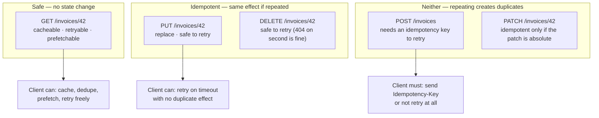

# REST

> REST is a set of constraints on how a client and server interact — uniform interface, statelessness, cacheability. Follow them and HTTP does caching, retries, and concurrency control for you. Ignore them and you have JSON over HTTP with a REST-shaped URL scheme.

**Part:** [03 · Application Architecture](../) · **Domain:** API Design & Contracts · **Priority:** Critical · **Difficulty:** Advanced · **Reading time:** ~16 min

## TL;DR

A REST API models the system as *resources* addressed by URLs and manipulated through a small, fixed set of methods whose meanings are defined by HTTP rather than by the application. The payoff for the frontend is concrete and mechanical: `GET` is safe and cacheable, so a browser, CDN, or client cache can serve it without asking; `PUT` and `DELETE` are idempotent, so a retry after a timeout cannot cause a second effect; `ETag` and `If-Match` turn "someone else edited this" from a silent overwrite into a `412`. Most APIs described as RESTful discard all three by tunneling verbs through `POST /api/doAction`, and then rebuild caching, retry safety, and conflict detection by hand in the client. REST's value is not the URL aesthetic — it is that the client can reason about a request it has never seen before.

> **Recommendation:** Use REST when the domain is resource-shaped and you want HTTP's caching and idempotency guarantees for free. Get the method semantics and status codes right first; URL prettiness is the least important part.

## At a Glance

| | |
| --- | --- |
| **Use when** | The domain maps to nouns, responses are cacheable, and multiple clients (including CDNs and proxies) sit in the path. |
| **Avoid when** | Screens need many resources at once, the domain is verb-shaped, or the payload must be client-specified. |
| **Alternatives** | GraphQL, RPC, and realtime transports — see [Alternative Approaches](#alternative-approaches). |
| **Primary risk** | Adopting the URL style without the semantics, losing caching, safe retries, and concurrency control. |
| **Maturity** | Stable. |

## Prerequisites

- [HTTP/1.1 Semantics](../../00-foundations/networking-protocols/http-1-1-semantics.md) (`· Networking & Protocols`) — the methods, status codes, and headers REST assigns meaning to.
- [Structural Typing](../../01-core-languages/typescript/structural-typing.md) (`· TypeScript`) — how a response contract is expressed and checked on the client.

## Overview

*REST* (Representational State Transfer) is an architectural style defined by constraints, the load-bearing ones being a **uniform interface**, **statelessness**, and **cacheability**. Resources are identified by URLs; clients act on them by transferring representations — usually JSON — using methods whose semantics HTTP already defines. `GET /invoices/42` retrieves a representation of invoice 42, and every intermediary in the path knows that request is safe, cacheable, and repeatable without having read a line of the API's documentation.

That last point is the whole design. In an RPC-style API, `POST /api/getInvoice` is opaque: a proxy cannot cache it, a client cannot retry it safely, and a reader cannot tell whether it changes anything. In REST the method carries the meaning, so generic infrastructure — browser caches, CDNs, retry middleware, HTTP client libraries — can act correctly on requests specific to your application.

Two clarifications. Statelessness means *the server keeps no per-client session context between requests*; each request carries what it needs. It does not forbid databases, and it does not forbid cookies used as credentials. And hypermedia (HATEOAS), the constraint that responses link to available transitions, is the part almost nobody implements; an API without it is often called "REST-ish," and for frontend purposes the caching and idempotency constraints matter far more.

## The Problem

A team builds an API that looks RESTful and gets none of REST's benefits, and the symptoms arrive as client-side complexity.

The endpoints are `POST /api/getInvoices`, `POST /api/updateInvoice`, `POST /api/deleteInvoice`. Every request is a `POST` because "it's simpler to always send a body." Immediately, nothing can be cached: `POST` responses are not cacheable by default, so the CDN passes everything through, the browser cache is useless, and the same invoice list is fetched on every screen. The client compensates with its own cache, and the team's first big state-management refactor begins.

Then a mobile user's `POST /api/chargeInvoice` times out on a train. The client retries — and the charge happens twice, because a `POST` is not idempotent and the server had already processed the first one. The fix is an idempotency key, which is the right fix, but it is being invented from scratch under incident pressure.

Then two users edit the same invoice. The second save silently overwrites the first, because nothing in the request said which version the client had read. The team adds a `version` field to the body and a comparison in the handler — reimplementing `ETag` and `If-Match`, badly, without the header support that would have let a proxy participate.

Then errors arrive as `200 OK` with `{ "success": false, "message": "Not found" }`. Now every caller must parse the body to know whether the request worked, `fetch` never rejects, retry middleware cannot distinguish a transient failure from a permanent one, and monitoring reports a 100% success rate during an outage.

Each of these is a feature HTTP already had. The API opted out of all of them by using one method for everything.

## Why It Matters

For the client, HTTP semantics are the difference between infrastructure that works generically and infrastructure you write per endpoint. Because `GET` is safe, a client cache can deduplicate concurrent requests for the same URL, serve stale data while revalidating, and prefetch on hover — none of which is sound for a request that might charge a card. Because `PUT` and `DELETE` are idempotent, retry-with-backoff can be a single wrapper around the transport rather than a per-endpoint judgment call. Take away the semantics and every one of those behaviors needs an endpoint-specific decision, encoded somewhere in the client, kept in sync by hand.

Correct status codes matter for the same reason: they let generic code branch correctly. A `401` means refresh the token and retry once. A `403` means do not retry, and show a permissions message. A `404` means remove it from the cache. A `409` means reload and re-present. A `429` carries `Retry-After`, which a backoff policy can obey exactly. Collapse all of these into `200 { success: false }` and every branch becomes string matching on a message field that product will change without telling you.

Concurrency control is the case teams discover last and regret most. `ETag` plus `If-Match` gives optimistic concurrency at the protocol level: the server rejects a write whose base version has moved, and the client can reload and re-present rather than silently destroying someone's work. Building the same thing in the body works, but it is invisible to caches and proxies and has to be reimplemented in every client.

And it matters for what the team spends its time on. An API that honors HTTP lets the frontend adopt an off-the-shelf caching layer and be done. One that does not turns cache invalidation, retry safety, and conflict resolution into bespoke application code — the most expensive kind, because it is subtly wrong in ways that only appear under concurrency.

## Mental Model

Think of a REST API as *a filesystem with types*: URLs are paths to things, and the method says what you are doing to the thing. The client's ability to reason about a request comes entirely from the method, not from the path.



Two rules follow. First, **the method is a contract with every intermediary**, not a stylistic choice — using `POST` for a read does not merely look wrong, it disables caching for that URL everywhere in the path. Second, **idempotency is what makes retries safe**, and retries are not optional: mobile networks time out, and a timeout tells the client nothing about whether the server acted. An API whose writes are not idempotent forces every client to choose between duplicate charges and lost work.

`PATCH` deserves a note. It is idempotent only when the patch describes an absolute state (`{"status": "paid"}`), not a relative one (`{"incrementBy": 1}`). If any patch in the API is relative, the whole endpoint loses retry safety and needs an idempotency key like `POST`.

## Best Practices

Use the method that matches the semantics. Reads are `GET`, full replacements are `PUT`, partial absolute updates are `PATCH`, deletions are `DELETE`, and creations or genuinely non-idempotent operations are `POST`. This single rule recovers most of REST's value.

Name resources with plural nouns and put identity in the path. `/invoices/42/payments` is a hierarchy a client can construct and a cache can key on; `/getInvoicePayments?id=42` is a function call wearing a URL.

Return the status code that describes the outcome, and never `200` for a failure. `201` with `Location` for creation, `204` for a successful delete, `400` for malformed input, `401` versus `403` distinguished correctly, `404` for missing, `409` for conflict, `422` for semantically invalid, `429` with `Retry-After`, `5xx` for server faults.

Serve `ETag` on resources and honor `If-Match` on writes. This is optimistic concurrency for the cost of a header, and it turns lost updates into a `412` the client can handle. See [Rollback & Conflict Resolution](../data-server-state/rollback-and-conflict-resolution.md) (`· Data & Server State`).

Accept an `Idempotency-Key` on every non-idempotent write. The server stores the key with the result and returns the original response on replay, which makes a client retry safe without changing the method's semantics.

Use one error format across the whole API. RFC 9457 problem details (`type`, `title`, `status`, `detail`, plus your own fields) gives the client one shape to parse and one place to find a machine-readable code.

Set cache headers deliberately. `Cache-Control: private, max-age=0, must-revalidate` with an `ETag` is a good default for authenticated resources; it makes revalidation cheap without risking a shared cache serving one user's data to another.

Paginate with a cursor, not an offset. Offsets skip and duplicate rows when the underlying data changes between pages. See [Pagination](../data-server-state/pagination.md) (`· Data & Server State`).

Version at the boundary you can actually maintain — a URL prefix or a media type — and change additively within a version. See `Versioning Strategies · API Design & Contracts`.

Validate responses at the client boundary. The API's contract is a promise, not a guarantee; parsing with a schema turns a shape change into a caught error rather than an undefined access three components deep. See [Schema Validation](../forms-validation/schema-validation.md) (`· Forms & Validation`).

## Trade-offs

REST trades payload precision for uniformity. Every client gets the same representation of a resource, which is what makes caching possible and what makes screen-specific fetching awkward.

**Advantages**

- HTTP caching works end to end: browser, CDN, and proxy, with no application code.
- Safe and idempotent methods make retries and prefetching correct by construction.
- `ETag`/`If-Match` provides optimistic concurrency at the protocol level.
- Every tool in the ecosystem — curl, proxies, load balancers, gateways — understands the API.
- Endpoints are independently deployable and independently cacheable.

**Disadvantages**

- Screen-shaped views require several requests, producing round-trip waterfalls.
- Responses are resource-shaped, so clients over-fetch fields they do not use.
- Related data needs either multiple requests or an expansion parameter that erodes uniformity.
- No single place describes a screen's data needs, so a change to one screen can touch several endpoints.
- Real-time updates need a separate transport entirely.

| Dimension | REST | Cost / caveat |
| --- | --- | --- |
| Caching | HTTP-native, shared across clients | Requires correct methods and headers |
| Payload fit | Fixed per resource | Over-fetching; screen-specific views need composition |
| Round trips | One per resource | Waterfalls unless requests are parallelized or prefetched |
| Retry safety | Free for `GET`/`PUT`/`DELETE` | `POST` needs an idempotency key |
| Concurrency | `ETag` + `If-Match` | Server must implement and clients must send it |
| Real-time | Not supported | Needs SSE or WebSocket alongside |

## Alternative Approaches

The choice is about who decides the shape of the response, and how much the transport helps.

| Approach | Best when | Weakness | See |
| --- | --- | --- | --- |
| REST (this article) | Resource-shaped domain, caching matters, many clients | Over-fetching; round trips per resource | (this article) |
| GraphQL | Screens need many related entities and vary widely | HTTP caching largely lost; server complexity | `GraphQL · API Design & Contracts` |
| RPC | The domain is verb-shaped (`transcode`, `settle`, `reindex`) | No uniform interface; caching is manual | `RPC · API Design & Contracts` |
| Realtime / subscriptions | The client must be told about changes it did not request | Connection state, reconnection, and ordering to manage | `Realtime & Subscriptions · API Design & Contracts` |
| REST + a composition endpoint | Mostly REST, with one or two expensive screens | The composite endpoint has its own cache and versioning story | `Resource & Schema Design · API Design & Contracts` |

## Bad Example

An API that is REST in appearance only, and the client code that its choices force.

```ts
// ❌ Every operation is a POST, so nothing is cacheable and nothing is
//    safely retryable. The verb has moved from the method into the path.
//    POST /api/getInvoices
//    POST /api/updateInvoice
//    POST /api/deleteInvoice
//    POST /api/chargeInvoice

async function getInvoices(status: string): Promise<Invoice[]> {
  const response = await fetch('/api/getInvoices', {
    method: 'POST',
    headers: { 'Content-Type': 'application/json' },
    body: JSON.stringify({ status }),
  });

  // ❌ (1) The status code is always 200, so this check never fires.
  //        `fetch` only rejects on network failure, so a 500 that returned
  //        HTML would fall through to the JSON parse below.
  if (!response.ok) throw new Error('Request failed');

  const body = await response.json();

  // ❌ (2) Success is a body field. Every caller must know this convention,
  //        and monitoring sees 100% 2xx during a complete outage.
  if (!body.success) {
    // ❌ (3) The only machine-readable signal is an English message that
    //        product will reword next sprint, breaking this comparison.
    if (body.message === 'Not found') return [];
    throw new Error(body.message);
  }

  // ❌ (4) No cache key, no ETag, no Cache-Control. Every screen that needs
  //        invoices issues this request again, and the CDN cannot help.
  return body.data;
}

async function chargeInvoice(id: string) {
  // ❌ (5) Not idempotent, and no idempotency key. A timeout leaves the
  //        client unable to distinguish "not charged" from "charged, reply lost".
  const response = await fetch('/api/chargeInvoice', {
    method: 'POST',
    body: JSON.stringify({ id }),
  });
  return response.json();
}

async function updateInvoice(id: string, changes: Partial<Invoice>) {
  // ❌ (6) Last write wins. Two editors, and the second silently destroys
  //        the first one's changes, with no signal to either user.
  return fetch('/api/updateInvoice', {
    method: 'POST',
    body: JSON.stringify({ id, ...changes }),
  });
}
```

**What goes wrong:** The API has opted out of HTTP. No response can be cached by anything, so the client must build a cache. No write can be retried, so a mobile timeout is a business decision made by whoever wrote the retry loop. No write detects a conflict, so concurrent edits lose data silently. And because failures arrive as `200`, neither generic retry middleware nor the monitoring dashboard can tell that anything is wrong.

## Good Example

The same operations with HTTP doing the work: correct methods, real status codes, `ETag`, and idempotency keys.

```ts
import { z } from 'zod';

const Invoice = z.object({
  id: z.string(),
  reference: z.string(),
  amount: z.number(),
  currency: z.string().length(3),
  status: z.enum(['draft', 'sent', 'paid', 'void']),
  updatedAt: z.string().datetime(),
});
type Invoice = z.infer<typeof Invoice>;

/** RFC 9457 problem details — one error shape for the entire API. */
const Problem = z.object({
  type: z.string().url().optional(),
  title: z.string(),
  status: z.number(),
  detail: z.string().optional(),
  /** Application-specific, stable, and safe to branch on. */
  code: z.string().optional(),
});

export class ApiError extends Error {
  constructor(
    readonly status: number,
    readonly code: string | undefined,
    message: string,
  ) {
    super(message);
    this.name = 'ApiError';
  }
  /** Generic middleware can branch on this without knowing the endpoint. */
  get isRetryable() {
    return this.status === 429 || this.status >= 500;
  }
}

async function request<T>(
  url: string,
  schema: z.ZodType<T>,
  init?: RequestInit,
): Promise<{ data: T; etag: string | null }> {
  const response = await fetch(url, {
    ...init,
    headers: { Accept: 'application/json', ...init?.headers },
  });

  if (!response.ok) {
    // ✅ The status code already says what happened; the body adds detail.
    const problem = Problem.safeParse(await response.json().catch(() => null));
    throw new ApiError(
      response.status,
      problem.success ? problem.data.code : undefined,
      problem.success ? problem.data.title : response.statusText,
    );
  }

  if (response.status === 204) {
    return { data: undefined as T, etag: null };
  }

  // ✅ Validate at the boundary: a contract change fails here, once, with a
  //    useful message — not three components deep as `undefined is not an object`.
  return {
    data: schema.parse(await response.json()),
    etag: response.headers.get('ETag'),
  };
}

// ✅ GET: safe, cacheable, deduplicable, prefetchable. The CDN and the
//    browser cache both participate without any application code.
export function listInvoices(status: Invoice['status'], signal?: AbortSignal) {
  const url = `/api/v1/invoices?status=${encodeURIComponent(status)}`;
  return request(url, z.array(Invoice), { signal });
}

export function getInvoice(id: string, signal?: AbortSignal) {
  return request(`/api/v1/invoices/${id}`, Invoice, { signal });
}

// ✅ PATCH with If-Match: the server rejects a write whose base version has
//    moved, so a concurrent edit produces a 412 instead of silent data loss.
export async function updateInvoice(
  id: string,
  changes: Partial<Pick<Invoice, 'reference' | 'amount' | 'status'>>,
  etag: string,
) {
  try {
    return await request(`/api/v1/invoices/${id}`, Invoice, {
      method: 'PATCH',
      headers: { 'Content-Type': 'application/merge-patch+json', 'If-Match': etag },
      body: JSON.stringify(changes),
    });
  } catch (error) {
    if (error instanceof ApiError && error.status === 412) {
      // The caller can now reload and re-present the conflict to the user.
      throw new ConflictError('This invoice changed while you were editing it.');
    }
    throw error;
  }
}

// ✅ POST with an idempotency key: the retry after a timeout returns the
//    original result instead of charging a second time.
export function chargeInvoice(id: string, idempotencyKey: string) {
  return request(`/api/v1/invoices/${id}/charges`, Invoice, {
    method: 'POST',
    headers: {
      'Content-Type': 'application/json',
      'Idempotency-Key': idempotencyKey,
    },
    body: JSON.stringify({}),
  });
}

// ✅ DELETE: idempotent. A retry that gets 404 means the first attempt
//    succeeded, which the caller can treat as success.
export async function deleteInvoice(id: string) {
  try {
    await request(`/api/v1/invoices/${id}`, z.undefined(), { method: 'DELETE' });
  } catch (error) {
    if (error instanceof ApiError && error.status === 404) return;
    throw error;
  }
}
```

**Why it's better:** Reads are `GET`, so the browser cache, the CDN, and the client cache all work without being told anything about this API. Writes carry `If-Match`, so a concurrent edit produces a `412` the user can act on instead of silently destroying someone's work. The charge carries an idempotency key, so the retry that the network will eventually force is safe. Errors arrive as status codes, so one retry policy covers every endpoint and monitoring reflects reality. And responses are parsed at the boundary, so a contract change is a caught error rather than a mystery.

## Production Example

The two behaviors REST makes possible but does not perform for you are retry-with-backoff and token refresh. Both are generic *because* the method semantics are correct — that is the whole return on the design.

```ts
const IDEMPOTENT_METHODS = new Set(['GET', 'HEAD', 'PUT', 'DELETE', 'OPTIONS']);

interface RetryOptions {
  maxAttempts?: number;
  /** Cap so a long Retry-After from an overloaded origin can't hang the UI. */
  maxDelayMs?: number;
  signal?: AbortSignal;
}

/**
 * Retry is only correct where the method or an idempotency key makes a repeat
 * harmless. This is the single place that decision is encoded, and it is
 * expressible as one predicate precisely because the API honors HTTP.
 */
export async function fetchWithRetry(
  url: string,
  init: RequestInit = {},
  { maxAttempts = 3, maxDelayMs = 20_000, signal }: RetryOptions = {},
): Promise<Response> {
  const method = (init.method ?? 'GET').toUpperCase();
  const hasIdempotencyKey =
    new Headers(init.headers).get('Idempotency-Key') !== null;
  const mayRetry = IDEMPOTENT_METHODS.has(method) || hasIdempotencyKey;

  let lastError: unknown;

  for (let attempt = 1; attempt <= maxAttempts; attempt++) {
    try {
      const response = await fetch(url, { ...init, signal });

      // 429 and 5xx are transient by definition; 4xx are not, and retrying
      // them wastes the user's time and the origin's capacity.
      const transient = response.status === 429 || response.status >= 500;
      if (!transient || !mayRetry || attempt === maxAttempts) {
        return response;
      }

      // Retry-After is the server telling us exactly when to come back.
      // Guessing when we have been told is how a backoff turns into a stampede.
      const retryAfter = parseRetryAfter(response.headers.get('Retry-After'));
      await sleep(retryAfter ?? backoffWithJitter(attempt, maxDelayMs), signal);
      continue;
    } catch (error) {
      // A network failure or timeout: we do not know whether the server acted,
      // which is exactly why only idempotent requests may be repeated here.
      if (error instanceof DOMException && error.name === 'AbortError') throw error;
      lastError = error;
      if (!mayRetry || attempt === maxAttempts) throw error;
      await sleep(backoffWithJitter(attempt, maxDelayMs), signal);
    }
  }

  throw lastError;
}

function parseRetryAfter(header: string | null): number | null {
  if (!header) return null;
  // Retry-After is either delta-seconds or an HTTP-date; both occur in the wild.
  const seconds = Number(header);
  if (Number.isFinite(seconds)) return seconds * 1000;
  const date = Date.parse(header);
  return Number.isNaN(date) ? null : Math.max(0, date - Date.now());
}

function backoffWithJitter(attempt: number, maxDelayMs: number): number {
  const exponential = Math.min(2 ** (attempt - 1) * 500, maxDelayMs);
  // Full jitter: without it, every client that failed at the same moment
  // retries at the same moment and the origin never recovers.
  return Math.random() * exponential;
}

function sleep(ms: number, signal?: AbortSignal): Promise<void> {
  return new Promise((resolve, reject) => {
    const timer = setTimeout(resolve, ms);
    signal?.addEventListener('abort', () => {
      clearTimeout(timer);
      reject(new DOMException('Aborted', 'AbortError'));
    }, { once: true });
  });
}
```

```ts
/**
 * 401 has one correct response — refresh once, then replay — and the single
 * in-flight promise is what stops ten concurrent 401s from firing ten refreshes
 * and invalidating each other's tokens.
 */
let refreshInFlight: Promise<string> | null = null;

export async function authorizedFetch(url: string, init: RequestInit = {}) {
  const attempt = (token: string) =>
    fetchWithRetry(url, {
      ...init,
      headers: { ...init.headers, Authorization: `Bearer ${token}` },
    });

  let response = await attempt(await getAccessToken());

  if (response.status === 401) {
    refreshInFlight ??= refreshAccessToken().finally(() => {
      refreshInFlight = null;
    });
    const token = await refreshInFlight;
    // Replay exactly once. A second 401 means the session is genuinely gone.
    response = await attempt(token);
  }

  return response;
}
```

Note what makes this middleware possible: `mayRetry` is a one-line predicate over the method, and `401` versus `403` is a status code rather than a message. Against the `POST /api/doAction` API from the bad example, neither function can exist — every endpoint would need its own retry decision, hard-coded and maintained by hand.

## Common Mistakes

See the [API Design & Contracts anti-patterns](../../../anti-patterns/#api-design-contracts) for the domain catalog. Concept-specific:

### Mistake: Verbs in the path, `POST` for everything

- **Symptom:** `POST /api/getInvoices`, `POST /api/deleteUser`.
- **Why it fails:** The method no longer carries meaning, so caching, safe retries, and prefetching are unavailable to every intermediary and every generic client.
- **Fix:** Model resources as nouns and let the method express the operation.

### Mistake: `200 OK` with `{ success: false }`

- **Symptom:** `response.ok` is always true; callers branch on a body field.
- **Why it fails:** Retry middleware, caches, and monitoring all read the status code; a failure that reports success is invisible to all of them.
- **Fix:** Return the status code that describes the outcome, with RFC 9457 problem details in the body.

### Mistake: Non-idempotent writes with no idempotency key

- **Symptom:** Duplicate charges or duplicate records after a network timeout.
- **Why it fails:** A timeout tells the client nothing about whether the server acted, so any retry risks a second effect.
- **Fix:** Accept `Idempotency-Key` on `POST`, store the result against the key, and replay it.

### Mistake: No concurrency control

- **Symptom:** Two users edit the same record and the second save silently discards the first.
- **Why it fails:** Without a version in the request, the server cannot distinguish an update from an overwrite.
- **Fix:** Serve `ETag` and require `If-Match` on writes; surface `412` as a conflict the user resolves.

### Mistake: Offset pagination over changing data

- **Symptom:** Rows appear twice or are skipped while scrolling a live list.
- **Why it fails:** An offset is a position in a result set that shifts when rows are inserted or removed between requests.
- **Fix:** Use a cursor derived from a stable sort key. See [Pagination](../data-server-state/pagination.md).

### Mistake: Trusting the response shape

- **Symptom:** `Cannot read properties of undefined` in a component, days after a backend deploy.
- **Why it fails:** The type annotation is a compile-time assertion about runtime data that nothing verified.
- **Fix:** Parse responses with a schema at the network boundary. See [Schema Validation](../forms-validation/schema-validation.md).

## Checklist

- [ ] Reads are `GET`; no read has side effects.
- [ ] Writes use `PUT`, `PATCH`, `DELETE`, or `POST` according to idempotency.
- [ ] Failures return non-2xx status codes, never `200` with an error body.
- [ ] Errors share one machine-readable format with a stable `code` field.
- [ ] `401`, `403`, `404`, `409`, `422`, and `429` are distinguished correctly.
- [ ] Resources serve `ETag`; writes require `If-Match`.
- [ ] Non-idempotent writes accept and honor `Idempotency-Key`.
- [ ] `Cache-Control` is set deliberately on every response, including private ones.
- [ ] `429` responses carry `Retry-After`, and the client obeys it.
- [ ] Lists are cursor-paginated with a stable sort.
- [ ] Responses are schema-validated at the client boundary.

## Related Articles

- [Cache Keys & Query Identity](../data-server-state/cache-keys-and-query-identity.md) — turning a URL into a client-side cache key (`· Data & Server State`).
- [Retries & Backoff](../data-server-state/retries-and-backoff.md) — the client policy that idempotency makes safe (`· Data & Server State`).
- [Rollback & Conflict Resolution](../data-server-state/rollback-and-conflict-resolution.md) — handling the `412` a REST API can produce (`· Data & Server State`).
- [Pagination](../data-server-state/pagination.md) — cursor versus offset over a REST list (`· Data & Server State`).
- [Schema Validation](../forms-validation/schema-validation.md) — validating responses at the boundary (`· Forms & Validation`).
- [CORS](../../05-reliability-quality/security/cors.md) — what a cross-origin REST call actually requires (`· Security`).

## References

- [RFC 9110 — HTTP Semantics](https://www.rfc-editor.org/rfc/rfc9110.html) — the definitions of safe, idempotent, cacheable, and every status code.
- [RFC 9457 — Problem Details for HTTP APIs](https://www.rfc-editor.org/rfc/rfc9457.html) — the standard error body shape.
- [Fielding — Architectural Styles, Chapter 5](https://ics.uci.edu/~fielding/pubs/dissertation/rest_arch_style.htm) — the original constraints, including the ones most APIs skip.
