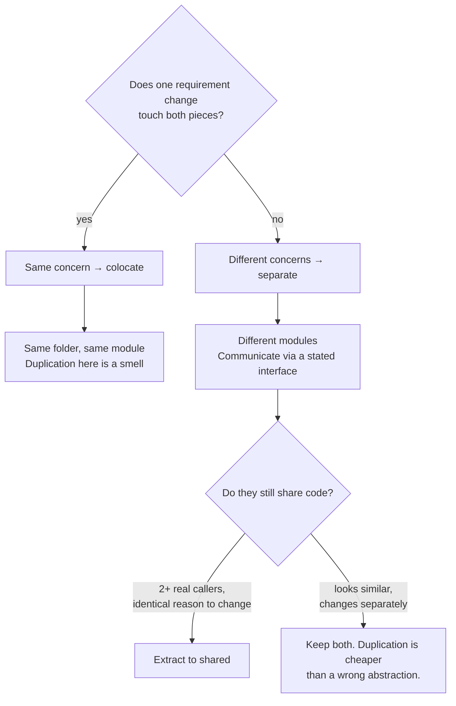

# Separation of Concerns

> Separating concerns means putting things that change together in the same place and things that change independently in different places. Everything else — layers, folders, file naming — is a consequence, and often a bad guess at it.

**Part:** [03 · Application Architecture](../) · **Domain:** Frontend Architecture · **Priority:** Critical · **Difficulty:** Intermediate · **Reading time:** ~12 min

## TL;DR

A concern is a reason to change. Two pieces of code belong together when the same requirement change touches both, and apart when they change for different reasons — from different requests, on different schedules, by different people. The common frontend interpretation, one folder per technical kind (`components/`, `hooks/`, `utils/`, `types/`), separates by *what a file is* rather than *why it changes*, which scatters every feature across the tree and leaves nothing that can be reasoned about, tested, or deleted as a unit. The useful cut is almost always: one folder per feature, with a hard boundary at the module's public surface, and shared code extracted only when a second real caller appears.

> **Recommendation:** Group by feature and separate by rate of change. Split a module when you can name two distinct reasons it changes; leave it alone when you cannot.

## At a Glance

| | |
| --- | --- |
| **Use when** | Always — it is the criterion behind every other structural decision. |
| **Avoid when** | Never, though *premature* separation is a real and common failure. |
| **Alternatives** | Layered and domain-driven structures are applications of this principle, not substitutes — see [Alternative Approaches](#alternative-approaches). |
| **Primary risk** | Separating by file type or by speculation instead of by observed rate of change. |
| **Maturity** | Stable. |

## Prerequisites

- [Elements vs Components](../../02-rendering-frameworks/react/elements-vs-components.md) (`· React`) — the unit most frontend boundaries are drawn around.
- [Structural Typing](../../01-core-languages/typescript/structural-typing.md) (`· TypeScript`) — how a module's public shape is described and enforced.

## Overview

*Separation of concerns* is the principle that a system should be decomposed so that each part addresses one concern, and that the parts interact through narrow, stated interfaces. Dijkstra's original framing was about attention: studying one aspect at a time is only possible if the aspects are actually separable. Parnas gave the operational test a few years later — decompose along the axes of *likely change*, so that a change is contained in one module rather than spread across many.

That test is the entire content of the principle, and it is the part most frontend applications skip. "Concern" is not a synonym for "kind of file." Fetching, validating, and rendering an invoice are three activities, but if every change to the invoice feature touches all three, they are one concern implemented in three styles. Conversely, two components that look identical but change for different reasons — one because the design system moved, one because a business rule moved — are two concerns that happen to share markup.

The practical questions this principle answers are always the same: what goes in this file, what may this module import, and when is duplication cheaper than an abstraction. The rest of this domain — layers, module boundaries, dependency direction, feature structure — is this principle applied at successively larger scales.

## The Problem

A codebase is organized the way most tutorials organize one:

```text
src/
  components/    # 180 files
  hooks/         # 60 files
  utils/         # 90 files
  types/         # 40 files
  services/      # 35 files
```

Nothing is obviously wrong, and for the first six months nothing is. Then a ticket arrives: invoices need a new "partially paid" status.

The change touches `types/invoice.ts`, `services/invoiceApi.ts`, `hooks/useInvoices.ts`, `utils/formatInvoiceStatus.ts`, `components/InvoiceRow.tsx`, `components/InvoiceStatusBadge.tsx`, and `components/InvoiceFilters.tsx` — seven directories for one requirement. The engineer finds five of them, ships, and the sixth surfaces in QA.

A month later the team wants to delete an abandoned feature. There is no folder to delete. Its components are among 180 siblings, its hooks among 60, and its helpers are in `utils/` next to helpers that everything imports. Nobody can tell which files are only used by the dead feature, so the code stays, and `utils/` grows another year of functions nobody dares remove.

Meanwhile `utils/formatCurrency.ts` is imported by 40 files. It gained a `compact` option for the dashboard, then a `showSign` option for the ledger, then a locale override for the export. Each caller wanted something slightly different, and because they all shared one function, each want became a parameter. It is now 120 lines of branching, and no one can change any branch safely.

Every one of these symptoms comes from the same root: the folders describe what files *are*, and the changes arrive by what features *do*.

## Why It Matters

The cost of a wrong decomposition is paid on every change, forever, and it compounds. When a feature's code is scattered, the expensive part of any modification is not writing it — it is finding everything the change touches, and being sure you found it all. That search cost grows with codebase size, while a well-bounded feature's search cost stays roughly constant.

It also determines what a team can *remove*. Software that cannot be deleted accumulates, and deletability is a structural property: a feature in its own folder with a single public entry point can be removed by deleting the folder and fixing the resulting import errors. The same feature scattered across five type-named folders cannot be removed at all, only abandoned in place. A codebase where nothing can be deleted grows without bound regardless of how carefully new code is written.

Then there is the shared-helper trap, which is the principle's failure mode in the other direction. Two call sites with similar code are not necessarily one concern. If they are pulled into a shared function before it is clear they change together, every later divergence arrives as a parameter, and the abstraction becomes a switch statement over its callers. That is strictly worse than the duplication it replaced: the duplication was two independent things, the abstraction is one coupled thing pretending to be general.

Finally, boundaries determine what can be tested cheaply. A module with a narrow public surface and its dependencies passed in can be tested through that surface. A module that reaches into three others' internals can only be tested by constructing all four, which is why "everything needs mocking" is a structural complaint rather than a testing one.

## Mental Model

Ask one question about any two pieces of code: *does a single requirement change touch both?* If yes, they are one concern and belong together. If no, they are two concerns and the boundary belongs between them.



Two corollaries are worth stating plainly. First, **similarity is not a reason to share**; a shared reason to change is. Code that looks the same today and is edited by different teams on different schedules is two things. Second, **the boundary is the import surface, not the folder**. A folder with an `index.ts` that re-exports everything inside it has no boundary — it has a directory. The boundary exists when the outside can only reach the module through a surface you chose.

The scale of the cut varies but the criterion does not. Within a component, separating "how it looks" from "what it does" is the same question as separating two features in a monorepo: does one change touch both?

## Best Practices

Organize by feature, not by file kind. A folder named for a capability — `invoices/`, `billing/`, `search/` — collects everything that changes together and gives the feature a shape that can be reviewed, tested, and deleted.

Give each module one public entry point. An `index.ts` that exports the handful of things outsiders may use turns "what is this module's API" from a question into a file. Everything not exported there is free to change without coordination.

Extract shared code on the second real caller, not the first speculative one. One caller means the code belongs to that caller. Two callers with the same reason to change means a shared module. Two callers with different reasons means two functions that happen to look alike.

Keep the dependency direction one-way. Features may depend on shared infrastructure; shared infrastructure must not depend on features. When it does, "shared" has become "everything," and nothing can be built or removed independently.

Delete `utils/`. A folder named for the absence of a concern collects code that has no home, and code with no home has no owner and no boundary. Every function in it belongs either to a feature or to a named shared module — `currency/`, `dates/`, `http/`.

Let the layer live inside the feature. `invoices/api.ts`, `invoices/model.ts`, `invoices/InvoiceTable.tsx` separates data access from rendering *and* keeps the feature intact. The layered cut and the feature cut are not in competition; the feature is the outer one.

Enforce the boundaries with tooling. A lint rule that forbids deep imports across features (`import ... from '../billing/internal/rates'`) is the only thing that keeps a boundary from eroding at 4 p.m. on a Friday.

Prefer duplication to a parameterized abstraction. When a shared function grows a boolean parameter that selects behavior per caller, it is two functions wearing one name. Split it.

Name modules for what they do, not what they contain. `pricing/` describes a concern; `helpers/` describes a filing cabinet.

## Trade-offs

Separation is not free, and more of it is not better. Every boundary is an interface to design, document, and cross, and every crossing is indirection a reader has to follow.

**Advantages**

- A requirement change touches one folder, so the cost of finding the change is bounded.
- Features can be deleted, which is what keeps a codebase from growing monotonically.
- Modules with narrow surfaces are testable through those surfaces instead of through their internals.
- Teams can work in parallel without editing the same files, because ownership follows the boundary.

**Disadvantages**

- Boundaries drawn early are drawn with the least information; a wrong one is expensive to move.
- Each boundary adds indirection: more files, more imports, and a longer path from symptom to cause.
- Genuinely shared concepts may be duplicated for a while before the shared reason to change is visible.
- Enforcement needs tooling; without it, boundaries decay into conventions nobody follows.

| Dimension | Well-separated | Cost / caveat |
| --- | --- | --- |
| Change locality | One folder per requirement | Only if the cut matched the real axis of change |
| Deletability | Delete the folder | Requires no deep imports from elsewhere |
| Testability | Test through the public surface | Requires dependencies to be injectable |
| Navigability | Feature is visible as a unit | More indirection per call path |
| Reuse | Shared modules are explicit | Premature sharing produces parameter-driven code |

## Alternative Approaches

These are not competing principles; they are different scales at which this one is applied. The genuine alternative is the type-based layout, and it is worth stating honestly why it loses.

| Approach | Best when | Weakness | See |
| --- | --- | --- | --- |
| Separate by rate of change (this article) | Always — the underlying criterion | Requires judgment; no mechanical rule | (this article) |
| Feature-based structure | Applications with recognizable capabilities | Cross-feature concepts need a home | `Feature-Based Structure · Frontend Architecture` |
| Layered architecture | Data flow is uniform across features | A change often crosses every layer | `Layered Architecture · Frontend Architecture` |
| Domain-driven frontend | The business domain is complex and stable | Heavy for CRUD-shaped applications | `Domain-Driven Frontend · Frontend Architecture` |
| Type-based folders (`components/`, `utils/`) | Very small codebases, throwaway prototypes | Scatters every feature; nothing can be deleted | (discussed above) |

## Bad Example

The type-based layout, with the coupling it hides made visible.

```ts
// ❌ src/utils/format.ts — a "shared" helper that is really five callers'
//    requirements crammed into one signature.
export function formatCurrency(
  amount: number,
  currency: string,
  options?: {
    compact?: boolean;        // added for the dashboard
    showSign?: boolean;       // added for the ledger
    locale?: string;          // added for the export
    hideZero?: boolean;       // added for the invoice table
    roundToWhole?: boolean;   // added for the summary cards
  },
) {
  // Every branch belongs to exactly one caller. Changing any of them risks
  // the other four, and the function's tests must cover the product of options.
  if (options?.hideZero && amount === 0) return '';
  const value = options?.roundToWhole ? Math.round(amount) : amount;
  const formatted = new Intl.NumberFormat(options?.locale ?? 'en-US', {
    style: 'currency',
    currency,
    notation: options?.compact ? 'compact' : 'standard',
  }).format(value);
  return options?.showSign && amount > 0 ? `+${formatted}` : formatted;
}
```

```tsx
// ❌ src/components/InvoiceRow.tsx — reaches across three type-folders, and
//    into another feature's internals.
import { formatCurrency } from '../utils/format';
import { useInvoices } from '../hooks/useInvoices';
import { calculateTax } from '../utils/taxCalculations';
import type { Invoice } from '../types/invoice';
// ❌ A deep import into billing's internals: nothing stops it, and billing
//    can no longer change this file without breaking invoices.
import { RATE_TABLE } from '../components/billing/internal/rates';

export function InvoiceRow({ id }: { id: string }) {
  // ❌ The component fetches, computes tax, and renders. Three reasons to
  //    change in one file — but the file is in components/, so the
  //    "separation" the folder claims to provide is fictional.
  const { invoices } = useInvoices();
  const invoice = invoices.find((i) => i.id === id);
  if (!invoice) return null;

  const tax = calculateTax(invoice.amount, RATE_TABLE[invoice.region]);

  return (
    <tr>
      <td>{invoice.reference}</td>
      <td>{formatCurrency(invoice.amount + tax, invoice.currency, { hideZero: true })}</td>
    </tr>
  );
}
```

**What goes wrong:** Adding the "partially paid" status requires edits in `types/`, `hooks/`, `utils/`, and `components/`, and nothing in the structure indicates that those four edits belong to one change. The shared formatter has five options that no single caller uses more than one of, so it is coupled to all five and safe to modify for none. And the deep import into `billing/internal/` means billing has no internals — every file in it is public whether its author intended that or not.

## Good Example

The same functionality cut along the axis of change: one folder per feature, one public surface each, shared code named for its concern.

```text
src/
  features/
    invoices/
      index.ts              # the only thing outside code may import
      api.ts                # data access for invoices
      model.ts              # invoice types and business rules
      format.ts             # invoice-specific formatting
      InvoiceTable.tsx
      InvoiceRow.tsx
      InvoiceStatusBadge.tsx
    billing/
      index.ts
      rates.ts              # internal: not exported from index.ts
  shared/
    currency/               # named for a concern, not "utils"
      index.ts
    http/
      index.ts
```

```ts
// ✅ src/shared/currency/index.ts — one reason to change: how money is
//    displayed. No caller-specific options; variants are separate functions.
export function formatCurrency(amount: number, currency: string, locale = 'en-US') {
  return new Intl.NumberFormat(locale, { style: 'currency', currency }).format(amount);
}

export function formatCurrencyCompact(amount: number, currency: string, locale = 'en-US') {
  return new Intl.NumberFormat(locale, {
    style: 'currency',
    currency,
    notation: 'compact',
  }).format(amount);
}
```

```ts
// ✅ src/features/invoices/format.ts — invoice-specific rules live with
//    invoices, because they change when invoicing changes, not when
//    currency formatting changes.
import { formatCurrency } from '../../shared/currency';
import type { Invoice } from './model';

/** Invoicing hides zero amounts; nothing else in the app does. */
export function formatInvoiceAmount(invoice: Invoice): string {
  if (invoice.amount === 0) return '';
  return formatCurrency(invoice.amount, invoice.currency);
}
```

```ts
// ✅ src/features/billing/index.ts — the boundary is what is exported here.
//    rates.ts is not, so billing is free to restructure it.
export { useBillingRate } from './useBillingRate';
export type { BillingRate } from './model';
// RATE_TABLE stays internal by simply not appearing in this file.
```

```tsx
// ✅ src/features/invoices/InvoiceRow.tsx — renders. It does not fetch,
//    and it does not know how tax is computed.
import { formatInvoiceAmount } from './format';
import type { Invoice } from './model';

interface InvoiceRowProps {
  invoice: Invoice;
  /** Computed by the caller: this component has no opinion on tax rules. */
  taxAmount: number;
}

export function InvoiceRow({ invoice, taxAmount }: InvoiceRowProps) {
  return (
    <tr>
      <td>{invoice.reference}</td>
      <td>{formatInvoiceAmount({ ...invoice, amount: invoice.amount + taxAmount })}</td>
    </tr>
  );
}
```

```ts
// ✅ src/features/invoices/index.ts — the feature's entire public surface.
//    Adding "partially paid" touches model.ts, format.ts, and the badge —
//    all in this folder, and none of it visible to other features.
export { InvoiceTable } from './InvoiceTable';
export { useInvoices } from './api';
export type { Invoice, InvoiceStatus } from './model';
```

**Why it's better:** The "partially paid" change is now three files in one folder, and the compiler finds every site because the status type is owned in one place. `InvoiceRow` renders and nothing else, so it can be tested with a plain object instead of a mocked fetch. Billing's rate table is genuinely internal, because no `index.ts` exports it. And the currency module has one reason to change; the invoice-specific rule that used to be a `hideZero` flag now lives with invoices, where it belongs.

## Production Example

Boundaries that are only a convention erode. The version that survives contact with a team under deadline is the one the tooling enforces, and the useful enforcement is narrow: no deep imports into another feature, and no feature imported by shared code.

```js
// eslint.config.js — the boundary as a rule rather than a README paragraph.
import boundaries from 'eslint-plugin-boundaries';

export default [
  {
    plugins: { boundaries },
    settings: {
      'boundaries/elements': [
        { type: 'feature', pattern: 'src/features/*', capture: ['name'] },
        { type: 'shared', pattern: 'src/shared/*', capture: ['name'] },
        { type: 'app', pattern: 'src/app/**' },
      ],
    },
    rules: {
      // 1. Dependency direction: shared may not know about features.
      //    Without this rule, "shared" quietly becomes "everything", and
      //    no feature can be deleted or built independently again.
      'boundaries/element-types': ['error', {
        default: 'disallow',
        rules: [
          { from: 'app', allow: ['feature', 'shared'] },
          { from: 'feature', allow: ['shared'] },
          // A feature may import another feature — but only its public surface,
          // which the next rule enforces. Cross-feature imports are a design
          // smell worth reviewing, not an error worth blocking.
          { from: 'feature', allow: [['feature', { name: '*' }]] },
          { from: 'shared', allow: ['shared'] },
        ],
      }],

      // 2. The public surface: other modules enter through index.ts only.
      //    This is what makes everything not exported there safe to change.
      'boundaries/entry-point': ['error', {
        default: 'disallow',
        rules: [
          { target: ['feature', 'shared'], allow: 'index.ts' },
        ],
      }],

      // 3. The escape hatch has to exist, and has to be visible. A file that
      //    genuinely needs a deep import gets an inline disable with a reason,
      //    which turns an invisible violation into a reviewable one.
      'no-restricted-imports': ['error', {
        patterns: [
          {
            group: ['**/utils', '**/utils/*', '**/helpers', '**/helpers/*'],
            message:
              'Name the concern: put this in a named shared module (currency/, dates/, http/) or inside the feature that owns it.',
          },
        ],
      }],
    },
  },
];
```

The rule set is deliberately small. It encodes exactly two decisions — direction and entry point — and leaves everything else to review, because a rule that fires on judgment calls gets disabled wholesale within a month. Note also that cross-feature imports are *allowed*: forbidding them entirely pushes teams to route everything through `shared/`, which is how shared modules become dumping grounds. What matters is that the import goes through the public surface, so the importing feature depends on a stated contract rather than on an implementation detail.

## Common Mistakes

See the [Frontend Architecture anti-patterns](../../../anti-patterns/#frontend-architecture) for the domain catalog. Concept-specific:

### Mistake: Folders named for file types

- **Symptom:** One requirement change edits files in `components/`, `hooks/`, `utils/`, and `types/`.
- **Why it fails:** The layout separates by what a file *is*, while changes arrive by what a feature *does*, so no folder contains a change.
- **Fix:** Group by feature and let the type distinction exist inside it.

### Mistake: A `utils/` folder

- **Symptom:** A directory of unrelated functions that everything imports and nobody owns.
- **Why it fails:** "Utility" is the absence of a concern; code without a concern has no boundary and cannot be reasoned about or removed.
- **Fix:** Move each function into the feature that owns it, or into a shared module named for its concern.

### Mistake: Extracting on the first duplication

- **Symptom:** A shared function whose boolean parameters each serve exactly one call site.
- **Why it fails:** The code was similar, not the same concern; every divergence becomes a parameter, and the abstraction couples callers that were independent.
- **Fix:** Inline it back into both callers, and extract again only when they demonstrably change together.

### Mistake: Deep imports across modules

- **Symptom:** `import { thing } from '../billing/internal/rates'`.
- **Why it fails:** It makes every file in the target module public, so the target can no longer change anything without breaking unknown callers.
- **Fix:** Export what is genuinely shared from `index.ts` and forbid deep paths with a lint rule.

### Mistake: Shared code that imports features

- **Symptom:** `shared/api.ts` imports a type from `features/invoices`.
- **Why it fails:** The dependency direction is now cyclic in practice; nothing can be built, tested, or deleted independently.
- **Fix:** Move the type down into shared, or invert the dependency so the feature passes what it needs in.

## Checklist

- [ ] Each feature has its own folder containing everything that changes with it.
- [ ] Each module has one public entry point, and outsiders import only from it.
- [ ] No folder is named `utils`, `helpers`, or `misc`.
- [ ] Shared modules are named for a concern and do not import features.
- [ ] Shared code was extracted on a second caller with the same reason to change.
- [ ] No shared function has parameters that select per-caller behavior.
- [ ] Deleting a feature means deleting one folder plus fixing imports.
- [ ] The dependency direction and entry-point rules are enforced by lint, not convention.
- [ ] Components that render do not also fetch and compute business rules.

## Related Articles

- [Categories of State](../state-management/categories-of-state.md) — separating state by ownership, the same criterion applied to data (`· State Management`).
- [Structural Typing](../../01-core-languages/typescript/structural-typing.md) — how a module's public surface is described (`· TypeScript`).
- [Composition and Children](../../02-rendering-frameworks/react/composition-and-children.md) — separating concerns inside a component tree (`· React`).
- [Pure Logic Testing](../../05-reliability-quality/testing/pure-logic-testing.md) — what becomes testable once boundaries exist (`· Testing & Quality`).
- [What to Test & Coverage Goals](../../05-reliability-quality/testing/what-to-test-and-coverage-goals.md) — testing through public surfaces rather than internals (`· Testing & Quality`).

## References

- [Dijkstra — On the role of scientific thought (EWD447)](https://www.cs.utexas.edu/~EWD/transcriptions/EWD04xx/EWD447.html) — the original statement of separation of concerns as a way of managing attention.
- [Parnas — On the Criteria To Be Used in Decomposing Systems into Modules](https://dl.acm.org/doi/10.1145/361598.361623) — the argument that modules should hide likely changes, not mirror processing steps.
