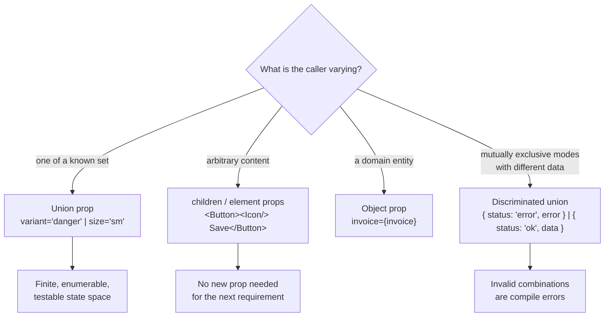

# Prop Design & Contracts

> A component's props are a public API. They are the thing every caller depends on, the thing that is hardest to change later, and the thing most often designed by accretion — one boolean per bug report.

**Part:** [04 · Interface Engineering](../) · **Domain:** Component & Interaction Design · **Priority:** High · **Difficulty:** Intermediate · **Reading time:** ~12 min

## TL;DR

A good prop contract makes the valid uses obvious and the invalid ones impossible to write. Three rules produce most of that: model mutually exclusive options as a discriminated union rather than independent booleans, so `variant="danger"` cannot also be `variant="ghost"`; accept children and elements instead of growing a prop for every possible piece of content; and pass domain objects rather than exploding them into a dozen scalars that must be kept in sync. The failure mode to design against is the boolean pile — `isLoading`, `isDisabled`, `isCompact`, `hasIcon`, `showBorder` — which multiplies into 32 states, of which perhaps five are meaningful and none are documented.

> **Recommendation:** Make invalid states unrepresentable in the type. If a combination of props is meaningless, the caller should not be able to write it — not merely be warned about it in a code review.

## At a Glance

| | |
| --- | --- |
| **Use when** | Designing or reviewing any shared component, especially one in a design system. |
| **Avoid when** | Never, though a single-use local component deserves less ceremony than a shared one. |
| **Alternatives** | Composition and slots move the decision from props to children — see [Alternative Approaches](#alternative-approaches). |
| **Primary risk** | Boolean accretion: independent flags that encode a state machine nobody wrote down. |
| **Maturity** | Stable. |

## Prerequisites

- [Elements vs Components](../../02-rendering-frameworks/react/elements-vs-components.md) (`· React`) — what a prop actually is, and why an element passed as a prop is not a rendered component.
- [Specificity](../../01-core-languages/css/specificity.md) (`· CSS & Visual Systems`) — why a `className` prop is the escape hatch that undermines a styling contract.

## Overview

A component's *contract* is everything a caller can rely on: which props exist, which combinations are valid, what the component renders, what it controls versus what the caller controls, and what it will do when a value changes. In TypeScript most of that contract can be expressed in the props type — and the part that is expressed there is the part that survives, because it is the part the compiler enforces.

The design question is where each decision lives. Every configurable aspect can be a prop, a child, a slot, a context value, or a CSS custom property, and the choice determines who can change what. A prop puts the decision in the component's type, which means the component's author must anticipate it. A child puts the decision in the caller's hands, which means the component's author does not need to anticipate it at all.

This is a design-system-scale concern even in an application that has no design system. Any component used in more than three places has callers who will need something slightly different, and the shape of the props determines whether that need is met by composition or by another boolean.

## The Problem

A `Button` starts with a clean signature and one caller. Over eighteen months it accumulates the following:

```ts
interface ButtonProps {
  label: string;
  onClick: () => void;
  isPrimary?: boolean;
  isSecondary?: boolean;
  isDanger?: boolean;
  isGhost?: boolean;
  isLarge?: boolean;
  isSmall?: boolean;
  isLoading?: boolean;
  isDisabled?: boolean;
  hasIcon?: boolean;
  iconName?: string;
  iconPosition?: string;
  fullWidth?: boolean;
  className?: string;
}
```

Each prop was reasonable when it was added. Together they describe 2^11 combinations, and the ones that are meaningful are known to nobody. What does `isPrimary` with `isDanger` render? What about `isLarge` with `isSmall`? The answers are wherever the class-name concatenation happens, and they are whatever it happens to do.

`hasIcon` and `iconName` must be kept in sync by every caller, and nothing enforces it. `iconName` is a `string`, so a typo is a runtime blank rather than a compile error. `label` is a `string`, so the one caller who needs bold text inside the button writes `dangerouslySetInnerHTML` or gives up. And `className` exists because someone needed one-off spacing and shipping a new prop took a week — which means every visual guarantee the component claims to make is now unenforceable, because any caller can override anything.

The component is 300 lines, and half of it is the branching that resolves this state space. Nobody will refactor it, because 200 call sites depend on the current behavior of combinations that were never designed.

## Why It Matters

Props are the hardest thing in a codebase to change. Internal code can be rewritten in an afternoon; a prop that 200 call sites pass is a migration. That asymmetry is the argument for spending design effort at this boundary specifically: a mistake in the implementation costs an hour, a mistake in the API costs a quarter.

Booleans in particular have a compounding cost, because their state space multiplies while their documentation does not. Eleven booleans produce 2,048 combinations; a variant union with four values and a size union with three produce twelve, all of which are enumerable, reviewable, and testable. The union does not merely read better — it converts an unbounded space into a finite one, which is what makes exhaustive tests and visual regression coverage possible at all.

There is also a real cost to the wrong prop *type*. A `string` for an icon name defers a typo to runtime and to whichever user hits that screen. A union of literal types moves it to the editor, before the code is written. This is the cheapest quality mechanism available in a component library, and it costs one type definition.

Finally, the contract determines whether the component can say no. A component with `children` can accept content its author never imagined, without a change. A component with `label: string` must ship a new prop for every new content shape, and each of those props is permanent. The difference shows up as the rate at which the design system team is blocked on other teams' requests.

## Mental Model

Ask, for each thing a caller might want to vary: *is this a choice among a known set, or is it content?* Choices are props with union types. Content is children. Almost every bad prop API is content forced into a prop.



Two rules fall out. First, **two booleans that cannot both be true are one union**, and the compiler should say so. Second, **a prop that only makes sense when another prop has a particular value belongs in a discriminated union with it** — `error` should not be optional on a component that is only sometimes in an error state; it should be required on the error variant and absent from the others.

The corollary is about `className`. It is not a prop, it is a hole in the contract: it lets any caller override any declaration, which means the component can no longer guarantee anything about its own appearance. Accepting it is sometimes the right call — but it is a decision to have no styling contract, and should be made deliberately rather than by default.

## Best Practices

Model variants as string unions, not booleans. `variant: 'primary' | 'secondary' | 'danger' | 'ghost'` has four states; four booleans have sixteen, twelve of which are undefined behavior.

Use a discriminated union when props travel together. If `error` only exists when the state is `'error'`, put them in the same union member. The caller then cannot forget the message, and cannot pass one where it is meaningless.

Take `children` for content. Anything that renders — labels, icons, formatted text — should come in as children or as an element prop, so the component does not need a new prop for the next content shape.

Pass the object, not its fields. `<InvoiceRow invoice={invoice} />` beats seven scalar props that callers must destructure and keep in sync, and it means adding a field to the model does not change the component's signature.

Give required props no default. If a component cannot render sensibly without a value, make it required. A default that hides a missing value produces a component that renders something wrong instead of failing.

Extend the native element's props for wrappers. `interface ButtonProps extends React.ComponentPropsWithoutRef<'button'>` gives callers `type`, `aria-*`, `form`, and `disabled` without enumerating them, and keeps the component honest about being a button.

Name props for meaning, not implementation. `isDestructive` survives a redesign; `isRed` does not. The prop name is part of the contract and outlives the styling it currently implies.

Prefer one callback with a payload to several callbacks. `onChange(value)` composes better than `onIncrement`/`onDecrement`/`onReset`, and it does not grow a new callback per interaction.

Keep the escape hatch narrow and named. If arbitrary styling must be possible, expose it as a constrained surface — a `tone` union, design tokens, or slot-specific class props — rather than a single `className` that overrides everything.

## Trade-offs

A precise contract trades caller flexibility for guarantees. The stricter the type, the more the component can promise — and the more often a caller with an unanticipated need is blocked.

**Advantages**

- Invalid combinations are compile errors instead of undefined rendering.
- The state space is finite, so it can be enumerated in tests and visual review.
- Autocomplete becomes documentation: the valid values appear as the caller types.
- Refactoring is safe, because every call site is type-checked against the new shape.

**Disadvantages**

- Union types are more work to write and to extend than adding a boolean.
- A strict contract blocks unanticipated needs, which routes work through the component's owner.
- Discriminated unions are more verbose at the call site than optional props.
- Over-constraining early can force a breaking change later when a real variant appears.

| Dimension | Precise contract | Cost / caveat |
| --- | --- | --- |
| Invalid states | Unrepresentable | Requires modeling effort up front |
| State space | Finite and enumerable | Every new variant is a type change |
| Caller flexibility | Bounded deliberately | Unanticipated needs are blocked on the owner |
| Refactorability | Compiler finds every call site | Only for what the type expresses |
| Discoverability | Autocomplete lists valid values | Verbose unions can obscure the common case |

## Alternative Approaches

The real question is *where* configurability lives. Props are one answer among several, and the best components use more than one.

| Approach | Best when | Weakness | See |
| --- | --- | --- | --- |
| Props with union types (this article) | A known, finite set of choices | Every new choice is a change to the component | (this article) |
| Composition / children | Content varies unpredictably | Less control over structure and spacing | `Composition vs Configuration · Component & Interaction Design` |
| Named slots | Several distinct content regions | More ceremony than plain children | `Slots & Children APIs · Component & Interaction Design` |
| Headless component + own markup | Behavior is shared, appearance is not | Callers reimplement markup and accessibility wiring | `Headless Components · Component & Interaction Design` |
| Design tokens / CSS custom properties | Visual variation within a system | No compile-time validation of values | `Token Architecture · Design Systems` |

## Bad Example

The accreted `Button`, and the branching it forces.

```tsx
// ❌ Eleven booleans and three loose strings: 2,048 combinations, of which
//    nobody knows which are valid.
interface ButtonProps {
  label: string;
  onClick: () => void;
  isPrimary?: boolean;
  isSecondary?: boolean;
  isDanger?: boolean;
  isLarge?: boolean;
  isSmall?: boolean;
  isLoading?: boolean;
  isDisabled?: boolean;
  hasIcon?: boolean;
  iconName?: string;        // ❌ (1) any string compiles; a typo is a blank space
  iconPosition?: string;    // ❌ (2) 'left' | 'right' | 'lft' all type-check
  fullWidth?: boolean;
  className?: string;       // ❌ (3) any caller can override any style
}

export function Button(props: ButtonProps) {
  // ❌ (4) The precedence of conflicting flags is defined here, by accident.
  //        <Button isPrimary isDanger /> renders danger, and no one decided that.
  const variantClass = props.isDanger
    ? 'btn-danger'
    : props.isSecondary
      ? 'btn-secondary'
      : props.isPrimary
        ? 'btn-primary'
        : 'btn-default';

  // ❌ (5) isSmall silently wins over isLarge. Also undecided, also permanent.
  const sizeClass = props.isSmall ? 'btn-sm' : props.isLarge ? 'btn-lg' : 'btn-md';

  return (
    <button
      className={[
        variantClass,
        sizeClass,
        props.fullWidth && 'btn-block',
        props.className, // ❌ arrives last, so it overrides everything above
      ].filter(Boolean).join(' ')}
      onClick={props.onClick}
      // ❌ (6) Loading is visual only: the button is still clickable, so a
      //        double submit is one impatient user away.
      disabled={props.isDisabled}
    >
      {/* ❌ (7) hasIcon and iconName must agree, and nothing enforces it. */}
      {props.hasIcon && props.iconPosition !== 'right' && <Icon name={props.iconName!} />}
      {props.isLoading ? <Spinner /> : props.label}
      {props.hasIcon && props.iconPosition === 'right' && <Icon name={props.iconName!} />}
    </button>
  );
}

// ❌ (8) label is a string, so this caller cannot bold a word and instead
//        forks the component.
<Button label="Delete invoice" isDanger isPrimary isSmall isLarge hasIcon />;
```

**What goes wrong:** The last line type-checks. It requests two variants, two sizes, and an icon with no name, and the component renders *something* — a behavior defined by ternary ordering rather than by design. `isLoading` does not disable the button, so the most common form bug in the application is one prop away. And because `className` overrides everything, no visual guarantee the component makes is enforceable.

## Good Example

The same component as a contract: unions for choices, children for content, and states that cannot be combined incorrectly.

```tsx
import { forwardRef, type ComponentPropsWithoutRef, type ReactNode } from 'react';

type ButtonVariant = 'primary' | 'secondary' | 'danger' | 'ghost';
type ButtonSize = 'sm' | 'md' | 'lg';

/**
 * ✅ A discriminated union: `loadingLabel` exists only where it means
 * something, and is required there — so a loading button can never be
 * unannounced to a screen reader.
 */
type ButtonState =
  | { state?: 'idle' }
  | { state: 'loading'; loadingLabel: string };

type ButtonProps = ButtonState &
  // ✅ Everything a <button> accepts — type, form, aria-*, onFocus — without
  //    enumerating it, and without letting the caller override `children`.
  Omit<ComponentPropsWithoutRef<'button'>, 'className' | 'children'> & {
    variant?: ButtonVariant;
    size?: ButtonSize;
    /** ✅ Content, not a string: callers can pass icons, marks, anything. */
    children: ReactNode;
    /** ✅ Named slots rather than hasIcon + iconName + iconPosition. */
    startIcon?: ReactNode;
    endIcon?: ReactNode;
    fullWidth?: boolean;
  };

export const Button = forwardRef<HTMLButtonElement, ButtonProps>(function Button(
  { variant = 'primary', size = 'md', fullWidth, children, startIcon, endIcon, ...rest },
  ref,
) {
  const isLoading = rest.state === 'loading';

  return (
    <button
      ref={ref}
      // ✅ No className prop: the component owns its appearance, and the
      //    class it renders is derived only from the union values above.
      className={clsx(
        'btn',
        `btn--${variant}`,
        `btn--${size}`,
        fullWidth && 'btn--full',
        isLoading && 'btn--loading',
      )}
      // ✅ Loading implies non-interactive. The caller cannot forget this,
      //    because the component derives it rather than accepting it.
      disabled={isLoading || rest.disabled}
      aria-busy={isLoading || undefined}
      {...rest}
    >
      {isLoading ? (
        <>
          <Spinner aria-hidden="true" />
          {/* ✅ Required by the type, so the loading state is always named. */}
          <span className="visually-hidden">{rest.loadingLabel}</span>
          <span aria-hidden="true">{children}</span>
        </>
      ) : (
        <>
          {startIcon && <span aria-hidden="true">{startIcon}</span>}
          {children}
          {endIcon && <span aria-hidden="true">{endIcon}</span>}
        </>
      )}
    </button>
  );
});
```

```tsx
// ✅ Every one of these is now a compile error, at the call site, in the editor:
<Button variant="danger" variant="primary">Delete</Button>;  // duplicate prop
<Button variant="destructive">Delete</Button>;               // not in the union
<Button size="huge">Delete</Button>;                         // not in the union
<Button state="loading">Save</Button>;                       // missing loadingLabel
<Button className="mt-4">Save</Button>;                      // className is not a prop

// ✅ And the content the string-based version could not express:
<Button variant="danger" startIcon={<TrashIcon />} size="sm">
  Delete <strong>INV-2043</strong>
</Button>;

<Button state="loading" loadingLabel="Saving invoice…">
  Save
</Button>;
```

**Why it's better:** The state space went from 2,048 combinations to twelve, all of which are enumerable in a visual regression suite. Conflicting variants and sizes are now unwriteable rather than silently resolved by ternary order. `loadingLabel` is required exactly where it is meaningful, so the loading state is always announced. Loading implies `disabled`, so the double-submit bug cannot be reintroduced by a caller. And content is `children`, so the next requirement — a badge, a keyboard hint, a formatted amount — needs no change to the component at all.

## Production Example

The hardest contract in component design is a component with genuinely different modes that carry different data. A `DataTable` cell is the canonical case: a text cell, a numeric cell, a status cell, and a custom cell need different props, and modeling them as optional fields on one interface produces the boolean pile all over again.

```tsx
import type { ReactNode } from 'react';

/**
 * Each column kind carries exactly the props it needs and none it doesn't.
 * The alternative — one interface with every field optional — makes
 * `format` valid on a status column and `options` valid on a text column,
 * neither of which means anything.
 */
type Column<Row> =
  | {
      kind: 'text';
      id: string;
      header: string;
      /** Required: a text column with no accessor has nothing to render. */
      accessor: (row: Row) => string;
      width?: number;
    }
  | {
      kind: 'number';
      id: string;
      header: string;
      accessor: (row: Row) => number;
      /** Only numeric columns can be formatted or aligned by magnitude. */
      format?: Intl.NumberFormatOptions;
      align?: 'left' | 'right';
      width?: number;
    }
  | {
      kind: 'status';
      id: string;
      header: string;
      accessor: (row: Row) => string;
      /**
       * Required, and exhaustive: adding a status to the domain makes every
       * table that renders it a compile error until the mapping is updated.
       * That is the point — a new status should not silently render grey.
       */
      tones: Record<string, 'neutral' | 'positive' | 'warning' | 'critical'>;
      width?: number;
    }
  | {
      kind: 'custom';
      id: string;
      header: string;
      /** The escape hatch, scoped to one cell rather than the whole table. */
      render: (row: Row) => ReactNode;
      width?: number;
    };

interface DataTableProps<Row> {
  rows: readonly Row[];
  columns: readonly Column<Row>[];
  /** Required: a table with no stable row identity cannot be virtualized,
   *  selected, or reordered correctly. Making it optional invites `index`. */
  getRowId: (row: Row) => string;
  /** A caption is required for accessibility, not optional politeness. */
  caption: string;
  emptyState: ReactNode;
  onRowActivate?: (row: Row) => void;
}

export function DataTable<Row>({
  rows, columns, getRowId, caption, emptyState, onRowActivate,
}: DataTableProps<Row>) {
  if (rows.length === 0) return <>{emptyState}</>;

  return (
    <table>
      <caption>{caption}</caption>
      <thead>
        <tr>
          {columns.map((column) => (
            <th
              key={column.id}
              scope="col"
              style={column.width ? { width: column.width } : undefined}
              // Alignment is derivable from the kind; callers don't repeat it.
              className={column.kind === 'number' ? 'align-end' : undefined}
            >
              {column.header}
            </th>
          ))}
        </tr>
      </thead>
      <tbody>
        {rows.map((row) => (
          <tr
            key={getRowId(row)}
            onClick={onRowActivate ? () => onRowActivate(row) : undefined}
          >
            {columns.map((column) => (
              <td key={column.id}>{renderCell(column, row)}</td>
            ))}
          </tr>
        ))}
      </tbody>
    </table>
  );
}

function renderCell<Row>(column: Column<Row>, row: Row): ReactNode {
  // The switch is exhaustive: adding a column kind above turns this into a
  // compile error rather than a silently blank cell in production.
  switch (column.kind) {
    case 'text':
      return column.accessor(row);
    case 'number':
      return new Intl.NumberFormat(undefined, column.format).format(column.accessor(row));
    case 'status': {
      const value = column.accessor(row);
      return <StatusBadge tone={column.tones[value] ?? 'neutral'}>{value}</StatusBadge>;
    }
    case 'custom':
      return column.render(row);
    default: {
      const exhaustive: never = column;
      return exhaustive;
    }
  }
}
```

The `never` assignment in the default branch is the load-bearing line. It converts "someone added a column kind and forgot a case" from a blank cell discovered by a user into a build failure discovered by the author. That is the general shape of a good contract: the compiler holds the invariant that a code review would otherwise have to catch every time.

## Common Mistakes

See the [Component & Interaction Design anti-patterns](../../../anti-patterns/#component-interaction-design) for the domain catalog. Concept-specific:

### Mistake: A boolean per variant

- **Symptom:** `isPrimary`, `isSecondary`, `isDanger` as independent optional flags.
- **Why it fails:** Mutually exclusive options become independent ones, so conflicting combinations type-check and are resolved by whatever the ternary chain happens to do.
- **Fix:** One `variant` prop with a union of literal types.

### Mistake: Props that must agree, but need not

- **Symptom:** `hasIcon` alongside `iconName`, or an optional `error` on a component that is only sometimes in an error state.
- **Why it fails:** The dependency between them exists in the author's head and nowhere in the type, so callers can and do violate it.
- **Fix:** Put them in the same member of a discriminated union.

### Mistake: `string` where a union belongs

- **Symptom:** `iconPosition?: string`, `size?: string`, `tone?: string`.
- **Why it fails:** Every typo compiles, and the failure is a silent visual defect on whichever screen uses it.
- **Fix:** Narrow to a union of the literal values the component actually handles.

### Mistake: Content as a string prop

- **Symptom:** `label: string`, and a caller who needs markup inside it forks the component.
- **Why it fails:** Content is unbounded; a string prop can only ever express the shapes the author anticipated.
- **Fix:** Accept `children` or a `ReactNode` prop.

### Mistake: An unconstrained `className`

- **Symptom:** A design system component whose appearance differs across call sites in ways the system did not define.
- **Why it fails:** It grants every caller the ability to override every declaration, so no visual guarantee is enforceable.
- **Fix:** Expose a bounded surface — variants, tones, spacing tokens — and treat `className` as a deliberate decision to have no styling contract.

### Mistake: Exploding a domain object into scalars

- **Symptom:** `<InvoiceRow id={} reference={} amount={} currency={} status={} paidAt={} />`.
- **Why it fails:** Every field added to the model is a change to the component's signature and to every call site.
- **Fix:** Pass the object and let the component read what it needs.

## Checklist

- [ ] Mutually exclusive options are one union prop, not several booleans.
- [ ] Props that only make sense together are in the same discriminated union member.
- [ ] No prop is typed `string` where a finite set of values is intended.
- [ ] Content is `children` or a `ReactNode` prop, never a plain string.
- [ ] Domain entities are passed as objects, not exploded into scalars.
- [ ] Required props have no defaults; optional ones have sensible defaults.
- [ ] Wrapper components extend the native element's props.
- [ ] Derived state (loading implies disabled) is computed, not accepted.
- [ ] Prop names describe meaning, not current appearance.
- [ ] The styling escape hatch is bounded, or its absence is deliberate.
- [ ] Exhaustive switches over union props end in a `never` assertion.

## Related Articles

- [Elements vs Components](../../02-rendering-frameworks/react/elements-vs-components.md) — what is actually being passed when a prop holds JSX (`· React`).
- [Composition and Children](../../02-rendering-frameworks/react/composition-and-children.md) — the alternative to configuring through props (`· React`).
- [Unions and Intersections](../../01-core-languages/typescript/unions-and-intersections.md) — the type machinery behind discriminated props (`· TypeScript`).
- [Literal and Unit Types](../../01-core-languages/typescript/literal-and-unit-types.md) — why `'sm' | 'md' | 'lg'` beats `string` (`· TypeScript`).
- [Controlled Inputs](../../03-application-architecture/forms-validation/controlled-inputs.md) — the controlled/uncontrolled decision as a prop contract (`· Forms & Validation`).
- [Role, Name, State](../accessibility/role-name-state.md) — the accessibility guarantees a contract should enforce rather than hope for (`· Accessibility`).

## References

- [React — Passing props to a component](https://react.dev/learn/passing-props-to-a-component) — the mechanics props are built on.
- [TypeScript — Discriminated unions](https://www.typescriptlang.org/docs/handbook/2/narrowing.html#discriminated-unions) — the pattern that makes invalid prop combinations unrepresentable.
