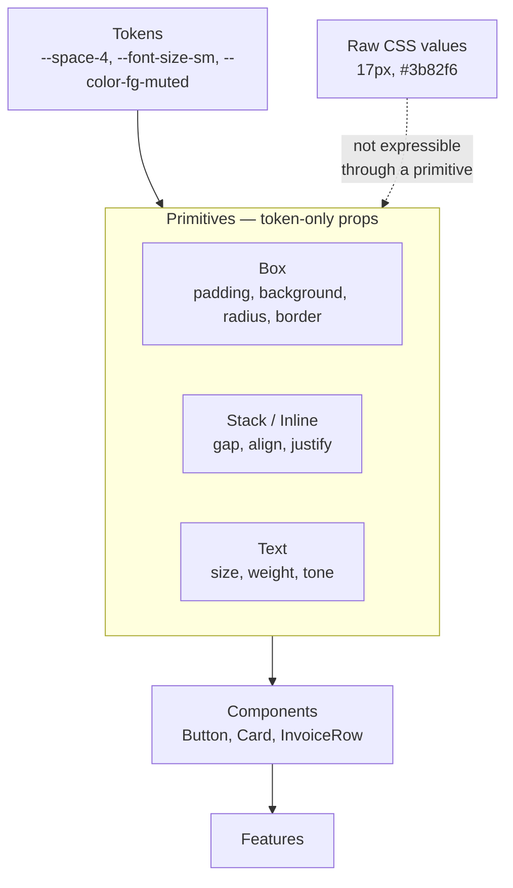

# Design Primitives

> Design primitives are the handful of low-level components everything else is built from — a box, a stack, a line of text. Their job is to make the design system's decisions the path of least resistance, and arbitrary values inconvenient.

**Part:** [04 · Interface Engineering](../) · **Domain:** Design Systems · **Priority:** High · **Difficulty:** Intermediate · **Reading time:** ~12 min

## TL;DR

A primitive is a component with no domain meaning that exposes a constrained slice of CSS: `Box` for a styled container, `Stack` for one-dimensional spacing, `Text` for typography. The value is not that they save typing — it is that their props are *tokens*, not values, so `<Stack gap="3">` compiles and `<Stack gap="13px">` does not. That converts spacing, type scale, and color from conventions that drift into a finite set the compiler enforces. Primitives earn their keep in systems with many contributors and a real token scale; in a small application with one designer and modern CSS, plain classes and custom properties do the same job with less machinery.

> **Recommendation:** Build primitives only after the token scales exist. Their props must accept token names, never raw CSS values, or they become a slower way to write inline styles.

## At a Glance

| | |
| --- | --- |
| **Use when** | Multiple teams build UI against a shared token scale and consistency keeps slipping. |
| **Avoid when** | One or two contributors, no token scale yet, or the design changes faster than the system. |
| **Alternatives** | Utility classes, plain CSS with custom properties, CSS modules — see [Alternative Approaches](#alternative-approaches). |
| **Primary risk** | Primitives that accept arbitrary CSS values, which reintroduce inline styles with extra steps. |
| **Maturity** | Stable. |

## Prerequisites

- [Specificity](../../01-core-languages/css/specificity.md) (`· CSS & Visual Systems`) — why primitives avoid the override wars that class-based systems fall into.
- [Prop Design & Contracts](../component-design/prop-design-and-contracts.md) (`· Component & Interaction Design`) — the union-type discipline that makes a primitive's props enforceable.

## Overview

A *design primitive* is a component that carries no domain meaning and exposes a deliberately narrow set of style controls, expressed in the design system's own vocabulary. The canonical set is small: a `Box` that renders an element with token-based padding, background, and border; a `Stack` that arranges children in one direction with a token gap; a `Text` that renders a string at a token size, weight, and color. Some systems add `Inline`, `Grid`, and `Divider`; very few need more than six.

The distinguishing property is *constraint*. A primitive is not a shortcut for writing CSS — it is a filter on which CSS can be written. `padding="4"` resolves to `var(--space-4)` and nothing else; there is no way to express `padding: 17px` through the primitive, and that is the feature. Every value that reaches the DOM is a token, so an audit of the design system's compliance becomes a type check rather than a survey.

This is distinct from two neighbors. *Tokens* are the values themselves — the scale of spacing steps, the type ramp, the color roles — and they exist independently of any component. *Components* like `Button` or `Card` carry domain meaning and are built *from* primitives. Primitives sit between: they know about tokens and nothing about the product.

## The Problem

A design system ships tokens as CSS custom properties and a Figma library, and the team writes ordinary CSS against them. Six months in, an audit of the codebase finds this:

```css
.invoice-header { margin-bottom: 24px; }
.invoice-summary { margin-bottom: 25px; }
.invoice-actions { margin-bottom: 1.5rem; }
.invoice-notes   { margin-bottom: var(--space-6); }
```

Four spacings that were meant to be one. Three of them are correct by accident and one is wrong by a pixel, and none of them can be changed centrally because only the last is expressed in the system's vocabulary. The token existed the whole time; nothing required its use.

The type scale has the same problem in a worse form. `font-size: 14px` appears 340 times, `0.875rem` 120 times, and `var(--font-size-sm)` 90 times. When the system moves the small size to 15px, one of those three groups updates.

Meanwhile the margins themselves are the second problem. Every component sets its own `margin-bottom`, so spacing depends on which components happen to be adjacent, collapsing margins produce gaps nobody specified, and removing a component from the middle of a page changes the spacing around it. There is no place where "the gap between items in this list" is stated, because the gap is distributed across the items.

And every fix is a review-time fix. A reviewer must notice `margin-bottom: 25px` among 400 changed lines — which is a task humans reliably fail at, especially on a Friday.

## Why It Matters

Consistency that depends on vigilance decays at a predictable rate. Each individual deviation is small and defensible ("it looked better with 25"), and none of them are caught, so the drift is monotonic. The only mechanism that reverses it is one that makes the deviation *harder to write than the correct value*, and a typed prop is the cheapest such mechanism available.

The compounding effect is on change. A design system's value proposition is that a decision made once propagates everywhere — the spacing scale tightens, the type ramp shifts, dark mode arrives. That propagation only reaches values expressed in the system's vocabulary. Every hard-coded `24px` is a place the redesign does not reach, discovered one screenshot at a time during QA.

Primitives also fix the ownership question for spacing specifically. When a component sets its own outer margin, it makes an assumption about its context that its author cannot verify — and the assumption breaks the moment it is reused elsewhere. Moving spacing into the parent (`Stack gap`) means each layout owns the space it creates, which is both correct and removes the margin-collapsing class of bug entirely.

There is a real limit worth stating plainly. Primitives are infrastructure, and infrastructure has to be maintained, documented, and learned. In a codebase with two contributors and a designer in the same room, the drift they prevent is smaller than the cost they impose. The honest condition for adopting them is: multiple teams, a real token scale, and observed drift that review is not catching.

## Mental Model

A primitive is a *narrow window onto CSS*. It exposes a few properties, and only in the system's units.



Two rules follow. First, **the layout owns the space, not the item**: gaps belong to `Stack`, not to `margin-bottom` on each child, which is what makes a component reusable in an unknown context. Second, **a primitive that accepts a raw CSS value is not a primitive** — `<Box padding="17px">` is an inline style object with an import, and it defeats the only thing primitives are for.

The corollary is about how many to build. Primitives compose, so a small set covers a very large surface: `Box` plus `Stack` plus `Text` handles most of a typical page. A system with fifteen primitives has usually started encoding product decisions in them, at which point they are components with confusing names.

## Best Practices

Define the token scales before writing any primitive. A primitive is a typed interface to a scale; without the scale there is nothing to type, and the props end up accepting strings.

Type props as token names, not CSS values. `gap: '0' | '1' | '2' | '3' | '4' | '6' | '8'` derived from the token object, so adding a token updates the type automatically and removing one produces compile errors at every use.

Give spacing to the container. `Stack` sets `gap`; children set nothing. This removes margin collapsing, makes the space visible in one place, and lets a child be moved anywhere without carrying assumptions about its neighbors.

Keep primitives free of domain meaning. `Box` knows about padding; it does not know about invoices. The moment a primitive has a product-specific prop, it has become a component and should be named as one.

Make them polymorphic. A `Stack` that renders `<ul>` when asked lets layout and semantics vary independently, so a list is not forced to be a `div` for the sake of spacing. See `Polymorphic Components (as) · Component & Interaction Design`.

Resolve tokens to CSS custom properties, not to values. Emitting `var(--space-4)` rather than `1rem` keeps theming, dark mode, and density switching working at runtime with no re-render.

Do not accept `className` or `style`. An escape hatch on a primitive is an escape hatch on the entire system, because every component is built from primitives. If an exception is genuinely needed, add a token.

Keep the set under six. Every primitive is a concept every contributor must learn; the compounding value comes from composition, not from coverage.

Document by example, not by prop table. Primitives are learned from three real layouts far faster than from an API reference.

## Trade-offs

Primitives trade the full expressiveness of CSS for guaranteed consistency. That trade is good exactly when uncontrolled expressiveness is the problem you have.

**Advantages**

- Off-scale values are compile errors, so drift is prevented rather than reviewed.
- Token changes propagate everywhere, because everything is expressed in tokens.
- Spacing lives in the layout, eliminating margin collapsing and context-dependent components.
- Layout intent is readable in the markup without opening a stylesheet.
- Theming and density work at runtime, since primitives emit custom properties.

**Disadvantages**

- A new abstraction layer to build, document, version, and teach.
- Genuinely one-off designs require either a new token or an escape hatch that weakens the system.
- Style information moves into JSX, which some teams find harder to scan than a stylesheet.
- Component-per-element adds runtime overhead and depth to the tree, which matters in very large lists.
- Poorly designed primitives (raw-value props) are worse than the CSS they replaced.

| Dimension | Primitives | Cost / caveat |
| --- | --- | --- |
| Consistency | Enforced by the type system | Only for properties the primitives expose |
| Change propagation | Token change reaches everything | Requires no raw values anywhere |
| Flexibility | Deliberately bounded | One-offs need a token or an exception |
| Learning curve | Small set, composes widely | Still a system contributors must learn |
| Runtime cost | One component per element | Noticeable only in very large trees |

## Alternative Approaches

Every option here solves the same problem — constraining which values reach the DOM — and they differ in where the constraint is enforced.

| Approach | Best when | Weakness | See |
| --- | --- | --- | --- |
| Primitives (this article) | Multiple teams, established tokens, observed drift | An abstraction layer to maintain | (this article) |
| Utility classes | You want constraint without a component layer | Long class strings; enforcement is lint-based | `Token Architecture · Design Systems` |
| CSS custom properties + plain CSS | Small teams, CSS-comfortable contributors | Nothing prevents a raw value | [Custom Properties](../../01-core-languages/css/custom-properties.md) (`· CSS & Visual Systems`) |
| CSS modules with scoped classes | Component-local styles, no shared vocabulary needed | Consistency is convention only | `Component & Interaction Design` |
| Native CSS layout only (`gap`, `flex`) | Modern baseline, no token enforcement needed | No compile-time constraint at all | [The Box Model](../../01-core-languages/css/the-box-model.md) (`· CSS & Visual Systems`) |

## Bad Example

Primitives that accept CSS values — the most common way this pattern is implemented and the way that provides no benefit.

```tsx
// ❌ A "primitive" whose props are CSS. This is inline styles with an import.
interface BoxProps {
  padding?: string;
  margin?: string;
  background?: string;
  display?: string;
  gap?: string;
  children: React.ReactNode;
  className?: string;
  style?: React.CSSProperties;
}

export function Box({ padding, margin, background, display, gap, style, ...rest }: BoxProps) {
  return (
    <div
      style={{ padding, margin, background, display, gap, ...style }}
      {...rest}
    />
  );
}

// ❌ (1) Every value here type-checks, and not one of them is a token.
//        The design system has no idea any of this exists.
<Box padding="17px" background="#3b82f6" margin="0 0 25px 0">
  <Box display="flex" gap="13px">
    {/* ❌ (2) style and className are still available, so even a
            well-typed prop can be overridden anywhere. */}
    <Box style={{ fontSize: 15, color: 'rgb(20, 20, 20)' }}>Invoice total</Box>
  </Box>
</Box>;

// ❌ (3) Spacing on the child: this component now assumes it has a sibling
//        below it, and breaks when it is the last item or is reused elsewhere.
function InvoiceSummary() {
  return <Box margin="0 0 24px 0">…</Box>;
}
```

**What goes wrong:** The primitives compile, render, and constrain nothing. `17px`, `#3b82f6`, and `13px` are invisible to any token audit, and none of them will move when the design system changes. Because `style` is accepted, even the props that *are* typed can be bypassed. And the outer margin on `InvoiceSummary` makes it context-dependent: it is correct in one layout and wrong in every other, which is a bug that only appears on reuse.

## Good Example

Primitives whose props are the token scale, with spacing owned by the layout.

```ts
// tokens.ts — the scale is the source of truth, and the types derive from it.
export const space = {
  '0': '0',
  '1': 'var(--space-1)',   // 4px
  '2': 'var(--space-2)',   // 8px
  '3': 'var(--space-3)',   // 12px
  '4': 'var(--space-4)',   // 16px
  '6': 'var(--space-6)',   // 24px
  '8': 'var(--space-8)',   // 32px
  '12': 'var(--space-12)', // 48px
} as const;

export const fontSize = {
  xs: 'var(--font-size-xs)',
  sm: 'var(--font-size-sm)',
  md: 'var(--font-size-md)',
  lg: 'var(--font-size-lg)',
  xl: 'var(--font-size-xl)',
} as const;

export const foreground = {
  default: 'var(--color-fg-default)',
  muted: 'var(--color-fg-muted)',
  critical: 'var(--color-fg-critical)',
  onFill: 'var(--color-fg-on-fill)',
} as const;

// ✅ Types derived from the scale: adding a token updates every prop type,
//    and removing one produces compile errors at every use site.
export type Space = keyof typeof space;
export type FontSize = keyof typeof fontSize;
export type Foreground = keyof typeof foreground;
```

```tsx
// Stack.tsx — the layout owns the space between its children.
import { type ElementType, type ComponentPropsWithoutRef, type ReactNode } from 'react';
import { space, type Space } from './tokens';

type StackProps<T extends ElementType> = {
  /** ✅ Token names only. gap="13px" does not compile. */
  gap?: Space;
  direction?: 'vertical' | 'horizontal';
  align?: 'start' | 'center' | 'end' | 'stretch';
  justify?: 'start' | 'center' | 'end' | 'between';
  /** ✅ Polymorphic: a list can be a <ul> and still use the layout. */
  as?: T;
  children: ReactNode;
} & Omit<ComponentPropsWithoutRef<T>, 'className' | 'style' | 'children'>;
//    ✅ className and style are removed from the surface entirely, so the
//       constraint cannot be bypassed by any caller.

export function Stack<T extends ElementType = 'div'>({
  gap = '0', direction = 'vertical', align, justify, as, children, ...rest
}: StackProps<T>) {
  const Component = (as ?? 'div') as ElementType;

  return (
    <Component
      // ✅ Resolves to var(--space-4), not to 16px — so theming and density
      //    switching work at runtime with no re-render.
      style={{
        display: 'flex',
        flexDirection: direction === 'vertical' ? 'column' : 'row',
        gap: space[gap],
        alignItems: align && ALIGN[align],
        justifyContent: justify && JUSTIFY[justify],
      }}
      {...rest}
    >
      {children}
    </Component>
  );
}

const ALIGN = { start: 'flex-start', center: 'center', end: 'flex-end', stretch: 'stretch' } as const;
const JUSTIFY = { start: 'flex-start', center: 'center', end: 'flex-end', between: 'space-between' } as const;
```

```tsx
// Text.tsx — typography as a token contract, with semantics kept separate.
import { fontSize, foreground, type FontSize, type Foreground } from './tokens';

interface TextProps {
  size?: FontSize;
  tone?: Foreground;
  weight?: 'regular' | 'medium' | 'bold';
  /** ✅ The visual size and the semantic element vary independently, so an
   *     <h2> can look small without misusing heading levels for styling. */
  as?: 'p' | 'span' | 'h1' | 'h2' | 'h3' | 'h4' | 'strong' | 'label';
  children: React.ReactNode;
}

export function Text({ size = 'md', tone = 'default', weight = 'regular', as: Component = 'p', children }: TextProps) {
  return (
    <Component
      style={{
        fontSize: fontSize[size],
        color: foreground[tone],
        fontWeight: `var(--font-weight-${weight})`,
        margin: 0, // ✅ Text never sets outer spacing; Stack owns that.
      }}
    >
      {children}
    </Component>
  );
}
```

```tsx
// ✅ Composed. Every value is a token, the spacing is stated once in the
//    layout, and none of these components assume anything about context.
function InvoiceSummary({ invoice }: { invoice: Invoice }) {
  return (
    <Stack gap="4">
      <Text as="h2" size="lg" weight="bold">
        {invoice.reference}
      </Text>

      <Stack direction="horizontal" gap="2" justify="between">
        <Text tone="muted">Amount due</Text>
        <Text weight="medium">{formatCurrency(invoice.amount, invoice.currency)}</Text>
      </Stack>

      {invoice.isOverdue && (
        <Text size="sm" tone="critical">
          Overdue since {formatDate(invoice.dueDate)}
        </Text>
      )}
    </Stack>
  );
}

// ✅ All compile errors, caught in the editor rather than in a design review:
<Stack gap="13px">…</Stack>;      // not a token
<Stack gap="5">…</Stack>;         // 5 is not on the scale
<Text size="15px">…</Text>;       // not a token
<Text className="mt-4">…</Text>;  // className is not part of the surface
```

**Why it's better:** No value in the rendered output originates outside the token scale, so a scale change reaches all of it. The spacing between the summary's parts is stated once, in the `Stack`, so removing the overdue line does not leave a stray margin behind and `Text` can be moved into any layout unchanged. And because tokens resolve to custom properties, switching to dark mode or a compact density is a change to `:root`, not a re-render.

## Production Example

The case that separates a usable primitive set from an academic one is responsive values. A `gap` that differs by breakpoint is a genuine need, and the tempting solutions — a `gapSm`/`gapMd`/`gapLg` prop trio, or accepting a media query string — both break the constraint.

```tsx
import { space, type Space } from './tokens';

/**
 * A responsive value is either a single token or a token per breakpoint.
 * Both forms stay inside the scale, which is the invariant worth protecting:
 * making a prop responsive must not make it accept arbitrary CSS.
 */
type Responsive<T> = T | { base: T; sm?: T; md?: T; lg?: T };

const BREAKPOINTS = { sm: '640px', md: '768px', lg: '1024px' } as const;
type Breakpoint = keyof typeof BREAKPOINTS;

/**
 * Resolution happens through CSS custom properties rather than by generating
 * a class per combination. The alternative — emitting `@media` rules from JS —
 * either needs a runtime style sheet (a rendering cost on every mount) or a
 * build-time extractor (which cannot see dynamic values). Setting a variable
 * per breakpoint keeps the media queries static and in the stylesheet, where
 * the browser can evaluate them without any JavaScript involvement.
 */
function responsiveVars<T extends string>(
  name: string,
  value: Responsive<T> | undefined,
  scale: Record<T, string>,
): Record<string, string> {
  if (value === undefined) return {};

  if (typeof value === 'string') {
    return { [`--${name}-base`]: scale[value] };
  }

  const vars: Record<string, string> = { [`--${name}-base`]: scale[value.base] };
  for (const bp of Object.keys(BREAKPOINTS) as Breakpoint[]) {
    const token = value[bp];
    if (token !== undefined) vars[`--${name}-${bp}`] = scale[token];
  }
  return vars;
}

interface StackProps {
  gap?: Responsive<Space>;
  direction?: Responsive<'vertical' | 'horizontal'>;
  children: React.ReactNode;
}

export function Stack({ gap, direction = 'vertical', children }: StackProps) {
  return (
    <div
      className="stack"
      style={{
        ...responsiveVars('stack-gap', gap, space),
        ...responsiveVars('stack-dir', direction, {
          vertical: 'column',
          horizontal: 'row',
        }),
      } as React.CSSProperties}
    >
      {children}
    </div>
  );
}
```

```css
/* stack.css — static, cacheable, and evaluated by the browser's cascade.
   Each breakpoint falls back to the previous one, so `{ base: '2', lg: '6' }`
   correctly keeps `2` at sm and md without the caller restating it. */
.stack {
  display: flex;
  flex-direction: var(--stack-dir-base, column);
  gap: var(--stack-gap-base, 0);
}

@media (min-width: 640px) {
  .stack {
    flex-direction: var(--stack-dir-sm, var(--stack-dir-base, column));
    gap: var(--stack-gap-sm, var(--stack-gap-base, 0));
  }
}

@media (min-width: 768px) {
  .stack {
    flex-direction: var(--stack-dir-md, var(--stack-dir-sm, var(--stack-dir-base, column)));
    gap: var(--stack-gap-md, var(--stack-gap-sm, var(--stack-gap-base, 0)));
  }
}

@media (min-width: 1024px) {
  .stack {
    flex-direction: var(--stack-dir-lg, var(--stack-dir-md, var(--stack-dir-sm, var(--stack-dir-base, column))));
    gap: var(--stack-gap-lg, var(--stack-gap-md, var(--stack-gap-sm, var(--stack-gap-base, 0))));
  }
}
```

```tsx
// ✅ Responsive, and still impossible to write an off-scale value.
<Stack gap={{ base: '2', md: '4', lg: '6' }} direction={{ base: 'vertical', md: 'horizontal' }}>
  <InvoiceFilters />
  <InvoiceTable />
</Stack>
```

The chained `var()` fallbacks are the detail that makes this correct rather than merely working. Without them, specifying only `base` and `lg` would reset the gap at `sm` and `md` to the default instead of inheriting `base` — the classic responsive-props bug, and one that only appears on the two breakpoints nobody tests.

## Common Mistakes

See the [Design Systems anti-patterns](../../../anti-patterns/#design-systems) for the domain catalog. Concept-specific:

### Mistake: Primitives that accept CSS values

- **Symptom:** `<Box padding="17px">` type-checks.
- **Why it fails:** The primitive constrains nothing, so it is inline styles with an import and an extra component in the tree.
- **Fix:** Type props as keys of the token object, so only scale values compile.

### Mistake: `className` or `style` on a primitive

- **Symptom:** A design system component whose rendered styles do not match its props.
- **Why it fails:** Because everything is built from primitives, an escape hatch on a primitive is an escape hatch on the whole system.
- **Fix:** Omit both from the props type; add a token when a real gap in the system appears.

### Mistake: Spacing set by the child

- **Symptom:** Components with `margin-bottom`, and stray gaps when one is removed or moved.
- **Why it fails:** The child asserts something about a context it cannot see, so it is correct only in the layout it was written for.
- **Fix:** Give the gap to the parent `Stack`; children set no outer spacing.

### Mistake: Building primitives before tokens

- **Symptom:** Primitive props typed as `string`, with a comment about which values are allowed.
- **Why it fails:** There is no scale to type against, so the prop degrades into free-form CSS.
- **Fix:** Define the scales first; derive the prop types from them.

### Mistake: Domain meaning in a primitive

- **Symptom:** `<Box variant="invoice-header">`.
- **Why it fails:** The primitive now encodes product knowledge, so it changes when the product changes and cannot be reused across contexts.
- **Fix:** Build a named component from primitives instead.

### Mistake: Too many primitives

- **Symptom:** Fifteen layout components, and contributors asking which one to use.
- **Why it fails:** The value comes from composing a few well-understood pieces; a large set is a second system to learn.
- **Fix:** Collapse to `Box`, `Stack`, `Inline`, `Grid`, and `Text`, and build the rest by composition.

## Checklist

- [ ] Token scales exist and are the single source of truth for values.
- [ ] Every primitive prop is typed as a key of a token object.
- [ ] No primitive accepts `className` or `style`.
- [ ] Tokens resolve to CSS custom properties, not to literal values.
- [ ] Spacing is set by layout primitives; children set no outer margin.
- [ ] Primitives are polymorphic, so semantics and layout vary independently.
- [ ] No primitive contains product or domain vocabulary.
- [ ] The primitive set is small enough to list from memory.
- [ ] Responsive props accept token values per breakpoint, with correct fallback chaining.
- [ ] Adding or removing a token produces compile errors at every affected use.

## Related Articles

- [Custom Properties](../../01-core-languages/css/custom-properties.md) — the mechanism tokens are delivered through (`· CSS & Visual Systems`).
- [Cascade Layers (`@layer`)](../../01-core-languages/css/cascade-layers-layer.md) — keeping system styles below product overrides (`· CSS & Visual Systems`).
- [The Box Model](../../01-core-languages/css/the-box-model.md) — what `Box` and `Stack` are abstracting over (`· CSS & Visual Systems`).
- [Prop Design & Contracts](../component-design/prop-design-and-contracts.md) — the typing discipline primitives depend on (`· Component & Interaction Design`).
- [Inheritance and Initial Values](../../01-core-languages/css/inheritance-and-initial-values.md) — why `Text` must not rely on inherited sizes (`· CSS & Visual Systems`).

## References

- [MDN — Using CSS custom properties](https://developer.mozilla.org/en-US/docs/Web/CSS/CSS_cascading_variables/Using_CSS_custom_properties) — including the fallback chaining the responsive example relies on.
- [Every Layout — The Stack](https://every-layout.dev/layouts/stack/) — the argument for spacing owned by the layout rather than the item.
