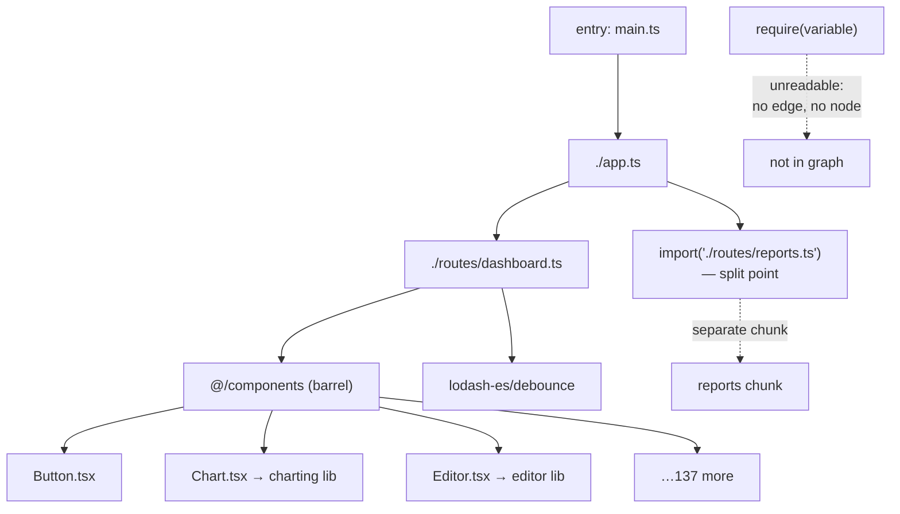

# The Dependency Graph

> A bundler's first job is to walk your imports and build a graph. Everything it can do afterwards — splitting, tree shaking, ordering — is a query against that graph, so anything the graph cannot see, the bundler cannot optimize.

**Part:** [06 · Engineering Systems](../) · **Domain:** Build Systems & Tooling · **Priority:** High · **Difficulty:** Intermediate · **Reading time:** ~12 min

## TL;DR

Starting from each entry point, the bundler parses a module, records its imports, resolves each one to a file, and repeats. The result is a directed graph of modules, and every later decision reads from it: which modules are unreachable (dead code), which are shared by multiple entries (a common chunk), where a `import()` creates a split point, and what order side effects run in. The graph is built by *static analysis*, so it only sees what is statically written: `import x from 'y'` is a node, and `require(someVariable)` is a wall. The two things that most often go wrong are barrel files, which pull an entire module's worth of graph in for one export, and side effects, which prevent the bundler from removing code it can prove is unused.

> **Recommendation:** Import from specific paths rather than barrels, mark packages `"sideEffects": false` when true, and read the bundle analysis before optimizing anything — the graph will tell you where the weight is, and it is rarely where you guessed.

## At a Glance

| | |
| --- | --- |
| **Use when** | Diagnosing bundle size, configuring code splitting, or publishing a tree-shakeable package. |
| **Avoid when** | Never — every bundler builds one, whether or not you look at it. |
| **Alternatives** | Unbundled ESM and import maps skip the build graph — see [Alternative Approaches](#alternative-approaches). |
| **Primary risk** | Imports the analyzer cannot follow, or side effects that block elimination of provably dead code. |
| **Maturity** | Stable. |

## Prerequisites

- [Primitives & Wrappers](../../01-core-languages/javascript/primitives-and-wrappers.md) (`· JavaScript`) — module scope and what "module-level state" means for evaluation order.
- [Dependency Resolution](../package-architecture/dependency-resolution.md) (`· Package Architecture`) — how a bare specifier becomes a file path before it can become a graph node.

## Overview

The *module dependency graph* is the data structure a bundler builds before it emits anything. Each node is a module — one file, resolved to an absolute path — and each edge is an import. The graph has one root per entry point, and traversal proceeds depth-first: parse a module, extract its import declarations, resolve each specifier to a file, recurse.

Two properties of the graph determine everything downstream. It is built by **static analysis**, meaning the bundler reads the syntax without executing it. And ES module syntax is **statically analyzable by design**: `import` declarations must appear at the top level with literal specifiers, precisely so tools can know a module's dependencies without running it. CommonJS `require()` is a function call that can take any expression, which is why bundlers can do far less with it.

Once the graph exists, the optimizations are graph operations. Dead code elimination removes nodes no live edge reaches. Code splitting cuts the graph at dynamic `import()` boundaries. Chunking groups nodes that are reachable from the same set of entries. Scope hoisting concatenates nodes with a single parent. None of these are separate analyses — they are questions asked of one structure.

## The Problem

A team ships a date picker. The bundle grows by 210 KB, and the date picker is 12 KB.

The cause is one line:

```ts
import { DatePicker } from '@/components';
```

`@/components/index.ts` is a barrel that re-exports 140 components. The bundler resolves the import, reads the barrel, and adds all 140 to the graph — along with everything *they* import: a charting library, a rich text editor, a PDF renderer. Tree shaking can remove some of it, but only where every module in the chain is side-effect-free, and one of them imports a CSS file at the top level. So most of it stays.

Elsewhere, a module tries to be clever:

```ts
const locale = navigator.language.split('-')[0];
const messages = await import(`./locales/${locale}.json`);
```

The bundler cannot know what `locale` will be, so it takes the only safe option: it includes every file matching `./locales/*.json` — all 40 of them, in separate chunks — and the developer who wrote this believes they implemented lazy loading.

And a third module does this:

```ts
const analytics = require(config.analyticsProvider);
```

Here the bundler cannot do anything at all. The specifier is a runtime value, so there is no edge to add, and the module simply is not in the graph. It works in development, where the file is on disk, and throws in production, where only bundled output exists.

Three bugs, one root cause: a mismatch between what the developer meant and what the graph could see.

## Why It Matters

The graph is the boundary of the bundler's knowledge, so it is also the boundary of every optimization. Code that is in the graph ships whether or not it runs; code that is not in the graph cannot ship even if it is needed. Both failure directions are common and neither produces a clear error — the first shows up as an unexplained bundle size, the second as a runtime `Cannot find module` in production only.

Barrel files deserve specific attention because they are recommended by nearly every "clean architecture" article and they are the single most common cause of frontend bundle bloat. The mechanism is not subtle: importing one name from a module that re-exports 140 puts all 140 in the graph, and whether any get removed depends on a chain of side-effect analysis that one stray CSS import can break. The cost is invisible in the source — the import line looks identical to a direct one — and appears only in a bundle report.

Graph shape also determines splitting quality. If a utility is imported by two routes, it belongs in a shared chunk; if by one, it belongs in that route's chunk. The bundler computes this from reachability, so a barrel that makes everything reachable from everything produces one large common chunk and defeats route-level splitting entirely. Teams frequently conclude that code splitting "doesn't work in our app" when what is actually true is that their import style has made every module reachable from every entry.

And build time follows graph size directly. A graph with 8,000 modules takes longer to parse, transform, and traverse than one with 2,000, on every cold build and every developer's machine, every day.

## Mental Model

Think of the bundler as a crawler that only follows links it can read. The links it can read are static `import` declarations with literal specifiers. Everything else is either a guess or a dead end.



Three rules explain most outcomes. First, **an edge to a barrel is an edge to everything it re-exports**; the graph does not know you only wanted one name until tree shaking runs, and tree shaking runs later and can be blocked. Second, **`import()` is where the graph is cut**, and it is the only place a bundler will split by default. Third, **a specifier the analyzer cannot evaluate produces either a wildcard match or nothing** — a template literal becomes "every file that could match," and a variable becomes no edge at all.

Side effects are the fourth rule and the subtlest. A module has side effects if importing it *does* something — registers a polyfill, injects CSS, mutates a global. A bundler cannot remove a module with side effects even when none of its exports are used, because removing it would change behavior. `"sideEffects": false` in `package.json` is the assertion that lets the bundler drop unused modules from that package, and it is the difference between tree shaking working and appearing to do nothing.

## Best Practices

Import from the specific module, not the barrel. `import { Button } from '@/components/Button'` adds one node; `from '@/components'` adds every node the barrel touches.

Declare `"sideEffects"` honestly in every package you publish. `false` when no module does anything on import; an array of globs (`["*.css", "./src/polyfills.ts"]`) when some do. Getting this wrong in either direction is expensive — too broad and nothing is shaken, too narrow and a needed polyfill is removed.

Use `import()` only where you want a chunk boundary. Every dynamic import is a network request the user may pay for; splitting at a component that always renders costs a round trip for nothing.

Keep dynamic specifiers analyzable, or make them explicit. If the path is computed, use an explicit map of static imports rather than a template literal, so the graph contains exactly what you intend.

Prefer ESM builds of dependencies. A package that ships only CommonJS cannot be tree-shaken meaningfully; check the `module` or `exports` field before adopting a large one.

Read the bundle analysis before optimizing. `rollup-plugin-visualizer`, `webpack-bundle-analyzer`, or `vite build --mode analyze` shows the graph as it actually resolved, which is regularly not what the source suggests.

Set a size budget per entry chunk in CI. A budget converts "the bundle feels big" into a build failure attached to the pull request that caused it.

Avoid circular imports. They are legal and usually work, but they force the bundler into a specific evaluation order and produce `undefined` at module-evaluation time in ways that are hard to trace.

Import only the functions you use from utility libraries. `import { debounce } from 'lodash-es'` shakes; `import _ from 'lodash'` does not, because the CommonJS build has no analyzable exports.

## Trade-offs

Building a graph ahead of time buys optimization at the cost of a build step and a set of rules the source must follow to stay analyzable.

**Advantages**

- Unreachable code can be proven unreachable and removed.
- Shared modules are identified automatically and hoisted into common chunks.
- Split points are explicit in the source and produce predictable chunk boundaries.
- Evaluation order is known ahead of time, so scope hoisting and minification are safe.

**Disadvantages**

- Dynamic specifiers are either over-included or invisible; both are silent.
- Barrel files inflate the graph in a way that is invisible at the import site.
- Side-effect analysis is conservative, so one unmarked module can block elimination across a package.
- Build time scales with graph size, and the graph grows faster than the source.
- CommonJS dependencies limit what the analysis can conclude.

| Dimension | Static graph | Cost / caveat |
| --- | --- | --- |
| Dead code | Removable when provably unreachable | Blocked by unmarked side effects |
| Splitting | Automatic at `import()` boundaries | Only where the source declares them |
| Dynamic imports | Wildcard-matched or missing | Silent in both failure directions |
| Build time | Proportional to graph size | Barrels multiply it without adding features |
| Correctness | Evaluation order is deterministic | Circular edges produce surprising `undefined` |

## Alternative Approaches

The alternatives are about whether a graph is built at all, and when.

| Approach | Best when | Weakness | See |
| --- | --- | --- | --- |
| Static graph, bundled (this article) | Production builds where size and requests matter | Build step; analyzability constraints on source | (this article) |
| Unbundled ESM in development | Fast cold starts; only changed modules are re-served | Many requests; not viable for production | `Bundler Models · Build Systems & Tooling` |
| Import maps, no build | Small apps, no transpilation needed | No tree shaking, no splitting, manual version pinning | `Module Formats (ESM/CJS/UMD) · Package Architecture` |
| Module federation | Independently deployed apps sharing dependencies | Shared-dependency version negotiation at runtime | `Micro-Frontends · Frontend Architecture` |
| Per-file compilation, no graph | Libraries publishing one file per module | Consumers do the bundling; no cross-module optimization | `Entry Points & Output · Build Systems & Tooling` |

## Bad Example

Import patterns that defeat the analysis, each one looking entirely reasonable in review.

```ts
// ❌ src/components/index.ts — a barrel over 140 components.
export * from './Button';
export * from './Chart';       // → pulls in a 180 KB charting library
export * from './RichEditor';  // → pulls in a 240 KB editor
export * from './PdfViewer';   // → pulls in a PDF renderer
// …136 more
```

```ts
// ❌ src/routes/Dashboard.tsx
// ❌ (1) One name requested, 140 modules added to the graph. The import
//        line is indistinguishable from a direct one, so review never
//        catches it; only the bundle report does.
import { Button } from '@/components';

// ❌ (2) The CommonJS build has no analyzable exports, so the whole of
//        lodash ships to remove one function's worth of code.
import _ from 'lodash';

// ❌ (3) A template literal specifier: the bundler cannot evaluate `locale`,
//        so it includes every file matching ./locales/*.json — 40 chunks —
//        and the author believes this is lazy loading.
const locale = navigator.language.split('-')[0];
const messages = await import(`../locales/${locale}.json`);

// ❌ (4) A runtime value as a specifier. There is no edge, so the module is
//        not in the graph at all. Works in dev; throws in production.
const analytics = require(window.__CONFIG__.analyticsProvider);

export function Dashboard() {
  const onSearch = _.debounce(handleSearch, 300);
  return <Button onClick={onSearch}>Search</Button>;
}
```

```jsonc
// ❌ package.json of an internal shared package
{
  "name": "@acme/shared",
  "main": "./dist/index.js"
  // ❌ (5) No "sideEffects" field, so the bundler must assume every module
  //        might do something on import and cannot drop any of them —
  //        tree shaking appears to be broken, and the config gets blamed.
}
```

**What goes wrong:** The dashboard route's chunk contains a charting library, a rich text editor, and a PDF renderer that no user of that route will ever see. Forty locale files are emitted as chunks when one was intended. The analytics module is missing from the build entirely, and the failure appears only in production. And because `@acme/shared` makes no side-effect claim, none of it can be shaken even where the graph proves it unused.

## Good Example

The same code written so the graph contains what the author meant.

```ts
// ✅ src/routes/Dashboard.tsx
// ✅ One node, one edge. The 139 other components are not in this graph.
import { Button } from '@/components/Button';

// ✅ ESM build with named exports: only `debounce` and its internal
//    dependencies are reachable, so only they ship.
import { debounce } from 'lodash-es';

// ✅ An explicit map of static imports. Every entry is analyzable, so the
//    bundler emits exactly these chunks — no wildcard, no surprises — and
//    an unsupported locale is a typed error rather than a 404 at runtime.
const LOCALE_LOADERS = {
  en: () => import('../locales/en.json'),
  fr: () => import('../locales/fr.json'),
  de: () => import('../locales/de.json'),
  fa: () => import('../locales/fa.json'),
} as const;

type SupportedLocale = keyof typeof LOCALE_LOADERS;

function resolveLocale(preferred: readonly string[]): SupportedLocale {
  for (const tag of preferred) {
    const base = tag.split('-')[0];
    if (base in LOCALE_LOADERS) return base as SupportedLocale;
  }
  return 'en';
}

export async function loadMessages(): Promise<Messages> {
  const locale = resolveLocale(navigator.languages);
  const module = await LOCALE_LOADERS[locale]();
  return module.default;
}

// ✅ A static import with a real chunk boundary: analytics is in the graph,
//    in its own chunk, loaded only when consent has been given.
export async function initAnalytics(consented: boolean) {
  if (!consented) return;
  const { track } = await import('../analytics/provider');
  track('session_start');
}

export function Dashboard() {
  const onSearch = debounce(handleSearch, 300);
  return <Button onClick={onSearch}>Search</Button>;
}
```

```jsonc
// ✅ package.json of the shared package
{
  "name": "@acme/shared",
  "type": "module",
  // ✅ ESM first so the analyzer sees real export declarations; CJS kept
  //    for consumers that need it.
  "exports": {
    ".": { "import": "./dist/index.js", "require": "./dist/index.cjs" },
    // ✅ Subpath exports let consumers skip the barrel entirely.
    "./*": { "import": "./dist/*.js", "require": "./dist/*.cjs" }
  },
  // ✅ The honest claim: only these files do something on import.
  //    Everything else may be dropped when unused.
  "sideEffects": ["*.css", "./dist/polyfills.js"]
}
```

```ts
// ✅ eslint.config.js — the rule that keeps barrel imports from returning
//    the next time someone reaches for autocomplete.
export default [{
  rules: {
    'no-restricted-imports': ['error', {
      patterns: [{
        group: ['@/components', '@/components/index', '@acme/shared'],
        message: 'Import the specific module: @/components/Button, not the barrel.',
      }],
    }],
  },
}];
```

**Why it's better:** The dashboard chunk contains a button, not an editor and a PDF renderer. Four locale chunks are emitted instead of forty, and requesting an unsupported one is a compile error rather than a production 404. The analytics module is in the graph and in its own chunk, so it exists in the build and loads only after consent. And `"sideEffects"` tells the bundler exactly which modules it may drop, which is what makes tree shaking do anything at all.

## Production Example

The most useful thing to automate is not size — it is *what is in each chunk*. A budget catches growth; a chunk-content assertion catches the specific regression that a barrel import reintroduces, and does so with a message that names the fix.

```js
// scripts/check-graph.mjs — run against the build's module metadata.
import { readFile } from 'node:fs/promises';

/**
 * Rollup and Vite emit a manifest describing which modules ended up in which
 * chunk. Asserting against that is far more durable than asserting on byte
 * counts: a size budget tells you the bundle grew, this tells you which
 * import did it, which is the part a developer can act on.
 */
const meta = JSON.parse(await readFile('dist/.vite/manifest.json', 'utf8'));

const RULES = [
  {
    // The regression this exists to prevent: a heavy dependency reachable
    // from the entry chunk, almost always via a barrel import.
    chunk: /^assets\/index-/,
    forbid: [/node_modules\/(chart\.js|quill|pdfjs-dist)/],
    hint: 'Reached from the entry chunk. Import the component directly rather than from @/components, or move it behind a dynamic import().',
  },
  {
    // Locale files must never be in a static chunk: they are per-user, and
    // bundling them ships 40 languages to every visitor.
    chunk: /^assets\/index-/,
    forbid: [/src\/locales\/.*\.json/],
    hint: 'Locales must load through LOCALE_LOADERS, not a static import.',
  },
];

let failed = false;

for (const [file, chunk] of Object.entries(meta)) {
  for (const rule of RULES) {
    if (!rule.chunk.test(chunk.file ?? file)) continue;

    // `modules` lists every source module the chunk absorbed — the graph
    // as it actually resolved, rather than as the source implies.
    for (const moduleId of chunk.modules ?? []) {
      const violation = rule.forbid.find((pattern) => pattern.test(moduleId));
      if (!violation) continue;

      failed = true;
      console.error(`\n✖ ${moduleId}`);
      console.error(`  ended up in ${chunk.file ?? file}`);
      console.error(`  ${rule.hint}`);

      // The import chain is what makes this actionable. Without it the
      // developer knows a module is present but not which line put it there,
      // and finding out by bisecting imports takes an afternoon.
      const chain = chunk.imports?.filter((id) => id.includes(moduleId));
      if (chain?.length) console.error(`  reached via: ${chain.join(' › ')}`);
    }
  }
}

process.exit(failed ? 1 : 0);
```

Two things make this worth maintaining. The rules name *modules*, not sizes, so the failure message describes a cause rather than a symptom — "chart.js is in your entry chunk, import Chart directly" is fixable in a minute, while "the bundle grew 180 KB" is a research project. And it runs on the manifest, which reflects the graph the bundler actually built, including everything a barrel dragged in that the source never mentions.

## Common Mistakes

See the [Build Systems & Tooling anti-patterns](../../../anti-patterns/#build-systems-tooling) for the domain catalog. Concept-specific:

### Mistake: Importing through a barrel

- **Symptom:** Adding one small component grows the bundle by hundreds of kilobytes.
- **Why it fails:** The edge is to the barrel, so everything it re-exports enters the graph, and removal depends on a side-effect chain that is easily broken.
- **Fix:** Import the specific module, and enforce it with `no-restricted-imports`.

### Mistake: A missing or wrong `"sideEffects"` field

- **Symptom:** Tree shaking appears to do nothing; unused exports still ship.
- **Why it fails:** Without the claim the bundler must assume every module does something on import and cannot drop any of them.
- **Fix:** Set `"sideEffects": false`, or list the globs that genuinely have effects.

### Mistake: A template literal as a dynamic import specifier

- **Symptom:** Dozens of unexpected chunks in the output directory.
- **Why it fails:** The analyzer cannot evaluate the expression, so it includes every file that could match the pattern.
- **Fix:** Use an explicit object of static `import()` thunks.

### Mistake: A runtime value as a specifier

- **Symptom:** `Cannot find module` in production only.
- **Why it fails:** There is no analyzable edge, so the module never enters the graph and is never emitted.
- **Fix:** Enumerate the possibilities as static imports and select among them.

### Mistake: Default-importing a CommonJS utility library

- **Symptom:** `lodash` appears whole in the bundle despite one function being used.
- **Why it fails:** CommonJS exports are computed at runtime, so the analyzer cannot prove which are unused.
- **Fix:** Use the ESM build (`lodash-es`) with named imports.

### Mistake: Circular imports

- **Symptom:** A module-level constant is `undefined` at evaluation time, depending on which file was imported first.
- **Why it fails:** A cycle forces the bundler to pick an evaluation order, and one participant necessarily sees the other before it has initialized.
- **Fix:** Extract the shared piece into a third module that both import.

## Checklist

- [ ] No application code imports from a barrel; a lint rule enforces it.
- [ ] Every published package declares `"sideEffects"` accurately.
- [ ] Dynamic imports use literal specifiers or an explicit loader map.
- [ ] No specifier is a runtime value.
- [ ] Utility libraries are imported by name from their ESM builds.
- [ ] There are no circular imports (checked in CI).
- [ ] A size budget for each entry chunk fails the build when exceeded.
- [ ] Heavy dependencies are asserted absent from the entry chunk.
- [ ] The bundle analysis is read before any size optimization work starts.
- [ ] `import()` appears only where a chunk boundary is wanted.

## Related Articles

- [Dependency Resolution](../package-architecture/dependency-resolution.md) — how a specifier becomes a file before it becomes a node (`· Package Architecture`).
- [Code Splitting](../../05-reliability-quality/performance/code-splitting.md) — using the graph's split points deliberately (`· Performance Engineering`).
- [Separation of Concerns](../../03-application-architecture/architecture/separation-of-concerns.md) — module boundaries that keep the graph shallow and acyclic (`· Frontend Architecture`).
- [The Critical Rendering Path](../../05-reliability-quality/performance/the-critical-rendering-path.md) — what the emitted chunks cost the browser (`· Performance Engineering`).

## References

- [MDN — JavaScript modules](https://developer.mozilla.org/en-US/docs/Web/JavaScript/Guide/Modules) — why `import` is statically analyzable and `require` is not.
- [webpack — Tree Shaking and `sideEffects`](https://webpack.js.org/guides/tree-shaking/) — the side-effect claim and what it permits the bundler to remove.
