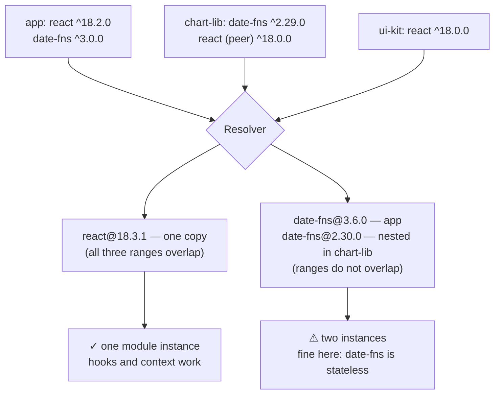

# Dependency Resolution

> Resolution is the step where a package manager turns "I want React 18" into an exact tree of exact versions on disk. Almost every confusing dependency bug is a disagreement between what you declared and what resolution produced.

**Part:** [06 · Engineering Systems](../) · **Domain:** Package Architecture · **Priority:** High · **Difficulty:** Advanced · **Reading time:** ~16 min

## TL;DR

A `package.json` declares *ranges*, not versions. Resolution walks the graph of your direct dependencies and everything they depend on, and picks a concrete version for each — reusing one copy where the ranges overlap and installing a second copy where they do not. Two consequences produce most of the pain. First, a range like `^18.2.0` means "any 18.x at or above 18.2.0," so the version installed today may not be the version installed next month; the lockfile, not the manifest, is what makes an install reproducible. Second, when two packages need incompatible versions of the same library, you get *two copies*, and any library that relies on module-level singleton state — React, a context provider, a CSS-in-JS registry — breaks in ways that look nothing like a version conflict.

> **Recommendation:** Commit the lockfile, install with `npm ci` (or the equivalent) everywhere, declare shared runtimes as `peerDependencies` in libraries, and treat any duplicate of a stateful package as a bug to be resolved, not a size problem to be tolerated.

## At a Glance

| | |
| --- | --- |
| **Use when** | Debugging a version conflict, adding a dependency, or publishing a library. |
| **Avoid when** | Never — every project has a resolved tree whether or not anyone has looked at it. |
| **Alternatives** | Different managers resolve differently; see [Alternative Approaches](#alternative-approaches). |
| **Primary risk** | Silent duplicate instances of a stateful package, producing errors that name the wrong cause. |
| **Maturity** | Stable. |

## Prerequisites

- [Primitives & Wrappers](../../01-core-languages/javascript/primitives-and-wrappers.md) (`· JavaScript`) — why two module instances produce objects that fail `instanceof` against each other.

## Overview

*Dependency resolution* is the algorithm that converts a dependency graph expressed in version ranges into a concrete tree of installed packages. The input is your `package.json` plus the `package.json` of every package you depend on, transitively. The output is a lockfile — an exact version and integrity hash for every package — and a `node_modules` layout that lets each package find the version it asked for.

The essential asymmetry is that **you declare ranges and receive versions**. `"react": "^18.2.0"` is a constraint, not a choice; the resolver satisfies it with the newest matching version available at install time. Two developers running `npm install` a month apart against the same manifest can get different trees, which is the entire reason lockfiles exist.

The second essential fact is that the tree can contain *the same package more than once*. If your app needs `date-fns@^3` and a dependency needs `date-fns@^2`, both are installed, each visible to whoever asked for it. For stateless utility packages this is merely bytes. For packages that hold module-level state — a framework runtime, a context object, a plugin registry — it is a correctness bug, because two instances do not share that state.

## The Problem

A dependency bug arrives without ever mentioning dependencies.

A developer adds a component library. The build succeeds. At runtime, every component using React context throws `Invalid hook call. Hooks can only be called inside of the body of a function component.` The message suggests a mistake in the component, and the developer spends an afternoon looking for one. There is none: the library bundled its own React, so the app's React renders the tree while the library's React holds the hook dispatcher, and the two have never met.

A month later CI fails on a build that nobody touched. The commit is a README change. The cause is a transitive dependency, four levels down, that published a patch release with a regression — and because the range was `^`, `npm install` picked it up. The lockfile would have prevented this, but the pipeline runs `npm install` rather than `npm ci`, so the lockfile is treated as a suggestion.

Then the bundle grows by 180 KB with no new features. `npm ls date-fns` shows three copies: one from the app on v3, one from a charting library on v2, one from a date picker on v1. Every one of them is used.

And in the monorepo, a package that imports a workspace sibling works locally and fails when published, because the sibling was resolved through hoisting rather than through a declared dependency. It was never in `package.json` at all; it just happened to be at the top of `node_modules`.

Four incidents, four different symptoms, one cause: nobody has looked at the resolved tree.

## Why It Matters

Resolution decides what your code actually runs. The manifest expresses intent; the tree is reality, and when they disagree the tree wins. Debugging without reading the tree means debugging a program you have not seen.

Duplicates are the highest-severity failure because they break the assumption libraries silently rely on: that there is one of them. React's hook dispatcher, a context object's identity, a CSS-in-JS style registry, an i18n instance, a state store's module-level singleton — all of these are module state, and module state is per-instance. Two instances produce symptoms that name the wrong thing: a hooks error that blames your component, a context that returns its default value even though a provider is clearly above it, styles that render in the wrong order. Each of these can absorb a day before anyone thinks to run `npm ls`.

Reproducibility is the second-order cost, and it is what turns a bad dependency into a bad week. If the tree is derived from ranges at install time, then "works on my machine" is not a joke but an accurate description: your machine resolved a different tree. A committed lockfile plus a frozen-install command in CI collapses that entire class of problem, and costs one line in a workflow file.

There is a security dimension too. A range means you have pre-authorized every future release that matches it, from every maintainer in your transitive graph. That is thousands of packages for a typical frontend project. The lockfile's integrity hashes are what convert "any matching version" into "exactly this artifact, verified" — which is the difference between a supply-chain compromise reaching your build and not.

## Mental Model

Resolution is a constraint solver: gather every range for every package, then find a set of versions that satisfies all of them — installing multiple copies when no single version can.



Two rules explain most outcomes. First, **overlapping ranges deduplicate; disjoint ranges duplicate**. `^18.0.0` and `^18.2.0` both accept `18.3.1`, so one copy. `^2` and `^3` accept nothing in common, so two. Second, **`peerDependencies` is how a library says "do not bring your own"** — it declares a requirement that the *consumer* must satisfy, which is precisely the mechanism that prevents the duplicate-React failure.

The range operators are worth having exact: `^1.2.3` allows `>=1.2.3 <2.0.0` (minor and patch), `~1.2.3` allows `>=1.2.3 <1.3.0` (patch only), `1.2.3` is exact, and `*` or `latest` is an open invitation. Below `1.0.0` semver treats minor as breaking, so `^0.3.1` allows only `>=0.3.1 <0.4.0` — a detail that surprises people who assume `^0.x` behaves like `^1.x`.

## Best Practices

Commit the lockfile and install from it in CI. `npm ci`, `pnpm install --frozen-lockfile`, or `yarn install --immutable` fails when the lockfile and manifest disagree, which is the only way the lockfile is actually enforced.

Use `^` for application dependencies and let the lockfile pin the exact version. Pinning exact versions in the manifest as well produces churn without benefit and makes transitive deduplication harder.

Declare shared runtimes as peers in published libraries. React, React DOM, and anything else with module-level state belongs in `peerDependencies` (plus `devDependencies` for local development), never in `dependencies`.

Audit for duplicates of stateful packages. `npm ls react`, `pnpm why react`, or `yarn why react` should show exactly one version. Treat more than one as a bug, not a size issue.

Prefer pnpm for monorepos and strictness. Its content-addressed store with symlinks makes undeclared dependencies fail immediately rather than working by accident through hoisting.

Use `overrides` (or `resolutions`) surgically and with a comment. Forcing a transitive version is the right tool for a security patch or a duplicate; leaving one in place for a year without a note is how a build breaks mysteriously later.

Keep dependency kinds honest. `dependencies` ship to consumers, `devDependencies` do not, and `optionalDependencies` must never be required for the package to work. Getting this wrong is invisible locally and breaks on publish.

Never rely on a package you did not declare. If it works because hoisting put it at the top level, it will stop working the day another version is installed.

Review lockfile diffs. A one-line manifest change that produces 400 lockfile lines is worth understanding before it merges.

## Trade-offs

Ranges trade reproducibility for automatic patches. The lockfile is what lets you have both — at the cost of a file that must be maintained and reviewed.

**Advantages**

- Ranges receive bug and security fixes without a manual bump for every transitive package.
- The lockfile makes installs byte-for-byte reproducible and integrity-checked.
- Duplicate installation means two packages with incompatible requirements can coexist rather than deadlock.
- Peer dependencies let libraries express "share the consumer's copy" precisely.

**Disadvantages**

- A range is standing authorization for future releases from maintainers you do not know.
- Duplicates increase bundle size and break any package that relies on module-level state.
- Lockfile conflicts in busy repositories are frequent and cannot be resolved by hand-editing.
- Different package managers produce different trees from the same manifest.
- Peer dependency errors surface at install time with messages that are hard to act on.

| Dimension | Range-based resolution | Cost / caveat |
| --- | --- | --- |
| Reproducibility | Exact, via the lockfile | Only if CI uses a frozen install |
| Updates | Patches flow automatically | Unreviewed transitive changes |
| Conflicts | Resolved by duplication | Breaks stateful packages silently |
| Bundle size | Deduplicated where ranges overlap | Disjoint ranges ship both copies |
| Supply chain | Integrity hashes in the lockfile | Wide standing authorization in the manifest |

## Alternative Approaches

Every manager solves the same constraints; they differ in the layout they produce and in how strict they are about undeclared dependencies.

| Approach | Best when | Weakness | See |
| --- | --- | --- | --- |
| npm (hoisted `node_modules`) | Default tooling, maximum compatibility | Hoisting hides undeclared dependencies | (this article) |
| pnpm (content-addressed + symlinks) | Monorepos; strictness is wanted | Symlinks break a few tools that resolve real paths | `Node Modules & Hoisting Models · Package Architecture` |
| Yarn PnP (no `node_modules`) | Fast installs, strict resolution | Requires tooling that understands the PnP API | `Node Modules & Hoisting Models · Package Architecture` |
| Vendoring / bundled dependencies | Airgapped or long-lived builds | No updates; the repository carries all the weight | `Lockfiles & Determinism · Package Architecture` |
| Import maps (browser-native) | No build step; ESM straight from a CDN | No transitive resolution; you pin every URL yourself | `Module Formats (ESM/CJS/UMD) · Package Architecture` |

## Bad Example

A library manifest and a CI pipeline that together produce every failure described above.

```jsonc
// ❌ package.json for a published component library
{
  "name": "@acme/ui-kit",
  "version": "2.4.0",
  "dependencies": {
    // ❌ (1) React as a regular dependency. Every consumer now gets a second
    //        copy of React unless their range happens to match exactly —
    //        which is the "Invalid hook call" error, delivered by npm.
    "react": "^18.2.0",
    "react-dom": "^18.2.0",

    // ❌ (2) Unbounded range: the next major release of this package
    //        installs automatically and breaks the build with no commit.
    "lodash": "*",

    // ❌ (3) Exact pin on a transitive-heavy package. Nothing can dedupe
    //        against it, so consumers ship two copies of date-fns forever.
    "date-fns": "3.6.0",

    // ❌ (4) A build-time tool shipped to consumers: every install of this
    //        library also installs a bundler it will never run.
    "webpack": "^5.90.0"
  }
}
```

```yaml
# ❌ .github/workflows/ci.yml
- name: Install
  # ❌ (5) `npm install` may update the lockfile to satisfy the manifest,
  #        so CI can resolve a different tree than the developer did — and
  #        then commit nothing, leaving no record of what it ran.
  run: npm install

- name: Build
  run: npm run build
```

```ts
// ❌ src/DatePicker.tsx
// ❌ (6) date-fns is used but not declared here; it resolves because
//        hoisting placed it at the top of node_modules. The day another
//        package pulls in a different major, this import silently changes
//        which version it gets.
import { format } from 'date-fns';
```

**What goes wrong:** Consumers of this library get two Reacts, so any component using hooks or context throws — and the error blames their code. `lodash: "*"` means an unrelated maintainer can break the build on a Tuesday. `webpack` in `dependencies` adds hundreds of megabytes to every consumer's install. And `npm install` in CI means the pipeline is not testing the tree that the lockfile describes.

## Good Example

The same library with the dependency kinds correct, and a pipeline that installs what the lockfile says.

```jsonc
// ✅ package.json for a published component library
{
  "name": "@acme/ui-kit",
  "version": "2.4.0",

  // ✅ Only what consumers actually need at runtime, with ranges wide enough
  //    to deduplicate against whatever else they have installed.
  "dependencies": {
    "clsx": "^2.1.0"
  },

  // ✅ "Use the consumer's copy." This is the mechanism that prevents the
  //    duplicate-React failure, and the only correct home for a runtime
  //    that relies on module-level state.
  "peerDependencies": {
    "react": "^18.2.0 || ^19.0.0",
    "react-dom": "^18.2.0 || ^19.0.0",
    "date-fns": "^3.0.0"
  },

  // ✅ Peers the library can work without are marked optional, so consumers
  //    who don't use the date components aren't forced to install date-fns.
  "peerDependenciesMeta": {
    "date-fns": { "optional": true }
  },

  // ✅ The same packages as devDependencies so local development and tests
  //    have something to resolve against. These are not installed by consumers.
  "devDependencies": {
    "react": "^18.3.1",
    "react-dom": "^18.3.1",
    "date-fns": "^3.6.0",
    "typescript": "^5.4.0",
    "vitest": "^1.6.0"
  },

  // ✅ Documented and enforced, so a contributor on the wrong Node version
  //    gets a clear failure instead of a confusing one.
  "engines": { "node": ">=20.11.0" },

  // ✅ Explicit about what is published: nothing else in the repo ships.
  "files": ["dist"],
  "sideEffects": false
}
```

```jsonc
// ✅ package.json for the consuming application
{
  "name": "@acme/web",
  "private": true,
  "dependencies": {
    "@acme/ui-kit": "^2.4.0",
    "react": "^18.3.1",
    "react-dom": "^18.3.1",
    "date-fns": "^3.6.0"
  },

  // ✅ A surgical override with a reason and an exit condition. Without the
  //    comment, this line becomes permanent and nobody knows why.
  "overrides": {
    // CVE-2024-XXXXX; upstream fix is in chart-lib@4.2. Remove after upgrade.
    "chart-lib>semver": "^7.6.2"
  }
}
```

```yaml
# ✅ .github/workflows/ci.yml
- uses: actions/setup-node@v4
  with:
    node-version: '20.11.0'   # ✅ pinned: resolution can differ across Node majors
    cache: 'npm'

- name: Install
  # ✅ Fails if the lockfile and manifest disagree, and never mutates the
  #    lockfile. CI now tests the exact tree a developer would get.
  run: npm ci

- name: Assert single copies of stateful packages
  # ✅ The check that turns a day-long debugging session into a failed build.
  #    `npm ls <pkg>` exits non-zero when the tree is not deduplicated.
  run: |
    npm ls react --depth=10
    npm ls react-dom --depth=10

- name: Build
  run: npm run build
```

**Why it's better:** React is a peer, so consumers supply it and there is exactly one instance — the hooks error cannot occur. `date-fns` is an optional peer, so consumers who use the date components share their copy and those who do not install nothing. `webpack` is gone from the consumer's install entirely. `npm ci` means CI runs the lockfile's tree, so a green build is evidence about the tree that will ship. And the duplicate check fails loudly at build time rather than silently at runtime.

## Production Example

The single most valuable thing to automate is the duplicate check, because the failures it prevents are the ones that name the wrong cause. A useful version is stricter than `npm ls`: it distinguishes packages where duplication is a correctness bug from packages where it is merely bytes.

```js
#!/usr/bin/env node
// scripts/check-duplicates.mjs — run in CI after install.
import { execFileSync } from 'node:child_process';

/**
 * Packages that hold module-level state. A second instance does not merely
 * add bytes: it creates a second dispatcher, a second context identity, or a
 * second style registry, and the resulting error message never mentions
 * versions. These are build failures.
 */
const SINGLETON_PACKAGES = [
  'react',
  'react-dom',
  '@tanstack/react-query',   // module-level query client context
  'styled-components',       // style sheet registry
  'i18next',                 // singleton instance store
];

/**
 * Packages where duplication costs bundle size but is otherwise harmless.
 * Reported, not failed — otherwise the check gets disabled the first time a
 * transitive dependency lags a major behind, which is always.
 */
const SIZE_SENSITIVE_PACKAGES = ['date-fns', 'lodash-es', 'zod'];

function installedVersions(name) {
  // `npm ls --json` exits non-zero on duplicates, so capture rather than throw.
  let raw;
  try {
    raw = execFileSync('npm', ['ls', name, '--all', '--json'], { encoding: 'utf8' });
  } catch (error) {
    raw = error.stdout ?? '{}';
  }

  const versions = new Map(); // version -> the paths that resolved to it
  const walk = (node, path) => {
    for (const [dep, info] of Object.entries(node.dependencies ?? {})) {
      const here = [...path, dep];
      if (dep === name && info.version) {
        const at = versions.get(info.version) ?? [];
        at.push(here.join(' › '));
        versions.set(info.version, at);
      }
      walk(info, here);
    }
  };

  walk(JSON.parse(raw), []);
  return versions;
}

let failed = false;

for (const name of SINGLETON_PACKAGES) {
  const versions = installedVersions(name);
  if (versions.size <= 1) continue;

  failed = true;
  console.error(`\n✖ ${name} is installed ${versions.size} times.`);
  console.error('  Two instances mean two module scopes: hooks, context, and');
  console.error('  registries will not be shared. Fix with a peerDependency on');
  console.error('  the library side, or an override on the application side.\n');
  for (const [version, paths] of versions) {
    console.error(`  ${version}`);
    for (const path of paths) console.error(`    via ${path}`);
  }
}

for (const name of SIZE_SENSITIVE_PACKAGES) {
  const versions = installedVersions(name);
  if (versions.size <= 1) continue;
  // A warning, deliberately. Failing here would block upgrades on other
  // people's release schedules, and the check would be removed within a month.
  console.warn(`⚠ ${name} duplicated (${[...versions.keys()].join(', ')}) — bundle size only.`);
}

process.exit(failed ? 1 : 0);
```

The split between failing and warning is the design decision that makes this survive. A check that fails on every duplicate is correct in theory and gets deleted in practice, because half of the duplicates are in transitive dependencies you do not control. Failing only where duplication causes a correctness bug keeps the signal high enough that nobody argues for turning it off.

## Common Mistakes

See the [Package Architecture anti-patterns](../../../anti-patterns/#package-architecture) for the domain catalog. Concept-specific:

### Mistake: React (or another runtime) in a library's `dependencies`

- **Symptom:** Consumers get `Invalid hook call`, or a context returns its default despite a provider being present.
- **Why it fails:** The library ships its own copy, so two module instances exist and neither shares the other's state.
- **Fix:** Move it to `peerDependencies`, and keep it in `devDependencies` for local development.

### Mistake: `npm install` in CI

- **Symptom:** A build fails on a commit that changed only documentation.
- **Why it fails:** `install` may update the lockfile to satisfy the manifest, so CI resolves a tree nobody has tested.
- **Fix:** Use `npm ci` / `--frozen-lockfile` / `--immutable`, which fail rather than mutate.

### Mistake: Importing an undeclared package

- **Symptom:** Works locally, fails after another dependency is added or in a different package manager.
- **Why it fails:** The import resolves through hoisting, not through a declared dependency, so it depends on the layout rather than on the manifest.
- **Fix:** Declare every package you import; pnpm's default layout makes this failure immediate.

### Mistake: `*` or `latest` as a range

- **Symptom:** An unrelated maintainer's release breaks the build.
- **Why it fails:** The range authorizes every future version, including major ones.
- **Fix:** Use `^` for applications and an explicit compatible range for libraries.

### Mistake: Permanent, undocumented overrides

- **Symptom:** An `overrides` block nobody can explain, blocking an upgrade.
- **Why it fails:** An override pins a transitive version outside the resolver's view; without a reason and an exit condition it never gets removed.
- **Fix:** Add a comment with the cause and the version that lets it go, and revisit on every major upgrade.

### Mistake: Assuming `^0.x` behaves like `^1.x`

- **Symptom:** A `0.x` package does not receive updates that look compatible.
- **Why it fails:** Below `1.0.0`, semver treats a minor bump as breaking, so `^0.3.1` allows only `<0.4.0`.
- **Fix:** Know it, and pin `0.x` dependencies deliberately.

## Checklist

- [ ] The lockfile is committed and reviewed in pull requests.
- [ ] CI installs with a frozen-lockfile command, never plain `install`.
- [ ] The Node version is pinned in CI and declared in `engines`.
- [ ] Published libraries declare shared runtimes as peers, not dependencies.
- [ ] Optional peers are marked in `peerDependenciesMeta`.
- [ ] Build tooling is in `devDependencies`, never `dependencies`.
- [ ] Every imported package is declared in that package's `package.json`.
- [ ] A CI check fails on duplicate copies of stateful packages.
- [ ] `overrides` entries carry a reason and a removal condition.
- [ ] No dependency uses `*`, `latest`, or an unbounded range.
- [ ] `files` (or `.npmignore`) limits what is published.

## Related Articles

- [The Dependency Graph](../build-tooling/the-dependency-graph.md) — what the bundler does with the resolved tree (`· Build Systems & Tooling`).
- [Separation of Concerns](../../03-application-architecture/architecture/separation-of-concerns.md) — the dependency direction rules that keep the graph acyclic (`· Frontend Architecture`).
- [Primitives & Wrappers](../../01-core-languages/javascript/primitives-and-wrappers.md) — why duplicate instances fail identity checks (`· JavaScript`).

## References

- [Semantic Versioning 2.0.0](https://semver.org/) — the contract ranges are interpreted against, including the `0.x` rule.
- [npm — package.json dependencies](https://docs.npmjs.com/cli/v10/configuring-npm/package-json#dependencies) — the dependency kinds and what each one means at install time.
