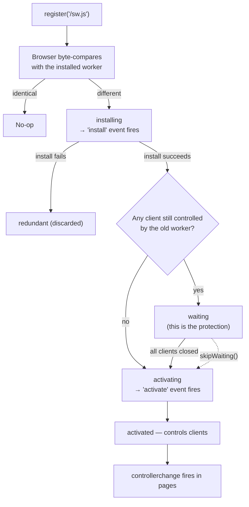

# The Service Worker Lifecycle

> A service worker installs, then waits, then activates. The waiting phase exists to protect open pages from a version swap they did not ask for — and it is the phase most implementations try to skip, which is why so many PWAs ship broken updates.

**Part:** [07 · Platform Reach](../) · **Domain:** Progressive & Cross-Platform Web · **Priority:** Medium · **Difficulty:** Advanced · **Reading time:** ~19 min

## TL;DR

A new service worker is installed as soon as the browser notices its bytes changed, but it does not take control while any page is still controlled by the old one. It sits in `waiting` until every such tab is gone. That delay is deliberate: an open page has already loaded assets from the old version, and swapping the worker underneath it can hand it chunks and API shapes it was not built for. Calling `skipWaiting()` unconditionally removes the protection and produces exactly that failure. The correct pattern is to detect the waiting worker, tell the user an update is ready, and activate it only when they accept — then reload once. Nothing about this is discoverable from the API, which is why almost every hand-written registration gets it wrong in the same way.

> **Recommendation:** Never call `skipWaiting()` unconditionally. Detect the waiting worker, prompt the user, and post it a message to activate; reload once on `controllerchange`, guarded against a loop.

## At a Glance

| | |
| --- | --- |
| **Use when** | Any application with a service worker — offline support, precaching, push, or background sync. |
| **Avoid when** | The application has no offline story and no caching need; a service worker adds a whole failure surface. |
| **Alternatives** | HTTP caching alone, or no worker at all — see [Alternative Approaches](#alternative-approaches). |
| **Primary risk** | An unconditional `skipWaiting()` swapping versions under a live page, producing chunk 404s and API mismatches. |
| **Maturity** | Stable. |

## Prerequisites

- [Web Storage](../../00-foundations/browser-apis/web-storage.md) (`· Browser APIs`) — the storage model a service worker's caches live alongside.
- [The Cache Storage API](../../00-foundations/browser-apis/the-cache-storage-api.md) (`· Browser APIs`) — what `install` populates and what `activate` cleans up.
- [HTTP/1.1 Semantics](../../00-foundations/networking-protocols/http-1-1-semantics.md) (`· Networking & Protocols`) — the caching headers that decide whether the browser sees your new worker at all.
- [Core Web Vitals](../../05-reliability-quality/performance/core-web-vitals-lcp-inp-cls.md) (`· Performance Engineering`) — the metrics an update prompt or unexpected reload affects.

## Overview

A *service worker* is a script that runs in a worker context, separate from any page, and can intercept network requests for the scope it controls. Its **lifecycle** — the sequence `installing → installed (waiting) → activating → activated` — governs when a given version of that script is in charge.

The lifecycle exists to solve a specific problem: a page and the worker serving it must agree on what version they are. A loaded page holds references to hashed chunk filenames, expects a particular API contract, and may request a lazy chunk minutes after load. If the worker under it changes to a version with different assets, those requests can fail. The browser's answer is that a new worker waits until every page controlled by the previous one has gone.

Two clarifications. The lifecycle is per *registration scope*, not per tab: two tabs on the same origin share one active worker. And "every page gone" means genuinely gone — a reload does not count, because the old page's unload and the new page's load overlap, so a controlled client exists continuously. This is why users report that reloading "doesn't pick up the update," and it is correct behavior rather than a bug.

## The Problem

A team ships a PWA. Updates do not reach users, so someone adds `self.skipWaiting()` to the `install` handler. Updates now reach users, and the error rate triples.

The mechanism: a user has the application open. A deploy happens. The browser fetches the new worker, installs it, and — because of `skipWaiting()` — activates it immediately, taking control of the open page. That page was built from the previous deploy and still references `dashboard-a3f9c1.js`. The new worker's precache contains `dashboard-b7e402.js`, and the old file is gone from the origin. The next lazy import throws `Failed to fetch dynamically imported module`, and the user sees a blank region where a route should be.

Worse variants follow. The old page calls `/api/v1/invoices` while the new deploy expects `/api/v2/invoices`, so requests start failing mid-session. Someone adds `window.location.reload()` on `controllerchange` to fix it, and now users lose form data mid-typing when a deploy lands. Someone else guards that with a flag stored in a variable, which resets on the reload it triggers, producing an infinite reload loop for anyone whose worker updates during page load.

Meanwhile a different team has the opposite bug: they never registered an update check, the worker's own HTTP response is cached for a year by the CDN, and some users have been running a six-month-old version with no way to escape it — because the worker serves the shell from cache, so even a hard refresh returns the old application.

Every one of these is a lifecycle misunderstanding, and none produce an error message that says so.

## Why It Matters

A service worker is the only piece of frontend code that persists across page loads and can serve content without the network. That makes its update path uniquely consequential: a bad application deploy is fixed by the next deploy, while a bad *worker* deploy can prevent the next deploy from ever reaching the user. A worker that caches the shell aggressively and has no update path is a permanent version pin on that user's device, escapable only by clearing site data — which no ordinary user will do.

The waiting phase is the protection against the mid-session variant of the same problem. It guarantees that a page is served by the worker version it started with, for its whole life. Skipping it trades an invisible, correct behavior for a visible, immediate update, and pays for it with a class of failure — missing chunks, mismatched API versions — that surfaces as unrelated-looking runtime errors, minutes after the deploy, only for users who happened to have a tab open.

There is a user-agency dimension too. An unprompted reload discards scroll position, form state, an open modal, and whatever the user was doing. On a page with an editor or a long form, that is data loss caused by a deploy. Prompting costs one banner and converts a silent interruption into a choice.

And the update *check* matters as much as the update handling. The browser checks for a new worker on navigation and roughly every 24 hours, but it honors HTTP caching on the worker script itself in most configurations. A worker served with a long `max-age` is a worker the browser may not re-fetch for as long as that header says, which is how a version becomes permanently stuck.

## Mental Model

Think of the lifecycle as a queue with one active slot. A new version enters, prepares itself, and then waits for the slot to be free.



Three rules explain nearly every confusing behavior. First, **a reload does not empty the waiting queue**, because the outgoing and incoming page overlap and a controlled client always exists; only closing every tab does, which is why "I refreshed and nothing changed" is expected. Second, **`skipWaiting()` is not an update mechanism, it is a decision to swap versions under a live page**, and it is only safe when the user has consented and a reload immediately follows. Third, **`clients.claim()` is separate**: it makes an active worker take control of pages that loaded without a controller, which matters chiefly on the very first visit.

The `install` and `activate` handlers have complementary jobs. `install` prepares the new version's resources — populate a versioned cache — and must not touch anything the old version is still using. `activate` is where cleanup belongs, because by then the old version is gone; deleting old caches there is safe, and deleting them in `install` is how you break every open page at once.

## Best Practices

Never call `skipWaiting()` unconditionally. Reserve it for a message the page sends after the user accepts an update.

Detect the waiting worker and tell the user. Check `registration.waiting` at startup and listen for `updatefound`, then show a non-blocking prompt with one action.

Reload exactly once on `controllerchange`, with a guard that survives the reload. A module-scope boolean does not survive; `sessionStorage` does.

Serve the worker script with `Cache-Control: no-cache`. The browser must be able to see a new worker; a long-lived cached response is how a version becomes permanent.

Version your caches and clean up in `activate`. `precache-v7` alongside `precache-v6` costs storage; deleting `v6` during `install` breaks the pages still using it.

Keep `install` correct or fail it. If `addAll` rejects, the worker becomes redundant and the old one keeps serving — which is the right outcome, and better than a half-populated cache.

Never precache the HTML document with a long-lived strategy unless you also serve it network-first. A cached shell that never revalidates is the mechanism by which users get stuck.

Ship an unregister path. A worker that can be told to unregister itself and clear its caches — triggered by a version flag from the server — is the only remote escape hatch when a bad worker ships.

Test the update path, not just the install path. Load the old version, deploy the new one, and verify the prompt, the activation, and the single reload. Almost nobody does this, which is why almost every PWA has the bug.

Keep the scope as narrow as the application needs. A worker registered at `/` controls everything on the origin, including pages other teams own.

## Trade-offs

A service worker buys offline capability and instant repeat loads at the cost of a second deployment target with its own version lifecycle.

**Advantages**

- Repeat visits can render from cache with no network, and work offline entirely.
- Requests are interceptable, so caching strategy becomes application logic rather than header negotiation.
- Background sync and push notifications become available.
- The waiting phase guarantees version consistency for the life of a page.

**Disadvantages**

- The update path is genuinely hard and silently wrong by default.
- A bad worker can persist on users' devices past the deploy that would fix it.
- Two versions of the application can be live at once, so API compatibility must span them.
- Debugging is awkward: the worker's state is separate from the page and survives reloads.
- Storage is subject to eviction, so cached content is not a guarantee.

| Dimension | Service worker | Cost / caveat |
| --- | --- | --- |
| Repeat load | Cache-speed, network-independent | Stale content unless revalidated deliberately |
| Offline | Fully possible | Every cached response is a version to manage |
| Updates | Controlled, consistent per page | Needs an explicit prompt-and-activate flow |
| Failure recovery | Requires a remote kill switch | Without one, a bad worker is stuck on devices |
| Complexity | A second deployable with its own lifecycle | Must be tested as an upgrade, not just an install |

## Alternative Approaches

The question is how much control over caching you need, and how much lifecycle complexity that is worth.

| Approach | Best when | Weakness | See |
| --- | --- | --- | --- |
| Service worker (this article) | Offline required, or repeat-visit speed is critical | An update lifecycle to get right | (this article) |
| HTTP caching + immutable URLs | No offline requirement | No offline, no interception, no background work | [Resource Prefetch & Preload](../../05-reliability-quality/performance/resource-prefetch-and-preload.md) (`· Performance Engineering`) |
| Cache Storage without a worker | Explicit app-controlled caching, no interception | No offline navigation; the document still needs the network | [The Cache Storage API](../../00-foundations/browser-apis/the-cache-storage-api.md) (`· Browser APIs`) |
| Native app | Deep OS integration, guaranteed storage | Distribution, review cycles, separate codebase | `Progressive & Cross-Platform Web` |

## Bad Example

The registration and worker that almost every project writes first.

```js
// ❌ sw.js
const CACHE = 'app-cache';   // ❌ (1) unversioned: v1 and v2 write to the same
                             //        cache, so entries from both mix.

self.addEventListener('install', (event) => {
  // ❌ (2) Activates immediately, taking over pages built from the previous
  //        deploy. Those pages still reference old chunk hashes that this
  //        worker's cache does not contain and the origin has deleted.
  self.skipWaiting();

  event.waitUntil(
    caches.open(CACHE).then((cache) =>
      cache.addAll(['/', '/app.js', '/app.css']),
    ),
  );
});

self.addEventListener('activate', (event) => {
  // ❌ (3) Deletes every cache, including one an open page is reading from.
  event.waitUntil(
    caches.keys().then((keys) => Promise.all(keys.map((key) => caches.delete(key)))),
  );
});

self.addEventListener('fetch', (event) => {
  // ❌ (4) Cache-first on everything, including the HTML document. Once '/'
  //        is cached there is no path by which a user ever sees a new
  //        version — not even a hard refresh, because this handler answers first.
  event.respondWith(
    caches.match(event.request).then((cached) => cached ?? fetch(event.request)),
  );
});
```

```js
// ❌ main.js
if ('serviceWorker' in navigator) {
  navigator.serviceWorker.register('/sw.js');

  // ❌ (5) Reloads whenever the controller changes — including the very
  //        first activation — and the guard is a module-scope variable that
  //        the reload itself resets. Infinite loop for some users.
  let reloaded = false;
  navigator.serviceWorker.addEventListener('controllerchange', () => {
    if (reloaded) return;
    reloaded = true;
    window.location.reload();   // ❌ (6) Discards unsaved work with no warning.
  });
}
```

```nginx
# ❌ nginx.conf
location /sw.js {
    # ❌ (7) The browser may not re-fetch the worker for a year, so the
    #        deploy that fixes all of the above may never reach anyone.
    add_header Cache-Control "public, max-age=31536000";
}
```

**What goes wrong:** Users with an open tab get a version swapped under them and start seeing chunk load failures. `activate` deletes the cache those pages were reading from, so even the assets that would have worked stop working. The document is served cache-first forever, so a user who lands on a broken version cannot escape it by refreshing. And the worker script itself is cached for a year, so the fix cannot be delivered.

## Good Example

The same worker with versioned caches, a safe activation path, and a document strategy that can always be updated.

```js
// ✅ sw.js
// Injected at build time, so a content change produces a new cache name and
// a byte-different worker — which is what makes the browser notice at all.
const VERSION = self.__BUILD_ID__;
const PRECACHE = `precache-${VERSION}`;
const RUNTIME = `runtime-${VERSION}`;
const PRECACHE_URLS = self.__PRECACHE_MANIFEST__; // [{ url, revision }, …]

self.addEventListener('install', (event) => {
  // ✅ No skipWaiting: this worker prepares itself and then waits, so pages
  //    already open keep the version they loaded with.
  event.waitUntil(
    (async () => {
      const cache = await caches.open(PRECACHE);
      // ✅ A versioned cache, so nothing here disturbs what the previous
      //    worker is still serving to open pages.
      await cache.addAll(PRECACHE_URLS.map((entry) => entry.url));
      // If addAll rejects, this worker becomes redundant and the previous
      // one keeps serving — a partial precache would be worse.
    })(),
  );
});

self.addEventListener('activate', (event) => {
  event.waitUntil(
    (async () => {
      // ✅ Cleanup belongs here: by now no client uses the old version.
      const keys = await caches.keys();
      await Promise.all(
        keys
          .filter((key) => key !== PRECACHE && key !== RUNTIME)
          .map((key) => caches.delete(key)),
      );

      // ✅ Take control of clients that loaded with no controller — chiefly
      //    the first visit. This does not affect already-controlled pages.
      await self.clients.claim();
    })(),
  );
});

// ✅ The page asks for activation; the worker never decides on its own.
self.addEventListener('message', (event) => {
  if (event.data?.type === 'SKIP_WAITING') {
    self.skipWaiting();
  }
});

self.addEventListener('fetch', (event) => {
  const { request } = event;
  if (request.method !== 'GET') return;

  const url = new URL(request.url);
  if (url.origin !== self.location.origin) return;

  // ✅ Navigations are network-first with a cache fallback: a user on a
  //    broken version can always recover by reloading with a connection,
  //    and still gets the shell when offline.
  if (request.mode === 'navigate') {
    event.respondWith(
      (async () => {
        try {
          const network = await fetch(request);
          const cache = await caches.open(RUNTIME);
          cache.put(request, network.clone());
          return network;
        } catch {
          return (await caches.match('/index.html', { cacheName: PRECACHE }))
            ?? Response.error();
        }
      })(),
    );
    return;
  }

  // ✅ Hashed assets are immutable, so cache-first is correct and safe:
  //    a new build produces new filenames rather than new contents.
  if (/\.[0-9a-f]{8,}\.(js|css|woff2)$/.test(url.pathname)) {
    event.respondWith(
      (async () => {
        const cached = await caches.match(request);
        if (cached) return cached;
        const network = await fetch(request);
        const cache = await caches.open(RUNTIME);
        cache.put(request, network.clone());
        return network;
      })(),
    );
  }
});
```

```ts
// ✅ registerServiceWorker.ts — the update flow the API does not give you.
const RELOADING_KEY = 'sw:reloading';

export function registerServiceWorker(onUpdateReady: (activate: () => void) => void) {
  if (!('serviceWorker' in navigator)) return;

  window.addEventListener('load', async () => {
    // ✅ Explicit scope, so the worker controls only what it should.
    const registration = await navigator.serviceWorker.register('/sw.js', { scope: '/' });

    const promptFor = (worker: ServiceWorker) => {
      onUpdateReady(() => worker.postMessage({ type: 'SKIP_WAITING' }));
    };

    // ✅ A worker may already be waiting from a previous visit — this is the
    //    case most implementations forget, and it is the common one.
    if (registration.waiting && navigator.serviceWorker.controller) {
      promptFor(registration.waiting);
    }

    registration.addEventListener('updatefound', () => {
      const installing = registration.installing;
      if (!installing) return;

      installing.addEventListener('statechange', () => {
        // ✅ `installed` + an existing controller means "an update is ready".
        //    Without the controller check this also fires on first install,
        //    where there is nothing to prompt about.
        if (installing.state === 'installed' && navigator.serviceWorker.controller) {
          promptFor(installing);
        }
      });
    });

    // ✅ Reload once, after the user accepted. sessionStorage survives the
    //    reload, so the guard actually guards — a module variable does not.
    navigator.serviceWorker.addEventListener('controllerchange', () => {
      if (sessionStorage.getItem(RELOADING_KEY)) return;
      sessionStorage.setItem(RELOADING_KEY, '1');
      window.location.reload();
    });

    // ✅ Check for updates periodically: the browser's own schedule is
    //    roughly daily, which is too slow for a long-lived open tab.
    setInterval(() => registration.update(), 60 * 60 * 1000);
    document.addEventListener('visibilitychange', () => {
      if (document.visibilityState === 'visible') registration.update();
    });
  });
}
```

```nginx
# ✅ nginx.conf
location = /sw.js {
    # ✅ Revalidated on every request, so a new worker is always discoverable.
    add_header Cache-Control "no-cache, must-revalidate";
}

location ~* \.[0-9a-f]{8,}\.(js|css|woff2)$ {
    # ✅ Hashed filenames are immutable, so this is safe and removes
    #    revalidation entirely for the assets the worker precaches.
    add_header Cache-Control "public, max-age=31536000, immutable";
}
```

**Why it's better:** An open page keeps the worker version it loaded with, so chunk 404s and API mismatches cannot occur mid-session. The update becomes a visible choice with a single reload, so no unsaved work is lost silently. Caches are versioned, so `activate` cleanup cannot delete what a live page is reading. Navigations are network-first, so a user on a bad version recovers by reloading. And `no-cache` on the worker script guarantees the next deploy is discoverable.

## Production Example

The failure a service worker uniquely enables is the one worth engineering for: a worker so broken that it prevents its own replacement. The remedy is a kill switch that does not depend on the broken code path — served from the origin, checked by the page, and capable of removing the worker entirely.

```ts
/**
 * A service worker that caches the shell can outlive every deploy meant to
 * fix it. This is the escape hatch: a small JSON file, served with no-cache
 * and fetched with `cache: 'no-store'` so neither the HTTP cache nor the
 * worker's own fetch handler can answer it, telling the page to tear the
 * registration down.
 *
 * It exists to be used once, in an incident, when nothing else can reach
 * the user. Everything about it is deliberately independent of the worker.
 */
interface ServiceWorkerPolicy {
  /** Set to false to remove the worker from every device that checks in. */
  enabled: boolean;
  /** Workers built before this ID are unregistered even when enabled. */
  minBuildId?: string;
  reason?: string;
}

const POLICY_URL = '/sw-policy.json';
const CURRENT_BUILD_ID = __BUILD_ID__;

export async function enforceServiceWorkerPolicy(): Promise<void> {
  if (!('serviceWorker' in navigator)) return;

  let policy: ServiceWorkerPolicy;
  try {
    // `cache: 'no-store'` bypasses the HTTP cache. The fetch handler in sw.js
    // ignores anything outside its asset patterns, so this request reaches the
    // network even when the worker is misbehaving on everything else.
    const response = await fetch(POLICY_URL, { cache: 'no-store' });
    if (!response.ok) return;
    policy = (await response.json()) as ServiceWorkerPolicy;
  } catch {
    // Offline or the request failed: leave the worker alone. Unregistering on
    // a failed check would break offline support for everyone on a train.
    return;
  }

  const outdated =
    policy.minBuildId !== undefined && CURRENT_BUILD_ID < policy.minBuildId;

  if (policy.enabled && !outdated) return;

  console.warn('[sw] policy requires removal:', policy.reason ?? 'disabled');

  // Order matters. Unregister first: if caches are cleared while the worker
  // is still active, its fetch handler answers from an empty cache and the
  // page can be left with no assets at all.
  const registrations = await navigator.serviceWorker.getRegistrations();
  await Promise.all(registrations.map((registration) => registration.unregister()));

  const keys = await caches.keys();
  await Promise.all(keys.map((key) => caches.delete(key)));

  // Reload once so the page loads uncontrolled, straight from the network.
  // Same sessionStorage guard as the update path: without it, a policy that
  // stays disabled reloads the page forever.
  if (!sessionStorage.getItem('sw:policy-reload')) {
    sessionStorage.setItem('sw:policy-reload', '1');
    window.location.reload();
  }
}
```

```jsonc
// public/sw-policy.json — served with Cache-Control: no-cache.
// Normal state:
{ "enabled": true, "minBuildId": "2026-08-16.1" }

// Incident state — flip this one file, and every device that opens the app
// removes its worker and reloads clean. No deploy required, and it works
// even when the deployed worker is the thing that is broken.
// { "enabled": false, "reason": "sw 2026-08-15.3 cached a broken shell" }
```

The ordering comment is the load-bearing detail. Clearing caches before unregistering leaves an active worker with an empty cache, which on a cache-first strategy means the page gets nothing — a worse state than the one being fixed. And the "leave it alone on a failed fetch" branch matters as much: a policy check that fails open would disable offline support for every user with a flaky connection, which is precisely the population a PWA exists to serve.

## Common Mistakes

See the [Progressive & Cross-Platform Web anti-patterns](../../../anti-patterns/#progressive-cross-platform-web) for the domain catalog. Concept-specific:

### Mistake: Unconditional `skipWaiting()`

- **Symptom:** Chunk load failures and API errors for users who had a tab open during a deploy.
- **Why it fails:** It swaps the worker under a live page whose assets and API expectations belong to the previous version.
- **Fix:** Call it only in response to a message the page sends after the user accepts the update.

### Mistake: Reloading on every `controllerchange`

- **Symptom:** Users lose form data when a deploy lands, or the page reloads in a loop.
- **Why it fails:** The event also fires on first activation, and a module-scope guard does not survive the reload it triggers.
- **Fix:** Reload only after a user-accepted activation, guarded by `sessionStorage`.

### Mistake: A long-lived `Cache-Control` on the worker script

- **Symptom:** Some users run a months-old version and nothing reaches them.
- **Why it fails:** The browser honors HTTP caching when checking for a new worker, so it never sees the new bytes.
- **Fix:** Serve `/sw.js` with `no-cache, must-revalidate`.

### Mistake: Cache-first on navigation requests

- **Symptom:** A user on a broken version cannot recover, even with a hard refresh.
- **Why it fails:** The worker answers the document request from cache before the network is consulted, so there is no path to a newer shell.
- **Fix:** Network-first for navigations, with the cached shell as the offline fallback.

### Mistake: Deleting caches in `install`

- **Symptom:** Open pages start failing to load assets the moment a new worker installs.
- **Why it fails:** `install` runs while the previous worker is still serving pages from those caches.
- **Fix:** Use versioned cache names and delete old ones in `activate`.

### Mistake: Unversioned cache names

- **Symptom:** Entries from two builds coexist and are served interchangeably.
- **Why it fails:** Both versions write to the same cache, so `caches.match` can return either.
- **Fix:** Include the build ID in every cache name.

### Mistake: No kill switch

- **Symptom:** A bad worker persists past every subsequent deploy.
- **Why it fails:** The worker controls what the page can fetch, including the deploy meant to replace it.
- **Fix:** Ship a policy check that can unregister the worker and clear its caches.

## Checklist

- [ ] `skipWaiting()` is called only in response to a user-accepted message.
- [ ] `registration.waiting` is checked at startup, not only on `updatefound`.
- [ ] The update prompt distinguishes first install from a genuine update.
- [ ] `controllerchange` reloads exactly once, guarded by `sessionStorage`.
- [ ] The worker script is served with `Cache-Control: no-cache`.
- [ ] Cache names include the build ID.
- [ ] Old caches are deleted in `activate`, never in `install`.
- [ ] Navigation requests are network-first with a cached fallback.
- [ ] `registration.update()` runs periodically and on tab focus.
- [ ] A remote kill switch can unregister the worker and clear caches.
- [ ] The upgrade path — old version open, new version deployed — is tested.

## Related Articles

- [The Cache Storage API](../../00-foundations/browser-apis/the-cache-storage-api.md) — the storage the lifecycle populates and cleans up (`· Browser APIs`).
- [Storage Quotas & Eviction](../../00-foundations/browser-apis/storage-quotas-and-eviction.md) — why cached content is not a guarantee (`· Browser APIs`).
- [The CSR Model](../../02-rendering-frameworks/rendering-architectures/the-csr-model.md) — the chunk-404-after-deploy failure a version swap produces (`· Rendering Architectures`).
- [Resource Prefetch & Preload](../../05-reliability-quality/performance/resource-prefetch-and-preload.md) — the HTTP-level caching a worker sits on top of (`· Performance Engineering`).
- [Same-Origin Policy](../../05-reliability-quality/security/same-origin-policy.md) — the boundary a worker's scope is defined within (`· Security`).

## References

- [MDN — Service Worker API](https://developer.mozilla.org/en-US/docs/Web/API/Service_Worker_API) — lifecycle events, `skipWaiting`, and `clients.claim`.
- [W3C — Service Workers specification](https://w3c.github.io/ServiceWorker/) — the normative definition of the waiting phase and the update algorithm.
