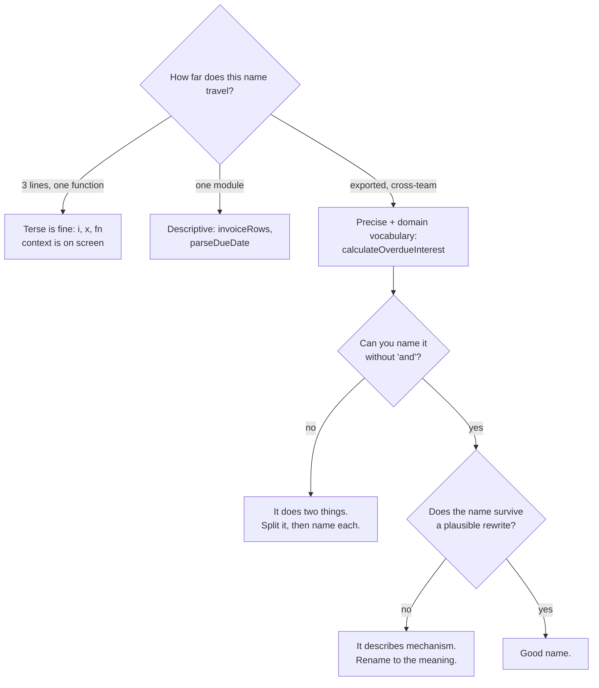

# Naming

> A name is a compression of everything a reader would otherwise have to reconstruct by reading the implementation. Get it right and the code explains itself; get it wrong and every reader pays the cost, forever, silently.

**Part:** [08 · Craft & Leadership](../) · **Domain:** Engineering Practices · **Priority:** High · **Difficulty:** Advanced · **Reading time:** ~16 min

## TL;DR

Name things for what they *mean* in the domain, not for what they *are* in the implementation. `retryDelayMs` survives a rewrite; `timeout2` does not. Three rules cover most of it: encode units and currency in the name, because a bare `duration` invites a caller to pass seconds where milliseconds were meant; name booleans as assertions that read true (`isOverdue`, not `overdueFlag` or `status`); and treat a name you cannot settle on as evidence about the design rather than a vocabulary problem — a module that resists naming is usually a module doing two things. The scope rule is inverse: a loop index can be `i`, but an exported symbol carries its name into every consumer's editor and every future reader's search.

> **Recommendation:** Name for meaning and lifetime. If a name would be wrong after a plausible redesign, it is describing the implementation instead of the concept.

## At a Glance

| | |
| --- | --- |
| **Use when** | Every declaration, and especially every exported one. |
| **Avoid when** | Never, though a two-line local scope needs far less deliberation than a public API. |
| **Alternatives** | None. A comment explaining a bad name is a worse version of a good name. |
| **Primary risk** | Names that describe the current implementation, which become lies after the first refactor. |
| **Maturity** | Stable. |

## Prerequisites

- [Separation of Concerns](../../03-application-architecture/architecture/separation-of-concerns.md) (`· Frontend Architecture`) — why a module that resists naming usually has more than one concern.
- [The Testing Pyramid/Trophy](../../05-reliability-quality/testing/the-testing-pyramid-trophy.md) (`· Testing & Quality`) — test names as the specification a reader consults first.

## Overview

Naming is the practice of choosing identifiers that let a reader understand code without reading everything it depends on. It is the highest-leverage readability decision available, because a name is consulted far more often than the implementation behind it: an exported function is read at every call site, appears in every consumer's autocomplete, and is searched for by every engineer investigating a related bug.

The useful frame is *lifetime versus specificity*. A short-lived, narrow-scope name can be terse, because the reader holds the whole context on screen: `for (let i = 0; ...)` is clear. A long-lived, wide-scope name must be specific, because the reader sees it without the context that produced it. This is why `data`, `item`, `handleClick`, and `utils` are acceptable in a five-line function and corrosive as module exports.

The second frame is *meaning versus mechanism*. `sortedByDateDescending` describes how it was produced; `mostRecentFirst` describes what it means. When the sort moves to the server, the first name becomes a lie and the second stays true. Names that describe mechanism have a half-life measured in refactors.

## The Problem

An engineer opens a file they did not write:

```ts
export function process(data: any[], flag: boolean, n: number) {
  const result = [];
  for (const d of data) {
    if (flag && d.s !== 2) continue;
    if (d.t > n) result.push(transform(d));
  }
  return result;
}
```

Every question a reader has requires reading something else. What is `data`? What does `flag` select? Is `n` a count, a timestamp, an index, a threshold in what unit? What does `s !== 2` mean — is `2` a status, and which one? What does `transform` produce? The names carry no information, so the file explains nothing and the reader must find the call sites, then the type definitions, then whatever defines the meaning of `2`.

Elsewhere in the same codebase, a different failure:

```ts
const timeout = 30;
setTimeout(retry, timeout);         // 30 milliseconds, not 30 seconds
```

The name is a word, and the word is ambiguous about units. The author meant seconds; the API takes milliseconds; the retry fires immediately and nobody notices until a rate limiter does.

And a third:

```ts
// `manager` used to just cache. Now it also fetches, retries, and emits events.
export const invoiceManager = { ... };
```

The name was vague when it was written, so nothing resisted the module growing. A module named `invoiceCache` would have made the fetching feel out of place; `manager` accommodates anything, and did.

Three failures, one theme: the names carry less information than the reader needs, so the information has to be recovered from somewhere else every single time.

## Why It Matters

Code is read far more than it is written, and names are the part that is read most. A reader scanning a file consults dozens of names and perhaps two implementations; the ratio means naming quality dominates the experience of working in a codebase, even though it occupies almost none of the time spent producing it.

The compounding effect is on *search*. Engineers navigate large codebases by searching for names, so a consistent vocabulary makes the codebase queryable and an inconsistent one makes it opaque. If the same concept appears as `user`, `account`, `member`, and `profile` in four modules, no search finds all four, and a change to the concept will miss some of them. This is not a style concern — it determines whether a change can be made completely.

Units in names are worth calling out separately because their absence causes a specific and expensive class of bug. `timeout`, `distance`, `size`, `price`, and `weight` are all ambiguous, and every one of them has caused a production incident somewhere. `timeoutMs`, `distanceKm`, `sizeBytes`, `priceCents`, and `weightGrams` cost seven characters and remove the ambiguity permanently, at the call site, where the mistake would be made.

Finally, naming difficulty is diagnostic. A function that needs `and` in its name does two things. A module named `manager`, `helper`, `service`, or `util` has no single responsibility, which is why the vague word was reachable. Treating a naming struggle as a design signal — rather than pushing through it with a vaguer word — is one of the cheapest design reviews available, and it happens automatically if you refuse to accept the vague word.

## Mental Model

A name answers a question the reader would otherwise have to research. Its required precision is proportional to how far it travels from its definition.



Two rules follow. First, **the name must survive the implementation**: if moving the sort to the server, swapping the storage, or changing the algorithm would make the name wrong, it was describing mechanism. Second, **a name that needs a comment to be understood is an unfinished name** — the comment is the good name, written in the wrong place.

Booleans have their own rule: name them so the true case reads as a true statement. `if (isOverdue)` reads; `if (overdue === true)` and `if (!disabled)` do not, and negated booleans compound badly (`!isNotDisabled` appears in real codebases). Name the positive.

## Best Practices

Encode units and currency in the name. `delayMs`, `sizeBytes`, `distanceKm`, `amountCents`, `priceUsd`. The cost is a suffix; the benefit is that the mistake becomes visible at the call site.

Name booleans as assertions. `isOverdue`, `hasUnsavedChanges`, `canPublish`, `shouldRetry`. Avoid negations in the name, so that the common check is not a double negative.

Use the domain's vocabulary, and use exactly one word per concept. If the business says "invoice," the code says `invoice` everywhere — not `bill` in one module and `charge` in another. A glossary of five terms prevents years of drift.

Say what it means, not how it works. `mostRecentFirst` over `sortedByDateDesc`; `activeSubscribers` over `filteredUserList`.

Match name length to scope. A three-line closure can use `x`; an export needs to stand alone in a consumer's autocomplete with no surrounding context.

Name functions with a verb phrase that states the effect. `calculateTax` returns; `saveInvoice` persists; `useInvoice` is a hook. A function named for a noun (`invoiceData()`) hides whether calling it does anything.

Refuse the vague nouns: `manager`, `helper`, `util`, `service`, `handler`, `data`, `info`, `processor`. Each of them is a place where a specific word was available and not found — which usually means the thing has no single responsibility.

Name the domain concept, not the type. `InvoiceList` over `InvoiceArray`; `Money` over `NumberWrapper`. The type is already in the type annotation.

Name tests as specifications. `throws when the amount is negative` is a sentence a reader can use; `test invoice 3` is not.

Rename as soon as the meaning drifts. A name that was accurate two features ago and is now approximate is a lie the compiler cannot catch, and renaming is one editor command.

## Trade-offs

Precision in names costs characters and churn. Both costs are real, and both are usually much smaller than the confusion they prevent — but not always.

**Advantages**

- Code is understandable without reading its dependencies.
- A consistent vocabulary makes the codebase searchable, so changes can be made completely.
- Unit suffixes prevent an entire category of conversion bug at the call site.
- Naming difficulty surfaces design problems early, when they are cheap.
- Review conversations move from "what does this do" to "should it do this".

**Disadvantages**

- Long names reduce lines-per-screen and can obscure structure in dense code.
- Renaming across a large codebase touches many files and creates merge conflicts.
- Domain vocabulary has to be learned by newcomers, and is wrong if the domain model is wrong.
- Over-precision is its own noise: `invoiceInvoiceNumberString` helps nobody.

| Dimension | Precise naming | Cost / caveat |
| --- | --- | --- |
| Comprehension | High; the name answers the question | Verbosity can hide structure |
| Searchability | One term per concept, findable | Requires enforcement to stay consistent |
| Correctness | Units at the call site | Only for values where units apply |
| Change cost | Rename is mechanical in a typed codebase | Wide diffs and conflicts in busy repositories |
| Onboarding | Domain vocabulary is discoverable | The vocabulary itself must be right |

## Alternative Approaches

There is no substitute for a good name, but there are things teams reach for instead — and it is worth being explicit about why each is weaker.

| Approach | Best when | Weakness | See |
| --- | --- | --- | --- |
| Precise names (this article) | Always | Costs deliberation and occasional churn | (this article) |
| A comment explaining a bad name | The name is fixed by an external contract | Comments drift; the name is still read first | `Comments & Intent · Engineering Practices` |
| Types carrying the meaning | Units and identities matter (branded types) | Enforces correctness, still needs a readable name | [Literal and Unit Types](../../01-core-languages/typescript/literal-and-unit-types.md) (`· TypeScript`) |
| Hungarian-style type prefixes (`strName`) | Untyped languages, historically | Redundant with a type system; encodes mechanism | (discouraged) |
| Short names + good tests | Exploratory or throwaway code | Tests describe behavior, not the reading experience | `Function & Module Size · Engineering Practices` |

## Bad Example

Names that require the reader to reconstruct meaning from elsewhere.

```ts
// ❌ Every parameter raises a question the name should have answered.
export function process(data: any[], flag: boolean, n: number) {
  const result = [];
  for (const d of data) {
    // ❌ (1) What is `s`, and what is 2? The meaning lives in a constants
    //        file the reader has not opened, or in nobody's memory.
    if (flag && d.s !== 2) continue;
    // ❌ (2) `n` is a threshold on `t` — days? cents? a timestamp?
    if (d.t > n) result.push(transform(d));
  }
  return result;
}

// ❌ (3) `timeout` with no unit. The author meant seconds; setTimeout takes
//        milliseconds, so this retries after 30ms and hammers the API.
const timeout = 30;
setTimeout(retry, timeout);

// ❌ (4) A negated boolean, then negated again at every use:
//        `if (!isNotAvailable)` is a real line in real codebases.
const isNotAvailable = !stock.some((s) => s.count > 0);

// ❌ (5) "Manager" accepts any responsibility, so it accumulated four.
//        A more specific name would have made each addition feel wrong.
export const invoiceManager = {
  get: (id: string) => { /* fetches, caches, retries, emits */ },
  doStuff: (id: string) => { /* … */ },
};

// ❌ (6) Four names for one concept: no search finds all of them, and a
//        change to the concept will miss some.
interface User { id: string }
interface Account { id: string }
interface Member { id: string }
type Profile = { id: string };

// ❌ (7) The type is already in the annotation; the name repeats it and
//        says nothing about meaning.
const invoiceArray: Invoice[] = [];
const dataObj: Record<string, unknown> = {};

// ❌ (8) A test name that describes nothing. When it fails in CI, the
//        report says "invoice 3 failed" and nobody knows what broke.
test('invoice 3', () => { /* … */ });
```

**What goes wrong:** Understanding `process` requires opening at least three other files, and the reader must do that every time they encounter it. The `timeout` bug is invisible in review because the line reads correctly in English. And because the same concept has four names, a change to it can only be made partially — the compiler will not object, because the four types are structurally identical.

## Good Example

The same code with names that answer the reader's questions in place.

```ts
type InvoiceStatus = 'draft' | 'sent' | 'paid' | 'void';

interface Invoice {
  id: string;
  status: InvoiceStatus;
  /** ✅ Unit in the name: nothing here can be confused with dollars. */
  amountCents: number;
  daysOverdue: number;
}

/**
 * ✅ Verb phrase, domain vocabulary, and no `and` — so it does one thing,
 *    and a reader knows what it returns without opening it.
 */
export function selectOverdueUnpaidInvoices(
  invoices: readonly Invoice[],
  minimumDaysOverdue: number,
): OverdueInvoice[] {
  return invoices
    // ✅ The status comparison reads as the business rule it encodes.
    .filter((invoice) => invoice.status === 'sent')
    .filter((invoice) => invoice.daysOverdue > minimumDaysOverdue)
    .map(toOverdueInvoice);
}

// ✅ The unit suffix makes the mistake visible at the call site: passing
//    30 where RETRY_DELAY_MS is expected now looks wrong to a reader.
const RETRY_DELAY_MS = 30_000;
setTimeout(retryFailedPayment, RETRY_DELAY_MS);

// ✅ Positive boolean, named as an assertion. Checks read as sentences,
//    and there is no double negative anywhere.
const isInStock = stockLevels.some((level) => level.count > 0);
if (isInStock) { /* … */ }

// ✅ Split by responsibility, and each name says exactly what it is.
//    Naming them forced the split; "manager" would have absorbed both.
export const invoiceCache = {
  read: (id: string): Invoice | undefined => { /* … */ },
  write: (invoice: Invoice): void => { /* … */ },
};

export const invoiceApi = {
  fetchById: (id: string): Promise<Invoice> => { /* … */ },
  markPaid: (id: string): Promise<Invoice> => { /* … */ },
};

// ✅ One word per concept, stated once. Everything else is a relationship
//    to it, named for that relationship.
interface Customer { id: string; email: string }
interface CustomerContactPreferences { customerId: string }

// ✅ Names describe meaning, not the mechanism that produced them.
//    Moving the sort to the server does not make either name wrong.
const mostRecentFirst = [...invoices].sort(byIssuedDateDescending);
const unbilledHours = timeEntries.filter((entry) => entry.invoiceId === null);

// ✅ A test name that is a specification. When it fails, the report is
//    already the bug description.
test('rejects an invoice whose amount is negative', () => { /* … */ });
```

**Why it's better:** `selectOverdueUnpaidInvoices` can be understood from its signature alone — the reader knows what comes in, what comes out, and what rule is applied, without opening it. `RETRY_DELAY_MS` makes the unit mistake a visible one. Splitting `invoiceManager` happened *because* naming it forced the question of what it does. And with one word per concept, a search for `Customer` finds every place the concept appears, so a change to it can be made completely.

## Production Example

Naming discipline that only lives in review erodes, because review is where deadlines apply pressure. The parts that can be made mechanical are worth making mechanical — and the parts that cannot should be pushed into the type system, where the compiler enforces what a convention only suggests.

```ts
/**
 * Branded types: the naming convention for units, enforced.
 *
 * A suffix (`amountCents`) tells a reader the unit. It does not stop anyone
 * passing dollars into a parameter typed `number`. Branding makes the two
 * incompatible at compile time, so a unit mistake is a build failure rather
 * than a rounding error someone finds in a reconciliation three weeks later.
 */
declare const brand: unique symbol;
type Branded<T, B extends string> = T & { readonly [brand]: B };

export type Cents = Branded<number, 'Cents'>;
export type Milliseconds = Branded<number, 'Milliseconds'>;
export type Seconds = Branded<number, 'Seconds'>;

// Constructors are the only way in, so every value's unit is stated once,
// at the boundary, where the raw number enters the system.
export const cents = (value: number): Cents => {
  if (!Number.isInteger(value)) {
    // The invariant the name implies, enforced: "cents" are whole.
    throw new RangeError(`Cents must be a whole number, received ${value}`);
  }
  return value as Cents;
};

export const ms = (value: number): Milliseconds => value as Milliseconds;
export const seconds = (value: number): Seconds => value as Seconds;

/** Conversions are explicit and named, so no call site guesses. */
export const secondsToMs = (value: Seconds): Milliseconds =>
  (value * 1000) as Milliseconds;

export function scheduleRetry(callback: () => void, delay: Milliseconds) {
  setTimeout(callback, delay);
}

// ✅ scheduleRetry(retry, ms(30_000));
// ✅ scheduleRetry(retry, secondsToMs(seconds(30)));
// ❌ scheduleRetry(retry, 30);              — Type 'number' is not assignable
// ❌ scheduleRetry(retry, seconds(30));     — Type 'Seconds' is not assignable
```

```js
// eslint.config.js — the mechanical half of the convention.
export default [{
  rules: {
    '@typescript-eslint/naming-convention': [
      'error',
      // Booleans read as assertions. This catches `overdueFlag` and `status`
      // on a boolean at the point of declaration, which is the only point
      // where fixing it is free.
      {
        selector: 'variable',
        types: ['boolean'],
        format: ['PascalCase'],
        prefix: ['is', 'has', 'can', 'should', 'did', 'will'],
      },
      { selector: 'typeLike', format: ['PascalCase'] },
      { selector: 'function', format: ['camelCase'] },
      // Reject the vague nouns wherever they appear as a whole identifier.
      // Deliberately not a substring match: `dataSource` and `serviceWorker`
      // are fine, and a rule that fires on them gets disabled within a week.
      {
        selector: 'default',
        format: ['camelCase', 'PascalCase', 'UPPER_CASE'],
        filter: {
          regex: '^(data|info|item|obj|temp|foo|manager|helper|util|utils|handler)$',
          match: false,
        },
      },
    ],

    // The vocabulary rule: one word per concept, listed once, enforced
    // everywhere. This is the cheapest defense against the four-names-for-
    // one-concept drift, and the list is short enough that people read it.
    'no-restricted-syntax': ['error', {
      selector: 'TSInterfaceDeclaration[id.name=/^(Account|Member|Profile)$/]',
      message: 'This domain calls it "Customer". See docs/glossary.md.',
    }],
  },
}];
```

The split is deliberate. Casing, boolean prefixes, and the banned-noun list are mechanical, so a linter should own them and no review should ever spend a comment on them. Whether a name describes meaning or mechanism is a judgment a linter cannot make, so it stays in review — and it gets the attention there precisely because the mechanical objections are already gone.

## Common Mistakes

See the [Engineering Practices anti-patterns](../../../anti-patterns/#engineering-practices) for the domain catalog. Concept-specific:

### Mistake: Numeric values with no unit

- **Symptom:** `timeout`, `distance`, `price`, `size` as bare names.
- **Why it fails:** The caller must guess the unit, and the guess is wrong often enough to cause incidents that are hard to trace.
- **Fix:** Suffix the unit (`delayMs`, `priceCents`), and brand the type where the cost of an error is high.

### Mistake: Negated booleans

- **Symptom:** `isNotAvailable`, `disableValidation`, and checks like `if (!isNotAvailable)`.
- **Why it fails:** Every use requires mentally inverting, and combinations produce double negatives that are read wrong.
- **Fix:** Name the positive: `isAvailable`, `shouldValidate`.

### Mistake: Vague nouns as module names

- **Symptom:** `manager`, `service`, `helper`, `util`, `handler`, `processor`.
- **Why it fails:** The word accommodates any responsibility, so nothing resists the module accumulating more.
- **Fix:** Name the actual responsibility; if you cannot, split until you can.

### Mistake: Several names for one concept

- **Symptom:** `user`, `account`, `member`, and `profile` referring to the same entity.
- **Why it fails:** Search cannot find all of them, so a change to the concept is made partially.
- **Fix:** Pick one term, write it in a glossary, and enforce it with a lint rule.

### Mistake: Names that describe mechanism

- **Symptom:** `sortedByDateDesc`, `filteredArray`, `mappedResults`.
- **Why it fails:** The implementation changes and the name becomes a lie that no test or compiler will catch.
- **Fix:** Name the meaning: `mostRecentFirst`, `activeSubscribers`.

### Mistake: Repeating the type in the name

- **Symptom:** `invoiceArray`, `userObj`, `nameString`.
- **Why it fails:** The type annotation already says it, so the name spends its characters on the least useful fact.
- **Fix:** Name the domain concept and let the type carry the shape.

### Mistake: A comment compensating for the name

- **Symptom:** `const n = 30; // retry delay in seconds`.
- **Why it fails:** The comment is the good name written in a place the compiler does not check and refactors do not update.
- **Fix:** Move the comment into the identifier.

### Mistake: Uninformative test names

- **Symptom:** `test('works')`, `test('invoice 3')`.
- **Why it fails:** A CI failure reports the name, so an uninformative name means the failure carries no information.
- **Fix:** Write the expected behavior as a sentence.

## Checklist

- [ ] Every numeric value with a unit carries it in the name.
- [ ] Booleans are positive assertions with an `is`/`has`/`can`/`should` prefix.
- [ ] No identifier is `data`, `info`, `manager`, `helper`, `util`, or `handler`.
- [ ] Each domain concept has exactly one word, recorded in a glossary.
- [ ] Names describe meaning, not the mechanism that produced the value.
- [ ] No name repeats its type.
- [ ] No function name contains `and`.
- [ ] Name length matches scope: terse locally, precise at exports.
- [ ] Test names are sentences describing the expected behavior.
- [ ] Casing and boolean prefixes are enforced by lint, not by review.
- [ ] High-cost units are branded types, not just suffixed names.

## Related Articles

- [Separation of Concerns](../../03-application-architecture/architecture/separation-of-concerns.md) — the design problem a naming struggle usually reveals (`· Frontend Architecture`).
- [Literal and Unit Types](../../01-core-languages/typescript/literal-and-unit-types.md) — moving a naming convention into the type system (`· TypeScript`).
- [Structural Typing](../../01-core-languages/typescript/structural-typing.md) — why four identically shaped types do not protect a vocabulary (`· TypeScript`).
- [Prop Design & Contracts](../../04-interface-engineering/component-design/prop-design-and-contracts.md) — naming as part of a component's public API (`· Component & Interaction Design`).
- [What to Test & Coverage Goals](../../05-reliability-quality/testing/what-to-test-and-coverage-goals.md) — test names as the specification (`· Testing & Quality`).

## References

- [Ottinger's Rules for Variable and Class Naming](https://www.se.rit.edu/~swen-261/papers/Ottinger%27s%20Rules%20for%20Variable%20and%20Class%20Naming.pdf) — the intention-revealing-name argument in its original form.
- [TypeScript Handbook — Declaration files: do's and don'ts](https://www.typescriptlang.org/docs/handbook/declaration-files/do-s-and-don-ts.html) — naming conventions for public API surfaces.
